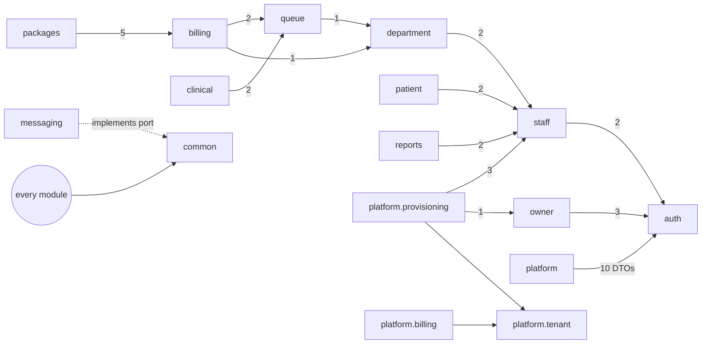
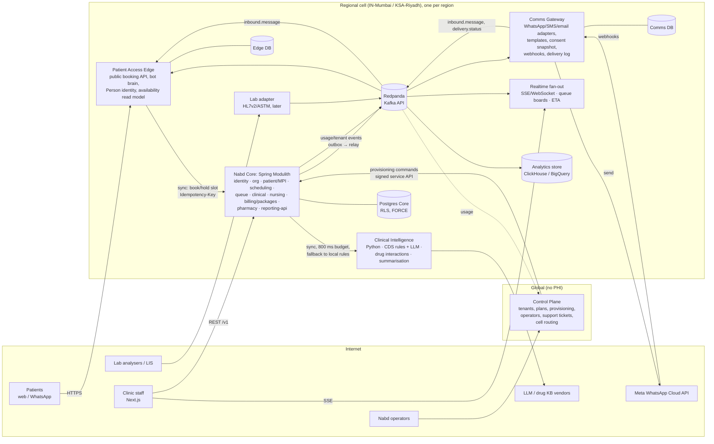

# Nabd HMS Backend: Architecture and Code-Quality Review

| | |
|---|---|
| **Scope** | `backend/` (Spring Boot 3.3.4, Java 17, JdbcTemplate, Postgres), `db/migrations/` (Flyway V1–V85), `api/openapi.yaml`, `Dockerfile`, `scripts/dev-up.sh` |
| **Size reviewed** | 463 main Java files / 25,770 LOC; 64 test files / 13,121 LOC; 59 migrations; 3,093-line OpenAPI spec |
| **Method** | Read-only. Every claim below was checked against the code and cites `file:line`. Paths are relative to `backend/src/main/java/com/nabd/hms/` unless they start with `db/`, `api/`, `backend/` or `scripts/`. Module graphs were built by scanning `import` statements and by scanning the table names in SQL string literals. |
| **Date** | 2026-10-17 |

---

## 0. Executive summary

**Overall verdict.** The codebase is a well-intentioned, unusually well-commented package-by-feature monolith. Its local engineering habits are good: package-private repositories, parameterised SQL, real-Postgres integration tests, a correct `SKIP LOCKED` outbox skeleton, a tenant-clock abstraction protected by a test, and RBAC that matches the spec. Its **system-level safety properties are weaker than the code comments claim**. Four issues need fixing before any real customer data goes in:

1. **MFA can be bypassed.** The `mfa_pending` and `mfa_setup_required` challenge JWTs are signed with the same key as access tokens, and the resource server accepts them as ordinary bearer tokens. A PIN alone, or a WhatsApp OTP alone, is therefore enough to call `/v1/auth/mfa/enroll`, which overwrites the TOTP secret and returns it, or `/v1/auth/break-glass/activate`, which mints a full session carrying Owner grants (§6.1).
2. **Postgres RLS is most likely not enforced in any deployed environment.** Flyway runs as the same `DB_USER` as the application, so that role owns every table, and no table uses `FORCE ROW LEVEL SECURITY`. Table owners bypass RLS. The test suite does not show this because it migrates as superuser and runs as a separate non-owner role (§3.2). As a side effect, the per-tenant audit hash chain becomes a single global chain and fails verification (§4.4).
3. **The app can only run as one instance.** The JWT signing key pair is generated fresh at every boot (`config/JwtConfig.java:32-35`). There is also no actuator, no metrics and no health endpoint (§8).
4. **There are races on money and visit state.** Invoice payments are a read-modify-write with no lock and no idempotency key (`billing/CheckoutService.java:233-246`). Queue status transitions are validated and then written without a compare-and-set (`queue/QueueService.java:127-137`). The double-booking guard only catches bookings with an identical start time (`db/migrations/V4__queue_appointments.sql:68`).

**Modularity.** The *import* graph is clean and acyclic. The *data* graph is not. `staff` and `roles` are read through raw SQL by 15 modules, `patients` by 10 and `queue_entries` by 8, and six tables are written by more than one module. This hidden coupling is the real obstacle to any service extraction. It has to be paid down inside the monolith first.

**Microservices recommendation (in one line).** Keep a **Spring Modulith "Nabd Core" modular monolith** as the system of record. Around it, deploy **four services where separation pays for itself**: (1) a **Comms Gateway** for WhatsApp, email and SMS plus inbound webhooks, (2) a **Patient Access Edge** for public booking and the WhatsApp booking bot, (3) a **Clinical Intelligence** service in Python for AI/CDS, and (4) a **Control Plane** for platform operators, provisioning and subscriptions. Add a fifth, a **Realtime fan-out** service, only when push connections outgrow the core. Events flow through the existing Postgres outbox, relayed to **Redpanda** (Kafka API). Pharmacy, billing, lab orders, reporting and notifications stay as enforced modules or pipelines, not services. Details and a phased strangler plan are in §10.

---

## 1. Inventory

| Package | Files | LOC | Notes |
|---|---:|---:|---|
| clinical (+dental, documents, templates) | 93 | 5,419 | Largest; contains the two biggest god classes |
| platform/* (control plane) | 78 | 3,972 | Operator auth, provisioning, billing, fleet, tickets, audit search |
| queue (appointments, schedule, waitlist, queue) | 46 | 2,882 | Scheduling and visit flow in one package |
| auth | 25 | 1,486 | `AuthService` is 643 LOC |
| setup | 26 | 1,476 | Grab-bag that writes `tenants`, `charge_catalogue`, holidays and more |
| packages | 22 | 1,391 | Calls `billing.CheckoutService` |
| billing | 20 | 1,226 | Checkout, invoices, day-close |
| patient | 16 | 1,180 | Registry, merge, guardianship |
| staff | 21 | 1,089 | Staff and roles |
| common | 28 | 974 | Shared kernel, but also holds the outbox, mail and WhatsApp OTP port |
| reports, nursing, messaging, department, pharmacy, owner, config | 14/19/14/13/12/11/4 | 906/894/864/681/607/531/177 | |

Layering is uniform: `XController → XService → XRepository`, with `dto/` or `XModels.java` records. There are 44 controllers, 50 services and 44 repositories. **All 44 repositories are package-private and all 50 services are public.** The compiler therefore stops one module from reaching into another module's repository class. There is no `api`/`internal` split, though, so every public service method is effectively part of the module's API.

---

## 2. Code structure and modularity

### 2.1 Module dependency graph: imports

These are all the cross-package `import` edges (count = number of import lines):



There are **no import cycles**, and `common` depends on nothing except `config` (`common/OutboxDispatcher.java:3`). The WhatsApp OTP port (`common/WhatsAppOtpSender`) is defined in `common` and implemented in `messaging`, which is correct dependency inversion. Two smells:

- **The control plane depends on tenant auth DTOs.** `platform → auth` has 10 imports (`MfaChallengeResponse`, `TokenPairResponse`, `TotpService`, and others). The operator console is welded to the clinic login module.
- **`platform.provisioning` drives `staff.StaffService` and `owner.OwnerService` in-process** (`platform/provisioning/ProvisioningStepRunner.java:60-62`). That is fine inside a monolith, but it becomes the first seam to cut when the control plane is separated.

### 2.2 Module dependency graph: data (the real coupling)

A JdbcTemplate codebase can couple through SQL just as easily as through Java. Scanning SQL literals for `FROM/JOIN/INTO/UPDATE <table>` gives:

| Table (logical owner) | Read by | Written by |
|---|---|---|
| `staff` (staff) | **15 modules**: auth, billing, clinical, department, nursing, owner, packages, patient, pharmacy, platform.provisioning, platform.ticket, queue, reports, setup, staff | **auth, owner, platform.provisioning, staff** |
| `roles` (staff) | the same 15 | platform.provisioning, staff |
| `tenants` (platform) | 15 modules | platform.provisioning, platform.tenant, **setup** |
| `patients` (patient) | 10: billing, clinical, nursing, packages, patient, pharmacy, platform.access, queue, reports, setup | patient |
| `queue_entries` (queue) | 8: billing, clinical, department, nursing, patient, pharmacy, queue, reports | queue |
| `invoices` (billing) | billing, packages, patient, **queue**, reports | billing |
| `package_instances` / `_items` (packages) | packages, patient, **queue**, reports | packages |
| `charge_catalogue` | billing, clinical, nursing, pharmacy, setup | **billing, pharmacy, setup** |
| `procedure_orders` | billing, nursing, reports | **billing, nursing** |
| `pharmacy_stock_movements` | billing, pharmacy | **billing, pharmacy** |
| `role_delegations`, `sessions`, `login_attempts` | auth, staff / auth, owner | **auth + staff**, **auth + owner** |

Two conclusions:

- **There is a hidden cycle.** `billing → queue` and `packages → billing` exist at the Java level, while `queue` reads `invoices` and `package_instances` in SQL. Queue, billing and packages are therefore one cyclic cluster.
- **Multi-writer tables have no single owner of their invariants.** Stock levels (`charge_catalogue.stock_qty` plus `pharmacy_stock_movements`) are mutated by two modules, and `staff` rows by four. Any split along module lines would immediately need distributed transactions.

Most of the 15 readers of `staff` and `roles` only want an actor's display name for an audit row. The same `findActorInfo` query (`SELECT s.name, r.name … FROM staff s JOIN roles r`) is copy-pasted into **12 repositories**, each with its own `ActorInfo` record (for example `clinical/dental/DentalRepository.java:75-80` and `pharmacy/PharmacyRepository.java:100`). One `ActorDirectory` port in the staff module removes about 30% of the cross-module table reads in one step.

### 2.3 God classes

| Class | LOC | Responsibilities mixed |
|---|---:|---|
| `clinical/PrescriptionService.java` | 708 | Rx CRUD/upsert (L120), favourite Rx sets (L199-L328), signing (L375), allergy and pregnancy safety detection (L548-L640), drug search (L603), dose calculator (L97), audit formatting. The safety-check part is exactly the seam the planned AI/CDS service needs, and it is buried. |
| `auth/AuthService.java` | 643 | PIN login, WhatsApp OTP, MFA verify, step-up, MFA enroll and confirm, PIN reset, break-glass, refresh rotation, logout, sessions, idle unlock, lockout, IP rate limit, token minting |
| `patient/PatientService.java` | 490 | Registry with in-memory filtering, CRUD, merge and undo, guardianship, consent, verification gate |
| `setup/SetupRepository.java` | 469 | Writes to roughly 10 tables owned by other concerns |

Suggested splits: `PrescriptionService` → `PrescriptionCommandService`, `FavouriteRxSetService`, `RxSafetyService` (the CDS port), `DrugCatalogue`. `AuthService` → `PinLoginService`, `OtpLoginService`, `MfaService`, `SessionService`, `BreakGlassService`, `TokenIssuer`.

### 2.4 Duplication and DTO sprawl

- **242 DTO files plus 33 `*Models.java` files.** `PageMeta` is defined **7 times** (in `platform/audit/dto`, `platform/billing/dto`, `platform/fleet/dto`, `clinical/dto`, `queue/dto`, `staff/dto` and `patient/dto`), and `TransitionRequest` twice.
- `private UUID tenantId(Jwt jwt)` appears in **25 controllers**, and a `notFound()` helper in **30 files**. A `@CurrentTenant TenantId` / `@CurrentStaff` `HandlerMethodArgumentResolver` removes both and gives one place to validate claims. Today a missing claim causes `UUID.fromString(null)` and a 500 error.
- **Two coexisting styles.** The older modules use `dto/` with one record per file plus Bean Validation (`@Valid` on 100 of the 108 `@RequestBody` parameters). The newer modules (`clinical/templates`, `clinical/documents`, `messaging`) nest public request records inside `*Models.java` or the service class, and validate by hand in `*Rules` classes. Six of their request bodies have no `@Valid` (for example `clinical/templates/NoteTemplateController.java:44,50` and `messaging/WhatsAppTemplateController.java:40,47`). Pick one style.

### 2.5 Naming and comments

Naming is consistent: `XController/XService/XRepository/XModels`, and ticket-referenced JavaDoc (102 distinct `NB-` tickets cited). Comments explain *why*, which is rare and valuable. There are 18 `ponytail:` markers that flag deliberate shortcuts, which is a good practice. Two problems:

- **Some comments are now false and mislead readers.** `db/migrations/V7__master_schema_operators.sql:1` says "DRAFT — not yet in db/migrations/, not applied anywhere", yet it is applied. `patient/dto/PatientDetailResponse.java:11` says "Packages doesn't exist yet", and the packages module exists. `packages/PackageInstanceService.java:244` says "No WhatsApp/notification channel exists yet", and `messaging` exists. `SecurityConfig.java:22-26` claims a 1:1 mapping onto `openapi.yaml`, which holds only for the endpoints that are in the spec (see §5).
- **Comments state guarantees the deployment does not provide.** Examples are "every RLS policy… checks this value" and "nabd_app is structurally unable to tamper" (`backend/src/test/java/com/nabd/hms/support/ApiTestBase.java:69-70`). See §3.2.

---

## 3. Domain modelling and tenancy

### 3.1 How tenant context is resolved per request

1. Spring Security validates the JWT. The `@Primary` `SessionRevocationJwtDecoder` wraps `NimbusJwtDecoder` (`auth/SessionRevocationJwtDecoder.java:21-43`).
2. Each controller pulls `tenantId` from the claim by hand (`queue/QueueController.java:88-90`) and passes it as a **method parameter** to the service.
3. Each service method calls `tenantContext.set(tenantId)` as its first line. There are **240 call sites**.
4. `TenantContext.set` runs `SELECT set_config('app.tenant_id', ?, true) || set_config('app.accessible_tenant_ids', <brand-scope subquery>, true)` (`common/TenantContext.java:34-47`). The settings are transaction-local (`is_local = true`), so they only take effect inside an active transaction.
5. RLS policies compare `tenant_id` with `current_setting('app.tenant_id', true)::uuid`, plus the brand-visibility list (`db/migrations/V6__owner_brand_hierarchy.sql:92-131`).

This is the correct Postgres pattern: transaction-scoped GUCs, safe with pooled connections, and no ThreadLocal. It has three weaknesses:

- **It is entirely manual.** Nothing asserts that a transaction is active when `set()` runs. If it runs outside one, the setting is silently lost and RLS filters every row out. `SessionLivenessChecker`'s JavaDoc (`auth/SessionLivenessChecker.java:9-14`) records that this failure already happened once. `TenantContext.set` should assert `TransactionSynchronizationManager.isActualTransactionActive()`.
- **Each call costs a query.** Every `set()` runs a 3-way join against `tenants` and `brands`. A typical request triggers 2–4 of them, because `AuditService.record` and `EventPublisher.publish` call `set()` again.
- **The context can switch mid-transaction.** `AuditService.record(tenantId, …)` (`common/AuditService.java:42-45`) re-sets the context to whatever tenant it is given, so passing the wrong ID silently switches RLS context inside a business transaction.

**Recommendation.** Resolve the tenant once into a request-scoped `TenantId` from the `SecurityContext`, and bind it on transaction begin. This can be a `TransactionSynchronization` or a small `@TenantScoped` aspect. Then remove the `tenantId` parameter from the service signatures.

### 3.2 RLS is very likely bypassed outside the test suite (Critical)

- `application.yml:5-11` points Flyway at the same datasource and user as the app (`DB_USER`, default `nabd_app`). The `Dockerfile:22` sets `SPRING_FLYWAY_LOCATIONS`, and Flyway migrates at boot.
- `scripts/dev-up.sh:12-14` creates `nabd_app` and grants it `ALL ON DATABASE`. That user runs the migrations, so it **owns every table**.
- No migration contains `FORCE ROW LEVEL SECURITY` (grep finds 0 matches; `ENABLE ROW LEVEL SECURITY` appears 68 times). In Postgres, **a table's owner is exempt from its RLS policies unless FORCE is set**.
- The tests avoid this by design. `ApiTestBase.java:93-122` migrates as superuser, creates a separate non-owner `nabd_app`, and disables Flyway for the app. The comment in `db/migrations/V1__staff_auth_core.sql:129` ("deployment must additionally: GRANT EXECUTE…") shows that a split role was intended, but nothing in the deployable artifact sets it up.

**Impact.** In dev, and almost certainly on Render, tenant isolation rests only on the hand-written `WHERE tenant_id = ?` clauses. Several queries rely on RLS alone. For example, `AuthRepository.java:114-115` runs `UPDATE staff SET mfa_secret_enc = ? WHERE id = ?`, `hasActiveBreakGlass` filters on `staff_id = ?` only, and the patient-registry subqueries filter on `patient_id = patients.id` only (`patient/PatientRepository.java:122-149`). UUIDs make exploitation hard, but the defence-in-depth layer that the design depends on is missing. The audit-chain trigger depends on RLS for its *correctness*, not just its safety (§4.4).

**Fix.** Use a separate `nabd_migrator` owner role (`spring.flyway.user`/`password`) and a `nabd_app` runtime role with DML-only grants and `NOBYPASSRLS`. Add `ALTER TABLE … FORCE ROW LEVEL SECURITY` to every tenant table. Add a startup self-check that fails boot if the runtime user owns any RLS table. The check can query `pg_class.relowner` and `relforcerowsecurity`. Also add one CI test that boots the app with production-shaped config.

### 3.3 Organisation hierarchy

The hierarchy is **Owner (L1) → Brand (L2) → Facility (= `tenants`, L3, the RLS boundary) → Department (L4) → Service point (L5)**, plus a commercial axis **Legal entity → Tax registration → Invoice series** (`db/migrations/V6__owner_brand_hierarchy.sql`, `db/migrations/V41__org_hierarchy_additive.sql`). Choosing the *facility* as the isolation grain is the right call for clinics. Brand- or owner-wide visibility is handled additively through `app.accessible_tenant_ids` (`common/TenantContext.java:36-46`), which is neat and tested (`CrossFacilityVisibilityTest`).

Gaps:

- **The commercial axis is modelled but not used.** `invoice_series` exists, but invoice numbers come from a **single global sequence** (`db/migrations/V20__checkout_invoices.sql:29-30`, `'INV-' || nextval('invoices_number_seq')`). Every tenant's numbering therefore has gaps, numbers reveal platform volume, and there is no per-GSTIN, per-fiscal-year series. India GST requires a consecutive series, and KSA ZATCA Phase 2 requires an invoice counter and a hash chain. Invoices also carry **no currency**, even though the product spans INR and SAR.
- **MRNs also come from a global sequence** (`db/migrations/V3__patients.sql:14,19`).
- **The region is a two-value CHECK** (`region IN ('IN','KSA')`, `db/migrations/V1__staff_auth_core.sql:23`). Other GCC markets (UAE, Qatar, Oman and so on) cannot be represented, and `ClinicClock.defaultZoneFor` falls back to UTC for them (`common/ClinicClock.java:68-73`).

### 3.4 Global versus tenant-scoped identities

| Identity | Model | Consequence |
|---|---|---|
| **Owner** | Global (`owners.email UNIQUE`). Logs in once, then a "shadow" `staff` row is found or created per clinic (`db/migrations/V6__owner_brand_hierarchy.sql:44-53`) | Pragmatic: it reuses all staff, RLS and JWT machinery |
| **Staff / doctor** | **Per facility.** `staff.tenant_id`; a doctor at 3 facilities has 3 rows, 3 PINs, 3 MFA enrolments and 3 schedules | The slot unique index (`doctor_id, start_time`) cannot stop the same human being double-booked across facilities. A doctor's cross-facility day view is impossible. Hospital chains will hit this first. |
| **Patient** | **Per facility** (`patients.tenant_id`, `UNIQUE(tenant_id, mrn)`). No person or master-patient-index layer, and no ABHA / national-ID link (`national_id_enc` is encrypted, which rules out deterministic lookup) | A patient visiting two clinics of one brand gets two charts. Brand-scope visibility shows both records but does not unify them. WhatsApp booking ("I'm a patient of Brand X") has no identity to attach to. |
| **Platform operator** | Global, in `master.operators` | Correctly separate from clinic data |

**Recommendation.** Introduce a global **Person** identity, owned by the Patient Access Edge or Core MPI (phone and verified national-ID hash, keyed per region), with `patients.person_id` as an optional link. Similarly, add a global **Practitioner** (with registration number; `db/migrations/V55__staff_professional_registration_no.sql` already adds the column) and make `staff` a facility *membership* of that practitioner. Both changes are additive and leave the RLS grain alone.

### 3.5 The `master` schema versus tenant data

Platform data lives in `master.*` without RLS (`db/migrations/V7__master_schema_operators.sql`), and tenant data lives in `public.*` under RLS. This is a sound *logical* split, but it is not a *security* boundary:

- The same runtime role has `SELECT, INSERT, UPDATE` on `master` (`ApiTestBase.java:109-111`).
- Tenant-facing endpoints write to it directly. For example, `/v1/support/tickets` writes `master.support_tickets` (`platform/ticket/TicketRepository.java:39`).
- Operator endpoints sit on the same public ingress, signing key and issuer as clinic endpoints (§6.2).

A bug or SQL injection anywhere in tenant code can therefore read operator data, and operator super-powers are one authority string away from tenant tokens. This is the main argument for splitting out the Control Plane (§10).

### 3.6 Data residency

There is one database for both regions. India's DPDP Act and Saudi Arabia's PDPL, together with KSA health-sector rules, effectively require PHI to stay in-region for KSA tenants. That means **regional cells**: one Core plus one database per region, behind a global control plane that holds only the tenant directory and routing, never PHI. The `region` column is already a natural cell key.

---

## 4. Transactions and consistency

### 4.1 `@Transactional` usage

There are 267 `@Transactional` annotations, all on service-layer methods, and only **5 are `readOnly`**. That means read traffic can never be routed to a replica, and Postgres loses the read-only optimisations. Method-level `noRollbackFor = ApiException.class` is used deliberately for lockout and reuse-detection writes (`auth/AuthService.java:96,160,192,435`), which is subtle but correct and well commented.

**The systemic problem is external I/O inside transactions**, while the HikariCP pool is left at its default of 10 (no `spring.datasource.hikari.*` in `application.yml`):

| Where | External call held inside a DB transaction |
|---|---|
| `auth/AuthService.java:160-187` (`requestOtp`), `:336-352` (`requestPinReset`) | Meta WhatsApp OTP send, up to 5 s connect + 10 s read (`messaging/MetaWhatsAppClient.java:19-21`) |
| `messaging/WhatsAppTemplateService.java:42-64`, `:67-87` | Meta template create and edit |
| `common/OutboxEventProcessor.java:36-44` | Every outbox handler, including Meta sends |
| `platform/provisioning/ProvisioningStepRunner.java:66-86` | WABA provisioning and SMTP invite inside the step transaction |

Ten concurrent slow OTP requests can exhaust the pool and stall every endpoint. Any calls to the planned AI/CDS service would make this worse. **Rule: no network I/O while a transaction is open.** Either commit and then call, or go through the outbox.

### 4.2 The outbox (V44, `OutboxDispatcher`)

What is right:

- Events are enqueued in the caller's transaction (`common/EventPublisher.java`).
- Events are claimed with `UPDATE … WHERE id IN (SELECT … FOR UPDATE SKIP LOCKED)` through a narrow `SECURITY DEFINER` function (`db/migrations/V44__outbox_events.sql:48-67`).
- `attempts` is incremented *on claim*, so a JVM-crashing handler still ends up dead-lettered (`V44:21-24`).
- Backoff is exponential (30 s up to 1 h), with 8 attempts before dead-lettering (`common/OutboxEventProcessor.java:22-24`).
- Handler writes and failure bookkeeping run in separate transactions.

What is wrong or missing:

1. **No lease fencing.** `markDone`, `markFailed` and `markDead` update by `id` only (`common/OutboxRepository.java:29-46`). A slow worker whose lease expired and whose event was reclaimed elsewhere will still mark it done or reset it to `pending` underneath the new owner. Fix by adding `AND status='processing' AND attempts = :claimedAttempts` (a fencing token) and treating "0 rows updated" as "lost the lease".
2. **The batch can outlive the lease.** Twenty events are processed **sequentially** on the single `@Scheduled` thread (`common/OutboxDispatcher.java:27-37`). The worst case is 20 × 15 s = 300 s against a 60 s lease (`application.yml:63-66`), so a second instance reclaims and resends. Fix by claiming smaller batches, extending the lease per event, or processing in parallel with a bounded executor.
3. **No ordering guarantee.** Events are ordered by `next_attempt_at` across all tenants, and a retried event moves behind newer ones. That is fine for notifications, and wrong for any future state-carrying event (for example `appointment.rescheduled` overtaking `appointment.booked`). Partition by aggregate key once a broker is in place.
4. **No retention, metrics or dead-letter visibility.** `done` rows accumulate forever. Nothing exposes lag, dead count or age of the oldest pending event.
5. **It is barely used.** `EventPublisher.publish` has exactly one caller (`messaging/WhatsAppMessageService.java:51`), and `WhatsAppMessageService.queueTemplate` has **no production callers**. There are no domain events at all (`appointment.booked`, `visit.completed`, `invoice.paid` and so on). This matters for the microservices plan: the event backbone has to be designed first, not just extracted.

### 4.3 Concurrency hot spots

| Operation | Mechanism | Assessment |
|---|---|---|
| Queue token number | `pg_advisory_xact_lock(hashtext(doctor:date))` then `MAX(token_number)+1`, with `UNIQUE(tenant_id, doctor_id, queue_date, token_number)` as a backstop (`queue/QueueRepository.java:30-45`, `db/migrations/V4__queue_appointments.sql:93`) | **Correct.** Note that `hashtext` is 32-bit, so unrelated doctor-days can occasionally share a lock (harmless contention). Prefer `pg_advisory_xact_lock(int, int)` with two keys. |
| Session capacity (walk-in vs booking) | The same advisory lock in `AppointmentService.enforceSessionCapacity` (`queue/AppointmentService.java:174-191`) | Correct for booking. **The walk-in path takes the lock but `QueueService.enforceSessionCapacity` (`:228-244`) relies on its caller having taken it first;** document that or assert it. |
| Appointment double-booking | Partial unique index on `(doctor_id, start_time) WHERE status='scheduled'` (`db/migrations/V4__queue_appointments.sql:68`) | **Insufficient.** Overlapping bookings with different start times (10:00 for 30 min and 10:15) are accepted. `book()` does not check that the start time is on the slot grid, inside working hours, or outside doctor leave (`queue/AppointmentService.java:59-75`). Use `EXCLUDE USING gist (doctor_id WITH =, tstzrange(start_time,end_time) WITH &&) WHERE (status='scheduled')` and validate against `ScheduleGrid`. Also, `catch (DataIntegrityViolationException)` maps *any* constraint failure, such as a bad `patientId` foreign key, to 409 "slot unavailable" (`:70-73`). |
| Queue status transitions | Read the row, validate the transition against the workflow, then `UPDATE … SET status=? WHERE id=?` (`queue/QueueService.java:127-137`, `queue/QueueRepository.java:105-106`) | **Lost update.** Two front-desk users can each pass validation from the same state, so the transitions bypass the workflow guard. Use compare-and-set (`AND status = :expected`) and return 409 on 0 rows. |
| Invoice payment | Read `paid`, insert payment, write `paid + amount` (`billing/CheckoutService.java:233-246`, `billing/CheckoutRepository.java:221-229`) | **Lost update and double charge.** Concurrent payments, or a double click, leave `invoices.paid ≠ SUM(invoice_payments)`. There is no check that the amount does not exceed the balance, and no idempotency key. Use `SELECT … FOR UPDATE` or `UPDATE invoices SET paid = paid + ? … RETURNING`, and derive status from the sum. |
| Rx, allergy, documents, pharmacy stock | `SELECT … FOR UPDATE` (`clinical/PrescriptionRepository.java:69`, `pharmacy/PharmacyRepository.java:66`, and others) | Correct |
| Provisioning `advance()` | No transaction and no lock (`platform/provisioning/ProvisioningService.java:86-116`) | Two concurrent `advance` calls run the same step twice. `markStepRunning` should be a CAS. `listJobs` is N+1 (`:81-82`). |

There is **no optimistic-locking convention** anywhere: no `version` columns, except `clinic_policies` (`setup/SetupRepository.java:152`). Adopt `version int` plus `If-Match`/ETag for every user-edited aggregate.

### 4.4 The audit hash chain (V14)

The two-layer design (append-only triggers plus a per-tenant SHA-256 chain) is good. The implementation has three defects:

1. **The chain forks under concurrency.** The trigger runs `SELECT row_hash FROM audit_log ORDER BY id DESC LIMIT 1 FOR UPDATE` (`db/migrations/V14__audit_log.sql:69`). Under READ COMMITTED, a transaction that waited on that lock re-checks *the same locked row* after the first transaction commits, and does not see the new latest row. Two concurrent audited writes in one tenant therefore get the same `prev_hash`, and `verify_audit_chain` reports tampering. The lock also serialises **every audited write in a tenant** until commit, which becomes a hot spot.
2. **It depends on RLS for correctness.** The `SELECT` has no `tenant_id` predicate. With RLS bypassed (§3.2), the "previous row" is the latest row of *any* tenant, so the chain becomes global and every tenant's verification fails as soon as two tenants interleave writes.
3. **The hash input depends on the session time zone.** It includes `p_created_at::text` (`V14:58`), and `timestamptz::text` renders in the session's `TimeZone`, which the JDBC driver sets from the JVM default. Changing the container's TZ invalidates every stored hash.

**Fix.** Keep a `audit_chain_heads(tenant_id PK, last_id, last_hash)` table updated with `UPDATE … RETURNING`, which takes a proper row lock per tenant. Hash `extract(epoch from created_at)` or `to_char(created_at AT TIME ZONE 'UTC', …)`. At scale, consider batch Merkle anchoring instead of a strict per-row chain.

### 4.5 Time handling

This is a **strength**. `ClinicClock` (`common/ClinicClock.java`) is the single source of the clinic calendar (`tenants.timezone`, IANA IDs only), and a test bans `LocalDate.now()`, `CURRENT_DATE` and `::date` in production code (`ClinicClockUsageTest`). Gaps:

- `zone()` runs a database query on every call, and a single request calls it several times (`:38-43`).
- It does not wrap `java.time.Clock`, so tests cannot freeze time.
- GCC zones are missing (§3.3).

---

## 5. API design

- **Conventions.** Every route is under `/v1`, with resource nouns and action sub-resources (`/queue/{id}/transfer`, `/appointments/{id}/cancel`). That is a reasonable pragmatic REST style. Methods are GET/POST/PATCH/DELETE, and CORS matches.
- **Authorization matches the spec.** All 131 spec operations that declare `x-required-permission` match the code's `@PreAuthorize` exactly (0 mismatches). This is a real strength.
- **Spec drift is large.** Of the 212 implemented paths, **118 are not in `openapi.yaml`**. The missing ones cover all of billing (`/billing/*`), packages (21 paths), departments, nursing orders, the whole platform console (`/platform/auth/*`, `/platform/billing/*`, `/platform/provisioning-jobs/*`…), `/auth/mfa/enroll|confirm`, `/auth/break-glass/*`, `/schedule/*`, `/reports/*` (except money), and dental. Five spec paths are not implemented or were renamed: `/auth/pin-reset/request|confirm` (the code uses `/auth/pin/reset-request|confirm`), `/tenants/{id}`, `/tenants/{id}/branches` and `/audit-events`. The spec header says "the gateway rejects anything not explicitly granted" (`api/openapi.yaml:6-8`). If a spec-driven gateway is ever deployed, roughly half of the app stops working. **Pick a direction**: either contract-first with generated interfaces (openapi-generator `interfaceOnly`), or code-first with springdoc plus a CI diff against the committed spec.
- **Error handling.** `GlobalExceptionHandler` handles only `ApiException` and `MethodArgumentNotValidException` (`common/GlobalExceptionHandler.java:25,34`). Malformed JSON, path type mismatches (a bad UUID), `AccessDeniedException` from `@PreAuthorize`, `DataIntegrityViolationException`, `MissingServletRequestParameterException`, and any unexpected 500 fall back to Spring's default body: not `application/problem+json` and without `traceId`. Extend `ResponseEntityExceptionHandler`, add a catch-all that logs the stack trace with `requestId`, and set `spring.mvc.problemdetails.enabled=true`. Logging every 4xx at WARN (`:62`) is noisy.
- **Validation.** Bean Validation is applied on 100 of 108 bodies. Six bodies in the newer modules are validated by hand (§2.4).
- **Pagination.** Cursor pagination (`common/Cursor.java`, microsecond-safe) is good, but only **10 endpoints** use it, while **59 controller methods return an unbounded `List`**. The patient registry uses offset paging over an in-memory list (§9). Standardise one `Page<T>{items, page:{nextCursor, limit}}` type in the shared kernel.
- **Idempotency.** There are no `Idempotency-Key` headers. Payments, check-in, booking, package sale and refunds are all non-idempotent POSTs that will be retried by flaky clinic Wi-Fi, by mobile clients, and by the future WhatsApp bot. Add an `idempotency_keys(tenant_id, key, request_hash, response, created_at)` table and a filter.
- **Versioning.** A `/v1` prefix exists, but there is no deprecation policy and no `Sunset` headers. That is acceptable for now.
- **Concurrency control.** There are no ETags or `If-Match` (§4.3).

---

## 6. Identity and access architecture (architecture-level security)

### 6.1 Purpose-scoped tokens are accepted as access tokens (Critical)

`AuthService` issues four token types from one `JwtEncoder`, with the same key and the same `iss` (`auth/AuthService.java:62`):

- `mfa_setup_required`, carrying `sub` and `tenantId` (`:144-156`)
- `mfa_pending`, carrying `sub` and `tenantId` (`:522-535`)
- `step_up`, carrying only `sub` (`:265-290`)
- the access token, carrying `sub`, `tenantId`, `sid` and `permissions` (`:578-597`)

The resource server's decoder validates only signature and expiry (`config/JwtConfig.java:54`). The revocation wrapper deliberately lets any token without `sid` pass through (`auth/SessionRevocationJwtDecoder.java:16-19,38`).

Several authenticated endpoints have **no `@PreAuthorize`** and read only `sub` and `tenantId`: `/mfa/enroll`, `/mfa/confirm`, `/break-glass/activate`, `/break-glass/{id}/deactivate`, `/unlock`, `/sessions` and `/logout` (`auth/AuthController.java:81-134`). As a result:

- **MFA bypass.** An attacker with only a staff member's PIN, or only a WhatsApp OTP, receives an `mfa_pending` token, then:
  1. calls `POST /v1/auth/mfa/enroll` with that token as the bearer. `enrollMfa` overwrites `staff.mfa_secret_enc` (`auth/AuthService.java:299-307`, `auth/AuthRepository.java:114-115`) and **returns the new secret**;
  2. computes a TOTP code from that secret and completes `/v1/auth/mfa/verify` → full session.

  Even simpler, `POST /v1/auth/break-glass/activate` with the `mfa_pending` token mints a full token pair, folds in the **built-in Owner role's grants** (`auth/AuthService.java:376-388`, `:564-572`), and requires no permission at all.
- Even with a legitimate access token, `enrollMfa` replaces an *active* MFA secret without proving the current factor. A stolen 15-minute token can be turned into a permanent MFA takeover.
- `deactivateBreakGlass` lets any staff member deactivate anyone's grant (`auth/AuthService.java:391-396`).

No test covers these negative paths. **Fix (effort S):**

- Add a `typ`/`token_use` claim and a resource-server `OAuth2TokenValidator` that rejects every token with a `purpose` claim.
- Decode challenge tokens only in their dedicated endpoints, as `verifyMfa` already does.
- Make `/mfa/enroll` accept either a full access token (and require the current TOTP if MFA is enabled) or the `mfa_setup_required` token only for staff with `mfa_enabled = false`.
- Gate break-glass behind a permission and an MFA step-up.

### 6.2 One key, one issuer, one authority namespace for three populations

Staff, owner and platform-operator tokens share the in-memory RSA key and the issuer `https://api.nabd.health` (`platform/PlatformAuthService.java:48`, `owner/OwnerService.java:48`). Authorities are flat strings. Today the platform authorities (`clinics_fleet:view`…) and the clinic grants (`queue:view`…) do not collide, and `RoleService.requireNoPrivilegeEscalation` (`staff/RoleService.java:88-97`) stops clinic admins granting what they do not hold. However, isolation rests on naming discipline alone.

Platform operators, the most privileged users, also **have no revocation check**, because their tokens carry no `tenantId` (`auth/SessionRevocationJwtDecoder.java:38`). A revoked operator session keeps working for the access-token TTL.

**Recommendation.** Use separate issuers or audiences, ideally separate keys, and separate `SecurityFilterChain`s per path prefix (`/v1/platform/**` requiring `aud=platform`). Better still, put the control plane on its own deployable and ingress (§10).

### 6.3 Other

- **`X-Forwarded-For` is trusted blindly** (`common/RequestMeta.java:12-13`). That makes the per-IP login rate limit (`auth/AuthService.java:490-495`) trivially bypassable and makes audit IPs forgeable. Worse, a non-IP value breaks the `?::inet` cast in `AuditService.record` (`common/AuditService.java:49`) and the rate-limit query (`auth/AuthRepository.java:262`), turning ordinary requests into 500s. Fix with `server.forward-headers-strategy=native` plus a trusted-proxy list, and validate the value.
- **OTP requests are not rate-limited per number.** `requestOtp` records no attempt, so the IP counter never moves. Paid WhatsApp authentication messages can be pumped. The explicit "clinic not found / mobile not found" errors (`auth/AuthService.java:167-182`) enable enumeration. That is a documented choice and should be revisited.
- **AES-GCM has no key ID and no AAD** (`common/AesGcmCipher.java`). There is no key rotation path, and a ciphertext copied from one row (or tenant) to another decrypts fine. Prefix a key-version byte and bind `tenant_id:row_id` as AAD.

---

## 7. Integrations

### 7.1 WhatsApp (messaging)

The provider abstraction is right: the `WhatsAppClient` interface, a `MetaWhatsAppClient`, and a `LoggingWhatsAppClient` chosen when no token is set (`messaging/WhatsAppConfig.java:9-14`). Templates are per tenant, prefixed with the clinic slug (`messaging/WhatsAppTemplateService.java:58`). Consent is checked *at send time* (`messaging/WhatsAppSendHandler.java:51-54`). 4xx and 5xx/429 responses are classified separately (`:56-66`). The webhook is HMAC-SHA256-verified with constant-time compare and fails closed when no secret is set (`messaging/WhatsAppWebhookController.java:57-63`). Status transitions are monotonic in SQL (`db/migrations/V46__whatsapp_messages.sql:44-52`). These are all good decisions.

Gaps:

- **There is one global phone number and one WABA for all tenants** (`messaging/MetaWhatsAppClient.java:27-28`, `application.yml:69-72`). Every clinic messages patients from "Nabd". Per-tenant sender numbers (Embedded Signup or a BSP) change the client from a singleton into a per-tenant credential lookup. Design for that now.
- **Inbound messages are dropped** (`messaging/WhatsAppWebhookController.java:87-90`), so there is no conversational booking yet. The webhook is processed synchronously and in-line, with no persistence of the raw event and no dedup by entry ID. Under Meta's retry behaviour, a slow database causes redelivery storms. Store each raw delivery first, acknowledge 200, then process asynchronously.
- **There is no circuit breaker or bulkhead.** Timeouts are set (5 s / 10 s), which is good. `ResourceAccessException` (a timeout) is not caught in `submitToMeta` (`messaging/WhatsAppTemplateService.java:93-104`), so the user sees a 500 instead of the intended 502. If the database insert after a successful Meta create fails, Meta keeps an orphan template.
- **The OTP path is synchronous inside a transaction** (§4.1), and OTPs are logged by default (`application.yml:79` `log-otp: ${WHATSAPP_LOG_OTP:true}`, `messaging/TemplateWhatsAppOtpSender.java:25-28`). This must default to `false`.

### 7.2 Email

`EmailSender` is either SMTP or logging (`common/MailConfig.java`). SMTP timeouts are set to 5 s (`application.yml:27-32`), which is good. The email is sent synchronously inside the provisioning step transaction.

### 7.3 Other external calls

There are no other HTTP clients today. For the planned AI/CDS, lab and insurance integrations, establish a single `integration` pattern now:

- calls go through the outbox, or are synchronous with timeout, retry and circuit breaker (Resilience4j);
- never inside a transaction;
- one adapter per provider behind a port.

---

## 8. Observability and operations

| Area | State | Recommendation |
|---|---|---|
| Health checks | **None.** No `spring-boot-starter-actuator` in `backend/pom.xml` | Add actuator, with liveness and readiness (DB, outbox lag) |
| Metrics | None | Micrometer + Prometheus: Hikari, HTTP, outbox pending/dead/oldest-age, WhatsApp send outcomes, login failures |
| Tracing | Request ID in MDC (`common/RequestCorrelationFilter.java`), UUID-validated against log injection, echoed in problem details | Good start. Adopt OpenTelemetry (`traceparent`), keep `requestId` as an alias, and propagate it into outbox payloads |
| Logging | Plain-text pattern (`application.yml:42-45`) | JSON logs (logstash encoder). Add `tenantId` and `staffId` to the MDC |
| PHI discipline | Mostly IDs-only, documented (`application.yml:46-50`). **Leaks:** free-text reasons that can carry clinical content (`queue/AppointmentService.java:104`, `clinical/NoteService.java:91`, `auth/AuthService.java:386`, `queue/QueueService.java:191`, `queue/ScheduleService.java:132`); the mock client logs phone numbers and template params, which may include patient names (`messaging/LoggingWhatsAppClient.java:16`); OTP plus phone (above); owner email (`platform/provisioning/ProvisioningStepRunner.java:225,252`) | Log reason *codes* or lengths, not text. Add a Logback masking converter and a test that greps log call arguments |
| Config | Environment variables with defaults, mostly 12-factor. `APP_CRYPTO_KEY` has no default (good). The JWT key is generated at boot (bad). CORS origin and frontend URL are defaulted to prod values in the yml | Move the JWT key, crypto key and Meta token to KMS or Secrets Manager. Add `server.shutdown=graceful` |
| Dockerfile | Two-stage build (good). **Runs as root** (no `USER`); no JVM container flags (`-XX:MaxRAMPercentage`, `-XX:+ExitOnOutOfMemoryError`); copies `pom.xml` and `src` together, so there is no dependency-layer cache; no layered jar; no `HEALTHCHECK`; Flyway runs at app boot under the app role (§3.2) | Add `USER 10001`, `java -XX:MaxRAMPercentage=75 -jar`, a `dependency:go-offline` layer, Spring Boot layertools, and a separate migrate job or init container with the migrator role |
| Migrations | Version gaps: V49, V56–59, V61–68, V70–71, V73–77, V80–82, V84. Flyway's default `outOfOrder=false` will **refuse to start** if, say, V49 lands later | Use timestamp versions or enforce a monotonic merge rule in CI; run `flyway validate` in CI |
| Runtime | Java 17 | Move to Java 21 LTS. Virtual threads materially help this blocking JDBC and HTTP style |

---

## 9. Scalability: what breaks first

Targets: 1,000 clinics, 10,000 concurrent users and 1 million patients. Failure points are listed in the order they will be hit.

1. **A second instance.** The per-boot JWT key (`config/JwtConfig.java:32-35`) makes tokens minted by replica A invalid on replica B. Every deploy also invalidates every access token, forcing a refresh storm. *Breaks at instance #2; fix first.*
2. **The connection pool.** With Hikari's default of 10 and slow external calls held inside transactions, roughly 10 concurrent OTP or template requests stall the whole node.
3. **Per-request database overhead.** Every authenticated request costs one liveness check (`set_config` with the brand join plus a session lookup, `auth/SessionLivenessChecker.java:26-30`), at least one more `TenantContext.set`, one or more `ClinicClock.zone` queries, and the actual query or queries. That is about 5–7 round trips per request. The frontend polls the queue, arrivals and nursing boards every 15 s (`frontend/app/schedule/LiveQueueBoard.tsx:16`, `frontend/app/arrivals/page.tsx:47`, `frontend/app/nursing/page.tsx:116`). For 10k users that is about 670 req/s, or about 4k queries/s of mostly redundant work. Fixes: a 30 s Caffeine cache for session liveness (still meets the "revoked within 60 s" requirement), a cached tenant zone, and SSE for boards (§10).
4. **The patient registry.** It loads up to `REGISTRY_CAP = 3000` patients per request and filters in memory (`patient/PatientService.java:70-72`). Patients beyond 3,000 in name order are **silently invisible** to registry filters. Each row runs about 8 correlated subqueries, including an **O(n²) duplicate check** using `regexp_replace` on phone numbers and trigram similarity across the whole tenant (`patient/PatientRepository.java:132-137`). `queue_entries` has **no index on `patient_id`** (none in the migrations). A 30k-patient hospital will time out. Fixes: SQL-side filtering with keyset paging, precomputed duplicate flags (a normalised-phone column with an index, computed on write), and an index on `(tenant_id, patient_id)`.
5. **Queries that omit `tenant_id`** and rely on the RLS predicate for index selection. Examples are `nextTokenNumber` (`queue/QueueRepository.java:40-45`) against the `(tenant_id, doctor_id, queue_date)` index, and the registry subqueries. With RLS bypassed (§3.2) these become seek-less scans.
6. **The audit chain lock.** Every audited write in a tenant serialises on the chain head (or *globally*, with RLS bypassed). A busy hospital with 50+ concurrent clinicians will queue behind it.
7. **Outbox throughput.** One thread, 20 events sequentially every 2 s. At about 300 ms per Meta call that is roughly 3 msg/s per instance. Morning reminder bursts (1k clinics × about 80 appointments × 2 messages) need hours. Scaling out works thanks to `SKIP LOCKED`, but only after the lease fencing fix (§4.2).
8. **Reporting on the OLTP primary** (`reports/ReportsService.java:37-43` acknowledges this). With no read-only transactions, routing to a replica is impossible. Owner dashboards at month-end will compete with clinical writes.
9. **Unbounded tables.** `outbox_events` (done rows), `login_attempts` (`db/migrations/V1__staff_auth_core.sql:150` acknowledges it), `audit_log`, `whatsapp_messages`. Plan for partitioning by month on `audit_log` and `outbox_events`.
10. **Data residency** forces a second region before scale does (§3.6).

There is only one scheduled job (`OutboxDispatcher`), and it is multi-instance-safe by construction (`SKIP LOCKED`), so **ShedLock is not needed today**. Any future cron-style job (reminders, nightly read model, expiry sweeps) must use ShedLock or a `SKIP LOCKED` job table. The codebase currently avoids schedulers with lazy expiry at read time (`auth/AuthService.java:544-551`), which is clever but will not stretch to reminders.

---

## 10. Microservices recommendation

### 10.1 Principles

The team is small: about 340 commits over 8 weeks, mostly 1–2 humans plus AI pairing. For a team like this, every extra deployable costs on-call, CI, schema-evolution and debugging effort. The rule is therefore: **extract only where at least two strong criteria hold**, and **fix modularity inside the monolith first**, because the data coupling in §2.2 would otherwise turn into a distributed monolith.

Criteria used: **S**caling profile, **R**elease cadence, **T**eam ownership, **K** (different tech stack), **P**roduct (separately sellable), **B**last radius / security isolation, **D**ata ownership clarity.

| Candidate | S | R | T | K | P | B | D | Verdict |
|---|---|---|---|---|---|---|---|---|
| Comms Gateway (WhatsApp, email, SMS, webhooks) | ✔ bursty | ✔ | ◐ | – | – | ✔ Meta tokens, public webhook | ✔ already isolated tables | **Extract (first)** |
| Patient Access Edge (public booking, bot, directory) | ✔✔ 10–100× reads, bots | ✔ | ✔ | ◐ | ✔ aggregator | ✔✔ unauthenticated internet | ✔ greenfield | **Build as a separate service** |
| Clinical Intelligence (AI/CDS) | ✔ GPU/LLM latency | ✔ model cadence | ✔ | ✔✔ Python | ◐ | ✔ PHI egress boundary | ✔ drug KB | **Build as a separate service** |
| Control Plane (platform/*) | – | ✔ | ✔ ops team | – | – | ✔✔ operator super-powers | ✔ already `master` schema | **Extract** |
| Realtime fan-out (queue boards, ETA) | ✔✔ connection-bound | – | – | ◐ | – | ◐ | ✔ stateless | **Later, when needed** |
| Pharmacy | ◐ | ◐ | ◐ | – | ✔ | – | ✗ shares patients, Rx, billing, stock | **Module + "edition"**, not a service |
| Notifications (separate) | – | – | – | – | – | – | – | **Merge into Comms** |
| Reporting / analytics | ✔ | – | – | ◐ | ◐ | – | read-only | **Data pipeline (CDC → OLAP)**, not a service |
| Lab / LIS integration | – | ✔ | – | ✔ HL7, ASTM | ◐ | ✔ on-prem devices | ✔ | **Integration adapter, later** |
| Billing / insurance | – | ◐ | – | – | – | – | ✗ core money invariants | **Module**; TPA/claims adapters in Comms-like integration later |
| Queue write side | – | – | – | – | – | – | ✗ tightly bound to scheduling and billing | **Module** |

**Why pharmacy stays in the core.** "Sellable standalone" is a *packaging* concern, not a *deployment* one. A standalone pharmacy still needs patients, prescriptions (e-Rx from external prescribers), stock, invoices and tax, which are exactly the core's invariants. Sell it as a **facility type plus entitlement** (`tenants.facility_type` already exists, `db/migrations/V41__org_hierarchy_additive.sql:9-10`) running the same Core, with a pharmacy-only UI and plan gating. Revisit only if standalone pharmacy customers need an independent release train *and* the module boundary has held under ArchUnit for 6+ months.

### 10.2 Target architecture



### 10.3 Service definitions

**1. Comms Gateway (extract first)**
- *Bounded context:* delivering and receiving messages on external channels. Owns sender identities (per-tenant WABA and phone-number credentials), provider templates and their review state, delivery attempts and status, inbound raw events, a channel-consent *snapshot*, provider rate limiting and quality monitoring. Absorbs "Notifications".
- *Data:* `whatsapp_messages`, `whatsapp_templates` (moved), and new `inbound_events` and `sender_accounts`. It receives `consent.changed` events and keeps its own snapshot instead of reading `consents` (today it reads `consents` across the module boundary, as the §2.2 data shows).
- *Interfaces:* consumes `notification.requested{tenantId, patientId?, channel, template, params, dedupeKey}` commands from the bus. Emits `message.delivery_changed` and `inbound.message_received`. Synchronous API only for template management (proxied from Core's setup UI) and for OTP (`POST /otp`, a latency-critical path with a 3 s budget).
- *Why first:* it is already behind a port (`WhatsAppClient`, `WhatsAppOtpSender`) and the outbox. It has the fewest inbound data dependencies. It carries the highest-risk secrets and public webhook. Its scaling is bursty.

**2. Patient Access Edge (greenfield)**
- *Bounded context:* everything a patient does without staff: discovery and directory, the slot availability view, booking, reschedule and cancel, the WhatsApp conversational flow (state machine, NLU intent → booking), patient login by phone OTP, and a global **Person** identity linked to per-facility `patients`.
- *Data:* `persons`, `patient_links(person_id, tenant_id, patient_id)`, `conversations`, `booking_holds`, and an **availability read model** projected from Core events (`schedule.changed`, `appointment.booked/cancelled`, `doctor.leave_changed`).
- *Interfaces:* reads come from its own projection, so public traffic never hits Core. Writes are **synchronous** calls to Core's `POST /internal/v1/appointments` with an `Idempotency-Key`. Core stays the source of truth for slot invariants (the exclusion constraint), and Edge treats a 409 as "slot taken, re-offer". It consumes `inbound.message_received` from Comms and emits `notification.requested` for replies.
- *Why separate:* a different threat model (unauthenticated internet, bots, scraping, OTP abuse), a different scaling profile (heavy, cacheable reads), a different release cadence (conversation design), and a natural home for the aggregator product.

**3. Clinical Intelligence (greenfield, Python/FastAPI)**
- *Bounded context:* decision support. Drug–drug, drug–allergy and drug–condition interactions; dose checks; pregnancy and lactation; LLM features (note drafting, discharge-summary prefill, Rx suggestion explanation). It also owns the licensed drug knowledge base, prompt and version registry, evaluation datasets, and inference logs (PHI-minimised, short retention).
- *Interfaces:* a synchronous `POST /cds/rx-check` called by Core's `RxSafetyService` port at signing and editing time, with a hard **800 ms timeout and a circuit breaker**. If it fails, Core falls back to the existing in-process `RxSafetyChecks` and `AllergyDrugClasses` rules and stamps the response with `cdsSource=local`. Asynchronous work (summaries) goes through the bus. Only the minimum clinical context is sent, keyed by pseudonymous IDs, never names or phone numbers.
- *Why separate:* a different stack (Python ML ecosystem), a different release cadence (model updates and evaluations), a cost and latency profile that must not touch Core's pool, and a clean audit boundary for regulators (an SaMD-style change log).

**4. Control Plane (extract)**
- *Bounded context:* the Nabd business itself. Operators and their auth, tenant directory and lifecycle, provisioning saga, plans, subscriptions, discounts and dunning, territories, support tickets, fleet health, cell routing (which region hosts which tenant), and support-access grants (issued here, enforced in Core).
- *Data:* today's `master.*` schema moves to its own database. `tenants` stays in each regional Core as the *local* projection, and the Control Plane holds the *global* directory with no PHI.
- *Interfaces:* provisioning becomes a saga of **idempotent commands** to Core's internal API (`POST /internal/v1/tenants`, `/seed`, `/owners/invite`) over mTLS with a dedicated service identity. Core emits `tenant.usage_reported`, `tenant.status_changed` and `staff.count_changed`. Audit search across tenants becomes a federated query or an audit-event stream into the Control Plane's compliance store.
- *Why separate:* blast radius. Operator super-powers get a different key, issuer, ingress, network policy and on-call. The data is already separated. Separation is also a prerequisite for regional cells.

**5. Realtime fan-out (later)**
- *Trigger:* more than about 2–3k concurrent board or TV connections, or a patient-facing "your turn" push.
- *Design:* stateless SSE or WebSocket gateway subscribed to `queue.*` and `schedule.delay_*` topics, authorising with the same JWT plus a tenant check, and holding no source data. Until that point, serve SSE from Core itself (`SseEmitter` fed by an in-process Modulith event listener) and **delete the 15 s polling**. That alone removes about 70% of read QPS.

**Not services:**
- **Reporting** is CDC from the Core database (Debezium) or bus topics into ClickHouse/BigQuery, with Owner Insights reading from there. It is a pipeline, not a service with business logic.
- **Lab** starts as an order/result module in Core, plus an adapter process for HL7/ASTM devices once lab ships.

### 10.4 Messaging backbone: Redpanda (Kafka API)

Keep the **Postgres outbox as the only way to publish**, because it gives atomicity with the business write. Relay it to **Redpanda**. The reasons:

- **A replayable log** is needed for projections (the Edge availability model, the analytics store, a rebuilt Realtime service). RabbitMQ and SQS do not give replay.
- **Per-key ordering** (partition key `tenantId:aggregateId`) fixes the ordering gap in §4.2.
- **The Kafka ecosystem fits the plan:** Debezium's Outbox Event Router can replace the custom polling relay, the ClickHouse Kafka engine handles analytics, Spring Kafka works on the Java side, and `aiokafka` on the Python side.
- **Ops cost is low for a small team:** a single binary with no ZooKeeper or JVM, and an easy single-node deployment per regional cell (or Redpanda Cloud / BYOC).

**Runner-up:** NATS JetStream, which is lighter, but its Spring and Debezium ecosystem is thinner. **Not recommended:** RabbitMQ (no replay for projections) and full self-managed Kafka (operational weight).

Conventions:
- CloudEvents envelope.
- Topics per context (`core.scheduling.v1`, `core.queue.v1`, `comms.delivery.v1`).
- Schemas in a registry (Redpanda's built-in one).
- Consumers are idempotent on `eventId`.
- **No PHI in event payloads beyond IDs and the minimum needed.** Consumers that need more call the owning API.

### 10.5 What stays inside the Core, as enforced modules

`identity` (staff auth, sessions, MFA, roles), `organization` (owner, brand, facility, department, setup and policies), `patient` (MPI-lite, consent, guardianship, merge), `scheduling` (working hours, appointments, waitlist, delays), `visit` (queue, flow, transfers), `clinical` (notes, Rx, allergies, conditions, vitals, documents, dental), `nursing`, `billing` (catalogue, checkout, invoices, payments, day-close, packages), `pharmacy`, `reporting-api` (until the pipeline exists), and `shared`. Enforcement is with **Spring Modulith 1.2.x** (compatible with Boot 3.3) plus a few **ArchUnit** rules (§11).

### 10.6 Phased strangler path (no big-bang rewrite)

| Phase | Window | Work | Exit criteria |
|---|---|---|---|
| **0 – Make the monolith safe** | 0–4 weeks | §6.1 token-type fix; RLS role split + `FORCE` + boot self-check; persistent JWT key (KMS/JWKS with `kid`); trusted-proxy XFF; `log-otp=false`; payment and queue CAS fixes; appointment `EXCLUDE` constraint; actuator + Prometheus; non-root Dockerfile; Hikari sizing; external calls moved out of transactions | Two replicas behind a load balancer pass the test suite, plus a new "prod-config" CI job with a non-owner role |
| **1 – Modular monolith** | 1–3 months | Introduce Spring Modulith; restructure into `module/api` + `module/internal`; replace the 12 `findActorInfo` copies with `identity.api.ActorDirectory`; replace cross-module SQL reads with module query APIs or owned read-only views; single-writer rule for `staff`, `charge_catalogue`, stock and `procedure_orders`; define 15–20 domain events and publish them through the outbox (Modulith's JDBC event publication registry or the existing `outbox_events`); idempotency-key filter; OpenAPI generated in CI and diffed | `ApplicationModules.verify()` and ArchUnit green; shared-table matrix (§2.2) down to "read only through api"; zero raw SQL against another module's tables |
| **2 – First extractions** | 3–6 months | Stand up Redpanda + outbox relay (polling relay first, Debezium later). **Comms Gateway**: deploy the `messaging` module as its own Spring Boot app with its own DB; Core emits `notification.requested`; cut over per tenant with a flag. **Clinical Intelligence**: greenfield Python service behind `RxSafetyService` with fallback. **Control Plane**: first deploy the same codebase as a second deployment with only `/v1/platform/**` enabled, on its own host, key and issuer; then move `master.*` to its own DB and switch provisioning to the internal command API | Each service has its own DB, CI/CD, SLOs and runbook; Core runs fine with any of them down (degraded) |
| **3 – Patient edge and realtime** | 6–12 months | Patient Access Edge with Person identity, availability projection and WhatsApp bot (consuming Comms inbound events); SSE in Core, then extract Realtime when the connection trigger is hit; analytics CDC to OLAP and Owner Insights moved there; read replica for the remaining reports (needs `readOnly` transactions) | Public booking traffic never reaches Core's database; queue polling removed |
| **4 – Regional cells and integrations** | 12+ months | KSA cell (Core + Edge + Comms + Redpanda in-region); Control Plane routes by `tenant.region`; lab adapter; insurance/TPA adapters; decide on a pharmacy edition based on actual customer demand | KSA PHI never leaves KSA; tenant moves between cells are scripted |

---

## 11. Recommended code structure

### 11.1 Layout (single Maven build, Spring Modulith modules)

A single Maven module is enough. Spring Modulith enforces boundaries by package, so multi-module Maven is only worth it when a module is about to be extracted (for Comms in Phase 2, `messaging-api` becomes a published contract jar or just the event schema).

```
com.nabd.core
├── shared/                      # shared kernel, no business logic
│   ├── ids/        TenantId, FacilityId, StaffId, PatientId, PersonId (records)
│   ├── money/      Money(BigDecimal amount, Currency), TaxRate
│   ├── time/       ClinicCalendar (wraps java.time.Clock + tenant zone cache)
│   ├── tenancy/    TenantContext (tx-bound, asserting), @TenantScoped aspect, CurrentTenant resolver
│   ├── web/        Problem types, GlobalExceptionHandler, Page/Cursor, Idempotency filter
│   ├── audit/      AuditPort (interface) + Actor
│   ├── events/     DomainEvent base, EventPublisher (outbox)
│   └── crypto/     FieldCipher (key-versioned, AAD)
├── identity/
│   ├── api/        ActorDirectory, PermissionCatalogue, events (StaffInvited, RoleChanged)
│   ├── internal/   login/, otp/, mfa/, session/, breakglass/, token/ (split AuthService)
│   └── web/        controllers
├── organization/   api/ internal/ web/   (owner, brand, facility, department, setup, policies)
├── patient/        api/ (PatientDirectory, ConsentQuery) internal/ web/
├── scheduling/     api/ (SlotBooking, AvailabilityQuery) internal/ web/
├── visit/          api/ (VisitQuery, VisitCommands) internal/ web/     (queue, flow, transfers)
├── clinical/       api/ internal/{notes,rx,allergy,conditions,vitals,documents,dental}/ web/
│   └── internal/rx/safety/  RxSafetyService (port) → LocalRules | ClinicalIntelligenceClient
├── nursing/        api/ internal/ web/
├── billing/        api/ (InvoiceCommands, ChargeCatalogue) internal/{checkout,payments,dayclose,packages}/ web/
├── pharmacy/       api/ (StockCommands) internal/ web/
├── messaging/      api/ (NotificationRequest) internal/ web/   ← extracted in Phase 2
├── reporting/      internal/ web/   (read-only, may read others' tables via views it owns)
└── platform/       ← separate deployable in Phase 2; until then api/ internal/ web/
```

Conventions:
- `api` contains only interfaces, records and events.
- `internal` contains everything else and is package-private where possible (the codebase already does this for repositories).
- `web` contains controllers, which call only their own module's `internal` services.
- Every table has exactly one owning module (an ownership map in `docs/`), and only the owner writes it.

### 11.2 Rules to enforce (ArchUnit plus Modulith plus two source scans)

```java
@AnalyzeClasses(packages = "com.nabd.core", importOptions = ImportOption.DoNotIncludeTests.class)
class ArchitectureRules {

  // 1. Modules form a DAG
  @ArchTest static final ArchRule noCycles =
      slices().matching("com.nabd.core.(*)..").should().beFreeOfCycles();

  // 2. Cross-module access only through <module>.api
  @ArchTest static final ArchRule onlyApiAcrossModules =
      classes().that().resideInAPackage("com.nabd.core.(*).internal..")
          .should().onlyBeAccessed().byClassesThat()
          .resideInAnyPackage("com.nabd.core.$1..", "com.nabd.core.shared..");
      // (or simply: ApplicationModules.of(CoreApp.class).verify(); in a Modulith test)

  // 3. Controllers never touch repositories or JdbcTemplate
  @ArchTest static final ArchRule controllersNoData =
      noClasses().that().haveSimpleNameEndingWith("Controller")
          .should().dependOnClassesThat().haveSimpleNameEndingWith("Repository")
          .orShould().dependOnClassesThat().areAssignableTo(JdbcTemplate.class);

  // 4. @Transactional only on services
  @ArchTest static final ArchRule txOnlyInServices =
      methods().that().areAnnotatedWith(Transactional.class)
          .should().beDeclaredInClassesThat().haveSimpleNameEndingWith("Service");

  // 5. HTTP clients only in integration adapters
  @ArchTest static final ArchRule httpOnlyInAdapters =
      noClasses().that().resideOutsideOfPackage("..integration..")
          .should().dependOnClassesThat().areAssignableTo(RestClient.class);

  // 6. shared kernel depends on nothing else
  @ArchTest static final ArchRule sharedIsLeaf =
      noClasses().that().resideInAPackage("com.nabd.core.shared..")
          .should().dependOnClassesThat().resideOutsideOfPackages(
              "com.nabd.core.shared..", "java..", "org.springframework..", "com.fasterxml..", "org.slf4j..");

  // 7. platform (control plane) never imports clinical/patient internals
  @ArchTest static final ArchRule platformIsolated =
      noClasses().that().resideInAPackage("com.nabd.core.platform..")
          .should().dependOnClassesThat().resideInAnyPackage(
              "com.nabd.core.clinical..", "com.nabd.core.patient.internal..", "com.nabd.core.identity.internal..");
}
```

Add two source-scanning tests in the style of the existing `ClinicClockUsageTest`, for the things ArchUnit cannot see:

- **SQL ownership.** Parse the SQL string literals in each module and fail if a module `INSERT`s, `UPDATE`s or `DELETE`s a table it does not own, or reads a table outside its allow-list.
- **Tenant predicate.** Every SQL statement against an RLS table must contain `tenant_id` (belt-and-braces with RLS, and needed for index selection).

Add two runtime guards:
- `TenantContext.set` asserts that a transaction is active.
- The HTTP client wrapper asserts that *no* transaction is active (catches §4.1 regressions in tests).

---

## 12. Strengths to keep

- **Compiler-enforced repository encapsulation:** all 44 repositories are package-private, and there are no import cycles.
- **SQL is parameterised everywhere.** No dynamic SQL concatenation of user input was found.
- **Real-Postgres integration tests:** 64 files and 13k LOC with Testcontainers, a non-owner app role, `CrossTenantIsolationApiTest`, `OutboxDispatcherApiTest`, and lockout and reuse-detection tests. The pom comment explains why mocks would test nothing (`backend/pom.xml:89-93`).
- **RBAC matches the spec:** 131 of 131 operations agree, with deny-by-default (`SecurityConfig.java:92`).
- **The outbox fundamentals are right:** transactional enqueue, `SKIP LOCKED`, attempts counted on claim, backoff, dead-lettering.
- **`ClinicClock`** plus a test banning `LocalDate.now()`, a lesson learned from two real bugs.
- **Money is handled properly:** `BigDecimal` and `numeric(12,2)` throughout billing.
- **Good security primitives:** refresh-token rotation with family reuse detection (`auth/AuthService.java:432-461`); Argon2id PINs; AES-GCM for secrets; append-only audit via triggers; immutable signed prescriptions (V51); HMAC-verified webhooks; monotonic delivery status; lockout backoff hardened against lockout-renewal DoS (`auth/AuthService.java:497-502`).
- **Correlation IDs** validated as UUIDs to prevent log injection, and returned in problem details.
- **Explicit debt tracking** with `ponytail:` markers and ticket references; comments explain *why*.
- **Contained SECURITY DEFINER functions:** each cross-tenant operation is a narrow, `search_path`-pinned function (V44, V46, V16).

---

## 13. Findings

Severity: **Critical** = exploitable or data-integrity-breaking now; **High** = will cause an incident at modest scale or blocks scaling; **Medium** = significant quality or operability issue; **Low** = hygiene.

| ID | Sev | Area | Finding | Evidence | Recommendation | Effort |
|---|---|---|---|---|---|---|
| F-01 | Critical | AuthN | `mfa_pending` and `mfa_setup_required` challenge JWTs are accepted as bearer tokens, so a PIN or OTP alone can reach `/mfa/enroll` (overwrites the secret and returns it) or `/break-glass/activate` (full session with Owner grants): MFA bypass | `auth/AuthService.java:144-156,299-307,376-388,522-535`; `auth/AuthController.java:98-134`; `auth/SessionRevocationJwtDecoder.java:38`; `config/JwtConfig.java:54` | `token_use` claim plus a resource-server validator rejecting `purpose` tokens; enroll requires current factor; gate break-glass by permission and step-up; add negative tests | S |
| F-02 | Critical | Tenancy | RLS bypassed outside tests: the app role runs Flyway and owns all tables; no `FORCE ROW LEVEL SECURITY` | `application.yml:5-11`; `Dockerfile:22`; `scripts/dev-up.sh:12-14`; `ApiTestBase.java:93-122`; `db/migrations/V1__staff_auth_core.sql:129` | Separate migrator and runtime roles; `FORCE RLS`; boot self-check; prod-config CI job | S–M |
| F-03 | High | Scale/AuthN | JWT key pair generated per boot: no horizontal scaling, and every deploy invalidates all access tokens | `config/JwtConfig.java:23-36` | KMS-backed key, JWKS with `kid`, rotation | S |
| F-04 | High | Consistency | Invoice payment is a lost-update read-modify-write, with no overpayment check and no idempotency | `billing/CheckoutService.java:233-246`; `billing/CheckoutRepository.java:221-229` | `FOR UPDATE` or atomic increment; derive status from `SUM`; Idempotency-Key | S |
| F-05 | High | Consistency | Queue status transitions are validated, then written without compare-and-set, so concurrent edits bypass the workflow | `queue/QueueService.java:127-137`; `queue/QueueRepository.java:105-106` | `WHERE status = :expected`; 409 on 0 rows; version column | S |
| F-06 | High | Consistency | Double-booking guard only catches identical `start_time`; overlaps, off-grid starts, leave and outside-hours bookings are allowed; any constraint violation is reported as "slot unavailable" | `db/migrations/V4__queue_appointments.sql:68`; `queue/AppointmentService.java:59-75` | `EXCLUDE USING gist` on `tstzrange`; validate against `ScheduleGrid` and leave; map constraint names | M |
| F-07 | High | Audit | Hash chain forks under concurrent inserts, depends on RLS (global chain when bypassed), hashes TZ-dependent text, and serialises tenant writes | `db/migrations/V14__audit_log.sql:58,62-76` | Per-tenant chain-head table with `UPDATE … RETURNING`; UTC epoch in hash; consider batch anchoring | M |
| F-08 | High | Security/Ops | `X-Forwarded-For` trusted blindly: rate-limit bypass, forged audit IP, and a bad value causes a `::inet` cast 500 | `common/RequestMeta.java:12-13`; `auth/AuthService.java:490-495`; `common/AuditService.java:49` | Trusted-proxy config (`forward-headers-strategy`); validate IP | S |
| F-09 | High | PHI/Security | OTP codes plus phone numbers logged by default (`log-otp` defaults to `true`) | `application.yml:79`; `messaging/TemplateWhatsAppOtpSender.java:25-28` | Default `false`; refuse to start with `true` in prod profile | S |
| F-10 | High | Scale | External HTTP calls (OTP, Meta templates, outbox handlers, WABA, SMTP) run inside DB transactions with the default 10-connection pool | `auth/AuthService.java:160-187,336-352`; `messaging/WhatsAppTemplateService.java:42-86`; `common/OutboxEventProcessor.java:36-44`; `platform/provisioning/ProvisioningStepRunner.java:66-86` | Commit then call, or go through the outbox; runtime guard; size Hikari; Java 21 virtual threads | M |
| F-11 | High | Modularity | Hidden data coupling: `staff`/`roles` read by 15 modules, `patients` by 10, `queue_entries` by 8; 6 tables have multiple writers; queue↔billing↔packages SQL cycle | §2.2 table; e.g. `queue` reading `invoices` and `package_instances` | Table ownership map; module query APIs; single-writer rule; SQL-ownership test | L |
| F-12 | High | API | OpenAPI drift: 118 implemented paths missing from the spec; 5 spec paths unimplemented or renamed | `api/openapi.yaml` vs controllers (`/auth/pin-reset/*` vs `auth/AuthController.java:108-118`) | Contract-first codegen or springdoc plus CI diff | M |
| F-13 | High | Scale | Patient registry caps at 3,000 (silently truncates), filters in memory, and runs an O(n²) duplicate check with `regexp_replace`; no `queue_entries(patient_id)` index | `patient/PatientService.java:70-72,83+`; `patient/PatientRepository.java:119-161` | SQL filters with keyset paging; normalised-phone column and index; precomputed duplicate flag | M |
| F-14 | High | Ops | No actuator, health, metrics or tracing | `backend/pom.xml` | Actuator + Micrometer/Prometheus + OTel; outbox lag gauges | S |
| F-15 | High | Outbox | No lease fencing on `markDone`/`markFailed`; sequential batch can outlive the 60 s lease (duplicate sends); no ordering, retention or dead-letter visibility | `common/OutboxRepository.java:29-46`; `common/OutboxDispatcher.java:27-37`; `application.yml:63-66` | Fencing token; smaller batches or per-event lease; partition key; retention job; metrics | S–M |
| F-16 | High | Domain/Compliance | Single DB for IN and KSA; region CHECK only `IN`/`KSA`; GCC zones default to UTC | `db/migrations/V1__staff_auth_core.sql:23`; `common/ClinicClock.java:68-73` | Regional cells; extend region model | L |
| F-17 | Medium | AuthN | One key and issuer for staff, owner and operator tokens; flat authority namespace; operator tokens never revocation-checked | `platform/PlatformAuthService.java:48,226-233`; `auth/SessionRevocationJwtDecoder.java:16-19,38` | Separate `aud`/issuer/keys; per-prefix filter chains; operator revocation check | M |
| F-18 | Medium | AuthZ | Any staff member can self-activate break-glass (Owner grants) and deactivate anyone's grant | `auth/AuthService.java:376-396` | Permission plus MFA step-up; restrict deactivation to self or Owner; alerting | S |
| F-19 | Medium | Tenancy | Tenant context set manually at 240 call sites, with no transaction assertion and re-set by `AuditService` and `EventPublisher` | `common/TenantContext.java:30-48`; `common/AuditService.java:42-45`; `auth/SessionLivenessChecker.java:9-14` | Bind on transaction begin from `SecurityContext`; assert tx active; drop `tenantId` parameters | M |
| F-20 | Medium | Perf | Two to four extra queries per request (liveness, `set_config` brand join, uncached tenant zone) | `auth/SessionLivenessChecker.java:26-30`; `common/TenantContext.java:34-47`; `common/ClinicClock.java:38-43` | Caffeine caches (30 s); compute accessible IDs only for brand-scope tenants | S |
| F-21 | Medium | Domain | Global sequences for MRN and invoice numbers; `invoice_series` unused; no currency on invoices (GST/ZATCA) | `db/migrations/V3__patients.sql:14,19`; `db/migrations/V20__checkout_invoices.sql:29-30`; `db/migrations/V41__org_hierarchy_additive.sql` | Per-series gapless counters (row-locked); currency column; ZATCA hash chain | M |
| F-22 | Medium | Domain | Staff and patients are per-facility only; no Practitioner or Person identity, so cross-facility double booking and duplicate charts in chains | `db/migrations/V3__patients.sql`; `db/migrations/V6__owner_brand_hierarchy.sql:44-53` | Additive `persons` / `practitioners` with membership links | L |
| F-23 | Medium | API | Exception handler covers 2 types; others are not problem+json and carry no `traceId`; missing claim → NPE → 500 | `common/GlobalExceptionHandler.java:25-48`; e.g. `queue/QueueController.java:88-90` | Extend `ResponseEntityExceptionHandler`; catch-all; argument resolver for claims | S |
| F-24 | Medium | API | 59 unbounded list endpoints vs 10 paginated; `PageMeta` duplicated 7 times | controllers; `*/dto/PageMeta.java` | Shared `Page<T>`; default limits | S–M |
| F-25 | Medium | API | No idempotency keys on any POST (payments, check-in, booking, package sale) | grep finds none | Idempotency filter and table | M |
| F-26 | Medium | Consistency | Provisioning `advance()` not transactional or locked (double step execution); `listJobs` is N+1 | `platform/provisioning/ProvisioningService.java:81-116` | CAS on step status; batch query | S |
| F-27 | Medium | Ops | Dockerfile runs as root; no JVM container flags; no dependency cache or layers; no healthcheck; migrations at boot | `Dockerfile:1-25` | Non-root, `MaxRAMPercentage`, layertools, separate migrate job | S |
| F-28 | Medium | PHI | Free-text reasons and mock-message params (phone, names) logged | `queue/AppointmentService.java:104`; `clinical/NoteService.java:91`; `auth/AuthService.java:386`; `queue/QueueService.java:191`; `messaging/LoggingWhatsAppClient.java:16` | Log codes or lengths; masking converter; log-PHI test | S |
| F-29 | Medium | Structure | God classes: `PrescriptionService` (708), `AuthService` (643), `PatientService` (490), `SetupRepository` (469) | files cited | Split as in §2.3; extract `RxSafetyService` port | M |
| F-30 | Medium | Structure | Duplication: `ActorInfo` and `findActorInfo` ×12, `notFound()` ×30, `tenantId(Jwt)` ×25 | e.g. `clinical/dental/DentalRepository.java:75-80` | `identity.api.ActorDirectory`; argument resolvers; shared problems | S |
| F-31 | Medium | Structure | Two DTO and validation styles; 6 request bodies without `@Valid` | `clinical/templates/NoteTemplateController.java:44,50`; `messaging/WhatsAppTemplateController.java:40,47` | Pick Bean Validation and `dto/`; migrate the newer modules | S |
| F-32 | Medium | Integrations | One global WhatsApp number and WABA; inbound dropped; webhook processed in-line without dedup; timeout not mapped; orphan Meta templates possible | `messaging/MetaWhatsAppClient.java:18-29`; `messaging/WhatsAppWebhookController.java:57-93`; `messaging/WhatsAppTemplateService.java:59-64,93-104` | Per-tenant sender credentials; persist-then-ack webhook; Resilience4j; compensate on insert failure | M |
| F-33 | Medium | Events | No domain events; the outbox's only producer (`queueTemplate`) has no business callers | `common/EventPublisher.java`; `messaging/WhatsAppMessageService.java:42-53` | Define an event catalogue (booked, cancelled, checked-in, visit-completed, invoice-paid, consent-changed…) | M |
| F-34 | Medium | Scale | Reports run live on the primary; only 5 of 267 `@Transactional` are `readOnly` | `reports/ReportsService.java:37-43` | `readOnly` on reads; replica routing; CDC to OLAP | S–M |
| F-35 | Medium | Ops | Flyway version gaps will fail validation on out-of-order merges; stale "DRAFT" header in an applied migration | `db/migrations/` listing; `db/migrations/V7__master_schema_operators.sql:1` | Monotonic or timestamp versions; `flyway validate` in CI | S |
| F-36 | Medium | Crypto | AES-GCM with no key version and no AAD; single global key | `common/AesGcmCipher.java` | Key-ID prefix; AAD = tenant:row; rotation job | S |
| F-37 | Medium | Tenancy/Perf | Queries omit `tenant_id` and rely on RLS for safety and index use | `auth/AuthRepository.java:114-115`; `queue/QueueRepository.java:40-45`; `patient/PatientRepository.java:122-149` | Always include `tenant_id`; source-scan test | M |
| F-38 | Low | Security | OTP request not rate-limited per number (paid-message pumping); enumeration errors | `auth/AuthService.java:160-187` | Per-number and per-tenant limiter; consider 202 + silent | S |
| F-39 | Low | Control plane | Tenant endpoints write to `master.support_tickets`; app role has `master` DML | `platform/ticket/TicketRepository.java:39`; `ApiTestBase.java:109-111` | Route through a control-plane API once split | M |
| F-40 | Low | Time | `ClinicClock` does not wrap `java.time.Clock` (tests cannot freeze time) | `common/ClinicClock.java:45-47` | Inject `Clock` | S |
| F-41 | Low | Concurrency | 32-bit `hashtext` advisory lock key may collide across doctor-days | `queue/QueueRepository.java:36-38` | `pg_advisory_xact_lock(int,int)` with two hashes | S |
| F-42 | Low | Docs | Stale comments ("Packages doesn't exist yet", "No WhatsApp channel exists", V7 "DRAFT") | `patient/dto/PatientDetailResponse.java:11`; `packages/PackageInstanceService.java:244`; `db/migrations/V7__master_schema_operators.sql:1` | Fix during Phase 1 | S |

---

## 14. Suggested order of work (next 30 days)

1. F-01, F-02, F-09, F-08: the auth and tenancy safety net. About 3–4 days in total.
2. F-03, F-14, F-27: make two replicas observable and deployable.
3. F-04, F-05, F-06, F-15: money, visit and messaging integrity.
4. F-10, F-20: pool health and per-request overhead.
5. Start Phase 1: add the Spring Modulith dependency, write `ApplicationModules.verify()` in "report-only" mode, create the table-ownership map, and fix F-30 (the `ActorDirectory`) as the first cross-module API.

Only after Phase 1's exit criteria are met should the first service (Comms Gateway) be extracted.
