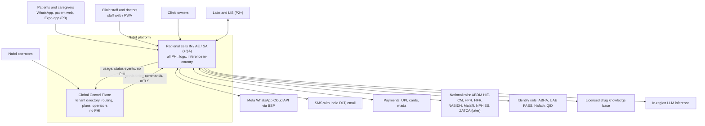
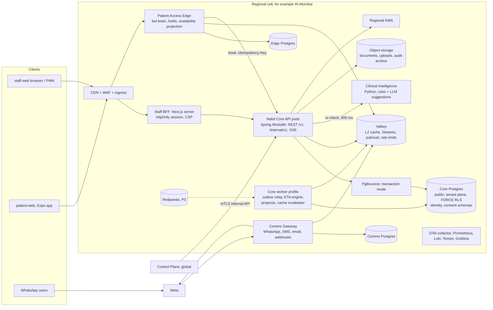
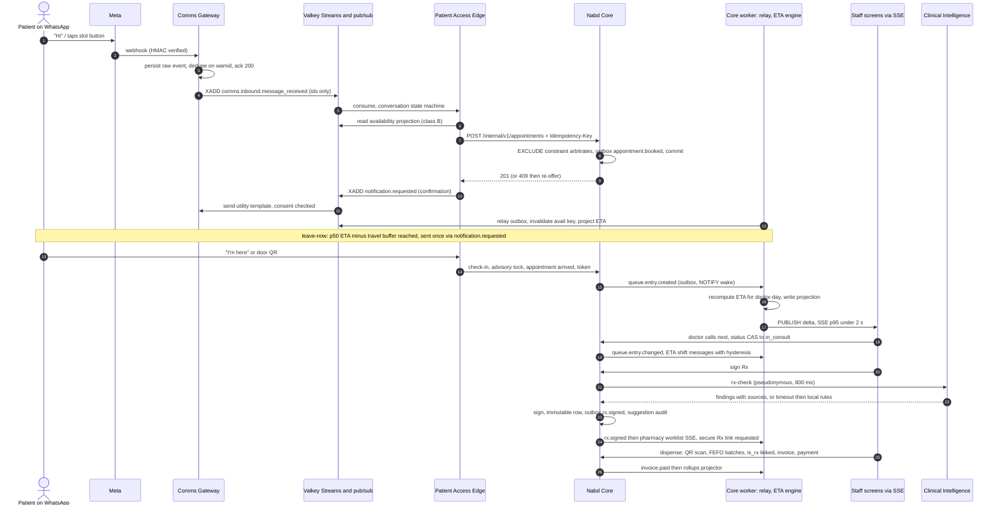

# 06 — Target Architecture & Remediation Plan (Nabd HMS)

| | |
|---|---|
| **Author role** | Chief Architect / VP Engineering |
| **Date** | 2026-10-17 |
| **Status** | v1 for founder/CTO review. It turns five independent reviews into one decision record and delivery plan. |
| **Inputs** | `01-backend-architecture-review.md`, `02-security-tenancy-privacy-review.md`, `03-data-performance-caching-review.md`, `04-frontend-review.md`, `05-qa-test-strategy-and-findings.md`, `07-consent-and-data-sharing-architecture.md`, `docs/strategy/05-gap-analysis-and-product-roadmap.md` |
| **Calendar** | Week 0 = Mon 26 Oct 2026, the same as the roadmap. Sprints are 2 weeks long. Sprint *n* starts in week 2*n*. |

**ID convention.** Docs 01 and 02 both number their findings `F-xx`. To keep them apart, this document adds a prefix for each source:

| Prefix | Source | Example |
|---|---|---|
| `ARCH-xx` | Doc 01, backend architecture | doc-01 F-02 is written **ARCH-02** |
| `SEC-xx` | Doc 02, security, tenancy and privacy | doc-02 F-01 is written **SEC-01** |
| `DP-xx` | Doc 03, data and performance | |
| `FE-xx` | Doc 04, frontend | |
| `QA-xx` | Doc 05, QA | |
| `CONS §n` | Doc 07, consent and identity | |
| `RM` / `EPxx` | The product roadmap and its epics | |

The roadmap's bare `F-` IDs refer to doc 01, so they are ARCH IDs. Consolidated findings carry **master IDs `MF-01…MF-80`** (§2).

**Severity used here.**
- **Critical:** exploitable now for MFA bypass, privilege escalation or cross-tenant/PHI exposure; a known-critical dependency CVE; or a measured defect that hides patient records or pushes a hot path to seconds.
- **High:** weakens a safety or security control, corrupts money or visit state, or blocks the pilot, high availability (HA) or a compliance date inside the plan horizon.
- **Medium:** a significant quality or operability gap that has a workaround.
- **Low:** hygiene.

**Effort:** XS < 1 day · S ≤ 3 days · M ≤ 2 weeks · L > 2 weeks (engineer effort).

---

## 1. Executive summary

### 1.1 Verdict

**Nabd's habits are good, but its system-level guarantees are not yet true.** The code is a carefully built package-by-feature monolith, but several properties its comments promise are not enforced where it is deployed.

**What is genuinely good, and should be kept:**
- Package-private repositories and no import cycles (ARCH §12); parameterised SQL everywhere (SEC S11).
- 560 real-Postgres RLS tests, green after the Docker workaround (QA §7).
- RBAC matches the spec on all 131 annotated operations.
- Correct outbox fundamentals and `ClinicClock`.
- Sound security primitives: Argon2id, refresh-token reuse detection, HMAC webhooks, append-only audit, DB-immutable signed Rx.
- A disciplined schema: `timestamptz`, `numeric` money, 137 CHECKs, keyset cursors (DP §0).
- On the frontend: consult autosave with conflict detection, zero `any`, accessible `Dialog` and combobox, and logical-property CSS that makes RTL cheap (FE §13).

**What is dangerous:**
- A PIN alone reaches about 30 days of Owner rights (MF-01, MF-02).
- RLS is almost certainly inert in deployment (MF-03).
- Money and visit writes race (MF-25…MF-30).
- The system cannot run as two replicas and has no CI or observability (MF-13, MF-34, MF-35).
- Several hot paths take seconds (MF-04, MF-06, MF-07, MF-31).
- There is no consent artefact, residency model or key management (MF-20…MF-22).

None of this needs a rewrite. Most fixes are S or M effort.

### 1.2 The ten things to fix first (Sprints 0–2)

| # | Fix | Master IDs |
|---|---|---|
| 1 | Separate token types: add `typ`/`aud` claims, and make resource servers accept only `typ=access`. Write a token-misuse test matrix. | MF-01 |
| 2 | Close the escalation paths: put break-glass behind a permission, step-up and notification; forbid self-delegation; enforce "no grant beyond your own" when roles are assigned. | MF-02, MF-11 |
| 3 | Make tenancy real: add a migrator role, a `NOBYPASSRLS` runtime role, `FORCE RLS` and a boot self-check; add `WITH CHECK` and switch the widened policies to the indexable array form. | MF-03, MF-04, MF-63 |
| 4 | Credential hygiene: stop logging OTPs, trust only known proxy hops for client IP, and add TOTP/unlock attempt limits plus MFA re-enrolment proof. | MF-14, MF-10, MF-09, MF-08 |
| 5 | Govern PHI reads: apply the consent, verification and own-patients gates to `/v1/clinical/**`, and audit every PHI read. | MF-17, MF-18 |
| 6 | Visit and money integrity: compare-and-set on queue status, atomic payments, `Idempotency-Key`, an `arrived` appointment status, an `EXCLUDE` booking constraint, and server-side pricing. | MF-25…MF-30 |
| 7 | Clinical-safety baseline: allow CORS `PUT`, gate Rx-only items, ship a CSO-owned dictionary v1, and base signing authority on a clinical licence. | MF-49…MF-52 |
| 8 | Frontend session safety: upgrade Next to ≥ 16.4.2, add single-flight refresh now, and move to a BFF with httpOnly cookies and CSP by Sprint 2. | MF-05, MF-16, MF-15 |
| 9 | Delivery and HA: CI with gates, Testcontainers ≥ 1.21, a persisted JWKS, actuator/OTel, a non-root image, and two replicas behind a load balancer. | MF-35, MF-13, MF-34 |
| 10 | Remove the performance cliffs: add the patient-path indexes, build the registry read model, take external I/O out of transactions, and set DB timeouts. | MF-06, MF-07, MF-32 |

### 1.3 Architecture decisions at a glance

| ADR | Decision | When |
|---|---|---|
| 01 | **Nabd Core** stays a Spring Modulith monolith. Around it sit four services: **Comms Gateway**, **Patient Access Edge**, **Clinical Intelligence** and **Control Plane**. Nothing else becomes a service until stated triggers fire. | Comms and Edge in Phase 1; Control Plane in Phase 2; Clinical Intelligence in Phase 3 |
| 02 | Module boundaries use `api`/`internal` packages, verified by `ApplicationModules.verify()`, ArchUnit and an SQL-ownership scan. | Report-only in S2; blocking in S5 |
| 03 | The transactional outbox is the only way to publish. It relays to **Valkey Streams** per region with a CloudEvents envelope. **Redpanda** replaces it in Phase 3. | Phase 1 / Phase 3 |
| 04 | Caching uses tiers: Caffeine L1, Valkey L2, versioned keys, and invalidation driven by the relay. PHI is default-deny. | Phase 1 |
| 05 | Queue, ETA and doctor status are pushed over **SSE** from Core, with a 60 s polling fallback. A separate Realtime service is extracted only above about 2–3k connections. | Phase 1 |
| 06 | The frontend uses a generated OpenAPI client, TanStack Query v5, and a same-origin in-region BFF with httpOnly cookies. | S0–S4 |
| 07 | Tenancy: `FORCE RLS`, a separate migration owner, no OR-widening, an indexable `tenant_id = ANY(uuid[])` read policy, and a `WITH CHECK` limited to a single tenant. | S0–S1 |
| 08 | Identity and consent: a global Person and Practitioner, consent artefacts, an Exchange that never widens RLS, and Cedar embedded as the only policy decision point (PDP). | Phase 3 (PEP groundwork in Phase 2) |
| 09 | Residency: one full regional stack per country (IN, AE, SA, later QA). A global Control Plane holds no PHI. | IN in Phase 1; AE in Phase 4; SA in Phase 5 |
| 10 | Contracts: spec bootstrapped from code, then **spec-first**, with an oasdiff drift gate in CI. | S1 (drift gate) → S3 (spec-first) |
| 11 | i18n: next-intl, locale in a cookie, ICU messages, one format library, the clinic timezone everywhere. | Phase 1 base; Arabic in Phase 4 |
| 12 | Mobile: the staff app is a PWA. The patient app is built in Expo, gated per RM D3. | PWA in Phase 1; Expo in Phase 3 |
| 13 | Clinical Intelligence is a Python service. Deterministic rules come first. LLM output is a suggestion only. Every suggestion is audited, and inference stays in-region. | Phase 3 |
| 14 | Observability: OpenTelemetry, Prometheus/Grafana, JSON logs with PHI redaction, all kept per region. | S1 |
| 15 | CI/CD: GitHub Actions, signed immutable images, migrations as a separate job, prod-shaped staging per region. | S0–S3 |

---

## 2. Consolidated findings register

The five reviews produced 175 source findings: 42 ARCH, 37 SEC, 32 DP, 32 FE and 42 QA. Merging the overlaps leaves **80 master findings**. Every source ID maps to exactly one master row. Where a source finding is split across two rows, both rows say so. The Phase column gives the phase and sprint in which the fix is *done*.

| Master ID | Sev | Title | Source IDs | Area | Fix summary | Effort | Phase |
|---|---|---|---|---|---|---|---|
| MF-01 | Critical | Challenge and purpose tokens are accepted as bearer credentials, so MFA can be bypassed | ARCH-01, SEC-01, QA-01 | AuthN | `typ`/`aud` claims; resource decoder accepts only `typ=access`; challenge tokens decoded only at their own endpoint; every non-public endpoint needs a `sid` or authority | M | P0·S0 |
| MF-02 | Critical | Break-glass is self-service Owner elevation; self-delegation makes it last 30 days; deactivate is ungated | SEC-02, SEC-36, ARCH-18, QA-02, QA-03, QA-26 | AuthZ | Permission + step-up + owner notification; clinical-read emergency scope only; forbid self-delegation; compute grantor rights from base role; revoke elevated sessions | M | P0·S0 |
| MF-03 | Critical | RLS is inert: the app role runs Flyway and owns every table; no `FORCE` | ARCH-02, SEC-03 | Tenancy | `nabd_migrator` owner role; `nabd_app` DML-only `NOBYPASSRLS`; `FORCE RLS`; boot self-check on `pg_class`; prod-config CI job | S | P0·S0 |
| MF-04 | Critical | Brand-visibility OR policies widen reads without consent, allow sibling writes (no `WITH CHECK`) and defeat indexes; queries omit `tenant_id` | SEC-04, DP-02, ARCH-37, CONS §7 | Tenancy/Perf | CONS M1 (add `WITH CHECK`, legacy flag off, no widening on staff/sessions/roles); array policy (933 ms → 0.99 ms); `tenant_id = ?` in every statement with a source-scan test; M4 removal | S → M | P0·S0 (contain), P1·S6 (remove) |
| MF-05 | Critical | `next@16.3.1` is in a critical advisory range; no SCA or SBOM | FE-03, SEC-31 | Supply chain | Upgrade to ≥ 16.4.2; Renovate; `npm audit`/Trivy/Dependency-Check gate; CycloneDX SBOM | S | P0·S0 |
| MF-06 | Critical | Missing indexes on patient-scoped paths (2.5 s seq scans); redundant indexes | DP-01, DP-24, DP-25 | Data | `queue_entries(tenant_id, patient_id, queue_date DESC)`, `vitals` partial, `audit_log(tenant_id, id DESC)`, appointment and invoice indexes, each `CONCURRENTLY`; drop 4 duplicates | S | P0·S0 |
| MF-07 | Critical | Registry caps at 3,000 rows (patients after about "M" are invisible), runs an O(N²) duplicate check and filters in memory (24.9 s per 100 rows) | DP-03, ARCH-13 | Data | `patient_registry_summary` read model; SQL filters with keyset paging; nightly duplicate job | M | P0·S2 |
| MF-08 | High | MFA re-enrol overwrites the active secret without the current factor; recovery codes accumulate and are never consumed; no admin reset | QA-04, SEC-22 | AuthN | Pending-secret column; current TOTP or step-up required; rotate codes; wire recovery verification; audited admin reset | S | P0·S1 |
| MF-09 | High | TOTP has no attempt limit; `/auth/unlock` is an unthrottled PIN oracle; PINs are 4–6 digits | SEC-05, QA-27, SEC-21 | AuthN | Per-account TOTP/unlock counters that share the lockout; ≥ 6-digit PIN; passphrase for Owner/operator | S | P0·S0 |
| MF-10 | High | `X-Forwarded-For` is trusted blindly: rate-limit bypass, forged audit IP, `::inet` 500s | ARCH-08, SEC-07 | AuthN/Ops | `forward-headers-strategy=native` + trusted-proxy list; validate the IP | XS | P0·S0 |
| MF-11 | High | Staff role assignment/invite accepts any `roleId`, including Owner; unaudited; no session revoke | SEC-08 | AuthZ | Assigned grants ⊆ caller grants; audit row; revoke the target's sessions | S | P0·S1 |
| MF-12 | High | MFA not forced for Owner, refund/discount/approve roles, operators (incl. `super_admin`) or owner accounts | SEC-10 | AuthN | Make MFA a non-optional invariant for those identities | M | P0·S2 |
| MF-13 | High | JWT key regenerated per boot: no HA, logout on every deploy; no JWKS; `iss`/`aud` not validated | ARCH-03, SEC-26, QA-37 | AuthN/Ops | Key in KMS/secret manager; JWKS with two active `kid`s; validate `iss`/`aud`/`typ` | S | P0·S0 |
| MF-14 | High | OTPs and PIN-reset tokens logged by default; free-text reasons and mock-client phone numbers logged | ARCH-09, ARCH-28, SEC-12 | PHI/Logs | `log-otp=false`, and refuse to boot with `true` in prod; log reason codes only; masking converter; log-PHI test | XS–S | P0·S0 |
| MF-15 | High | Tokens in `localStorage`; no CSP/HSTS/frame/Permissions-Policy; cross-site API | FE-02, SEC-15, SEC-17 | Web security | In-region same-origin BFF; httpOnly SameSite=Strict refresh cookie; CSRF; strict CSP via `proxy.ts` | M | P0·S2 |
| MF-16 | High | Clinic app never refreshes its 15-minute token; every 401 bounces to `/login` and loses work | FE-01 | Frontend | Single-flight refresh in one client (port `platformApi.ts`); `returnTo` | S | P0·S0 |
| MF-17 | High | `/v1/clinical/**` reads ignore consent, verification and own-patients scope; field grants applied in one place only | SEC-06, SEC-25 | AuthZ/PHI | Port `CONSENT_GATE`/`SCOPE_GATE` into the clinical SQL (S2); Cedar PEP on every clinical read (P2); apply `field_grants` everywhere | M → L | P0·S2 (gates), P2 (PEP) |
| MF-18 | High | PHI reads are not audited | SEC-09 | Audit | Partitioned, append-only `phi_read_log` written in batches and sealed asynchronously; read-volume alerting | M | P0·S2 |
| MF-19 | High | Operator access to PHI: audit console reads before/after across tenants, uncapped and unaudited; support access self-granted with identifiers; PHI in tickets | SEC-14, SEC-20, SEC-37 | Privacy | Clamp page size and audit searches; narrow the grant; tenant approval for support access; classify/redact ticket text | M | P0·S2 (clamp/audit), P1·S4 |
| MF-20 | High | One global AES key, no KMS, no key version, no AAD | SEC-11, ARCH-36 | Crypto | Key-version prefix + AAD `tenant:row` (S2); regional KMS with per-tenant DEKs and rotation (EP09/EP31) | M | P0·S2 → P1·S6 |
| MF-21 | High | One DB for IN and KSA; region is a two-value CHECK; binary region switches (SAR, SFDA, Riyadh time zone for UAE) | ARCH-16, SEC-13, QA-21 | Residency | `regions` reference model; region pinned at provisioning; per-country cells (ADR-09) | L | P1 (IN cell, EP09); P4 AE; P5 SA |
| MF-22 | High | No affirmative consent artefact (processing is default-allow); no DSR, retention, legal hold or backup/PITR machinery | SEC-29, CONS §3.1 | Privacy | EP08 consent capture with notice version; DSR engine, retention clocks, legal hold, encrypted regional PITR (EP31) | L | P1 (EP08, PITR); P2 (EP31) |
| MF-23 | High | No secure upload pipeline (type check, AV scan, signed short-lived URLs) | SEC-19 | Web security | Build the pipeline before any upload ships (EP19) | L | P1·S6 |
| MF-24 | High | Rate limits cover auth only and are forgeable; no per-tenant/user/phone limits; OTP pumping and enumeration | SEC-18, ARCH-38 | Abuse | Per-number OTP limit (S2); Valkey token buckets per tenant/user/phone/IP (S3); silent 202 responses | M | P0·S2 → P1·S3 |
| MF-25 | High | Payment is a lost-update read-modify-write; no overpayment check; an interim-paid invoice stays `paid` after new charges | ARCH-04, QA-10, QA-11 | Money | `UPDATE … SET paid = paid + ? … RETURNING`; derive status from `SUM` on every total change | S | P0·S1 |
| MF-26 | High | No idempotency on retried POSTs; `submitPayment` has no `catch` | ARCH-25, FE-11 | Money/API | `idempotency_keys` table + filter; client sends `Idempotency-Key` on payments, check-in and registration; "check status" recovery | M | P0·S1 |
| MF-27 | High | Discount bypass through client unit price or arbitrary charge code; later discount replaces earlier; tax on pre-discount value; SAR round-off | QA-12, QA-13 | Money/Tax | Catalogue pricing on the server; overrides need `billing.discount` + reason; cumulative discounts (S1); tax engine allocates discount before tax (EP20) | M | P0·S1 (QA-12), P1·S5 (QA-13) |
| MF-28 | High | Queue transitions not compare-and-set; `completed` bypasses checkout; `no_show` allowed from `in_consult` | ARCH-05, QA-32 | Visit | `WHERE status = :expected`, 409 on 0 rows; only billing completes a visit | S | P0·S1 |
| MF-29 | High | Same appointment can be checked in twice; stays `scheduled`, so cancellable mid-visit; any-day check-in; transfer leaves it `scheduled` | QA-06, QA-07, QA-08 | Visit [CLIN] | `arrived` status set under the lock; partial unique index on `appointment_id`; date check; transfer marks it | S | P0·S1 |
| MF-30 | High | Booking guard is identical-start only; overlaps, leave, hours, off-grid and past bookings accepted; any constraint error maps to 409 | ARCH-06, QA-09 | Scheduling | `EXCLUDE USING gist (doctor_id WITH =, tstzrange WITH &&)`; validate against `ScheduleGrid` and leave; map constraint names | M | P0·S1 |
| MF-31 | High | Audit chain forks under concurrency, depends on RLS, hashes TZ-dependent text, serialises tenant writes, finds the head by backward scan (5 s), is never verified | ARCH-07, DP-05, SEC-27 | Audit | Index (S0); `audit_chain_heads` row via `UPDATE … RETURNING`; UTC epoch in the hash; nightly verify + off-box checkpoint | M | P0·S2 |
| MF-32 | High | External I/O inside transactions; Hikari at default 10; no statement/lock/idle-in-transaction timeouts | ARCH-10, DP-06, DP-09 | Reliability | Intent → commit → call → record; OTP via outbox; Hikari 15–20 with 3 s timeout; role-level timeouts; "no tx open" HTTP guard | M | P0·S2 |
| MF-33 | High | Outbox: no lease fencing, batch outlives lease (duplicate sends), no ordering, no retention or metrics; no domain events | ARCH-15, ARCH-33, DP-07, QA-29 | Events | Fencing token (S2); 15–20 domain events + relay to Valkey Streams (ADR-03) | M | P0·S2 → P1·S4 |
| MF-34 | High | No actuator, health, metrics or tracing; root container; no JVM flags; migrations run at app boot | ARCH-14, ARCH-27 | Ops | Actuator + Micrometer + OTel; `USER 10001`, `MaxRAMPercentage`, layered jar; separate migrate job | S | P0·S1 |
| MF-35 | High | No CI; Testcontainers 1.19.8 fails on Docker 29 (459/560 errors); `tsc` needs typegen; consult-flow tests not wired; image built `-DskipTests` | QA-36, QA-34, SEC-30, FE-29 | Process | GitHub Actions pipeline (§7); pin Testcontainers ≥ 1.21; `next typegen && tsc`; wire all FE tests | S | P0·S0 |
| MF-36 | High | Test depth gaps: almost no concurrency, multi-actor, token-misuse, cross-tenant write, E2E, a11y or contract tests; no coverage or mutation measurement | SEC-23, FE-15, QA §1.3 | Quality | Suites in §7.4; JaCoCo/PIT gates | L | P0 → P1 (ongoing) |
| MF-37 | High | OpenAPI drift (118–139 operations undocumented; 5–6 phantom); hand-written FE types drift; no endpoint→permission registry | ARCH-12, QA-35, FE-14, SEC-24 | Contract | ADR-10: springdoc bootstrap + oasdiff gate; generated client; reflection test of `x-required-permission` against `@PreAuthorize` | M | P0·S1 → P1·S3 |
| MF-38 | High | Only two exception types handled; missing claim → 500; `limit=0/-5/MAX` → 500 and `limit=1000000` dumps every patient; 59 unbounded lists | ARCH-23, ARCH-24, QA-19, QA-42 | API | Extend `ResponseEntityExceptionHandler`; claim resolvers; shared `PageRequest` with `@Min(1) @Max(100)`; default limits | S | P0·S1 |
| MF-39 | High | Hidden data coupling: `staff` read by 15 modules, six multi-writer tables, queue↔billing↔packages SQL cycle | ARCH-11 | Modularity | Table-ownership map; `ActorDirectory`; module query APIs; single-writer rule; SQL-ownership test | L | P1·S3–S8 |
| MF-40 | High | 4–6 extra round trips per request (liveness transaction, 3-way tenant join, timezone lookup), some inside the check-in lock | ARCH-20, DP-14, DP-17 | Perf | Caffeine for tenant context and zone; Valkey revocation set; capacity counter row | S | P1·S3 |
| MF-41 | High | 15 s polling with N+1 fan-out (nursing ~2N+6 requests per tick, 2.25 s wait estimate per doctor); polls hidden tabs; My Day static; stale-response races | DP-04, FE-08, FE-09, FE-10 | Realtime | Interim: pause polling when hidden + sequence guards (S0); `/queue/board` projection + SSE + batch reads (EP06) | M | P0·S0 → P1·S5 |
| MF-42 | High | ETA is mean(invoice − check-in) × queue: includes wait, ignores delay, priority and slots; delays never expire | DP-08, QA-23 | Product core | `queue_entry_events`, `doctor_sessions`, `service_time_stats`, ETA engine (DP §5.5, EP11) | L | P1·S4–S7 |
| MF-43 | High | Patient search not index-assisted (490 ms); drug typeahead scans the whole Rx history on every keystroke; no drug master | DP-15, DP-16 | Search | Generated `phone_last10`, `btree_gin` name index, `UNION ALL` branches; regional `drug_master` + `drug_usage` + client index | M | P1·S4–S6 |
| MF-44 | High | Owner reports computed live on OLTP (about 14 queries per page; 974 ms spill); only 5 `readOnly` transactions | DP-10, ARCH-34 | Reporting | Rollup tables from the projector (EP23); `readOnly`; routing data source + replica at ~100 clinics | M | P1·S5–S6 |
| MF-45 | High | Migration hygiene: version gaps, non-concurrent indexes, CHECK without `NOT VALID`, in-transaction backfills, destructive drops | DP-12, ARCH-35 | Data/Ops | Playbook + CI lint (expand/contract, `CONCURRENTLY`, `lock_timeout`, monotonic versions, `flyway validate`) | S | P0·S0 |
| MF-46 | High | Backfills rewrote `updated_at`; "last visit" shows the migration date | DP-13 | Data | Last visit from `queue_date`/stage timestamps; one-off repair; triggers suppressed in backfills | S | P0·S1 |
| MF-47 | High | Global MRN and `INV-` sequences; `invoice_series` unused; no currency column; 2-decimal assumption; four FE money formatters | ARCH-21, DP-21, DP-22, FE-18 | Money/Compliance | Per-GSTIN, per-financial-year gapless series by row lock; `currency char(3)`; minor units; one ISO-4217 formatter | M | P1·S4–S5 |
| MF-48 | High | One global WABA; inbound messages (including STOP) dropped; webhook processed in-line without dedup; no circuit breaker; orphan templates | ARCH-32, QA-30 | Messaging | Comms Gateway: persist-then-ack, dedup by `wamid`, STOP → consent withdrawal, Resilience4j, per-tenant senders (EP07) | M | P1·S4–S6 |
| MF-49 | High | CORS forbids `PUT`, so the UI cannot record pregnancy status or "no known allergies" | QA-05 | Clinical safety | Allow `PUT`; preflight contract test; the BFF makes it same-origin | XS | P0·S0 |
| MF-50 | High | `is_rx` items can be sold over the counter without a signed Rx | QA-14 | Clinical safety | Require a linked signed Rx line; reconcile visit dispense against the Rx | M | P0·S2 |
| MF-51 | High | Thin pregnancy and allergy dictionaries (no brands); default-locale lowercasing | QA-16 | Clinical safety | CSO-owned, versioned regional dictionary v1; `Locale.ROOT`; ≥ 300 pairs per class; licensed KB later (RM D7) | M | P0·S2 (+ ongoing) |
| MF-52 | High | Owner seeded with `clinical:approve`; Rx/override authority not licence-based; nurses can sign or amend notes; no `signed_by`; Rx signer read from `audit_log` | QA-17, QA-18, DP-20 | Clinical safety | Seed aligned with the RBAC Matrix; `is_clinician` + registration required to sign; `signed_by` columns; `dental_chart_events` | M | P0·S2 |
| MF-53 | High | Package refunds: double refund, stale amount, approval race | QA-15 | Money | One open refund per instance; lock; recompute at approval; block redeem while pending | S | P0·S2 |
| MF-54 | High | Clinic-day/timezone defects: midnight splits evening sessions; three FE timezone strategies; nullable `tenants.timezone`; no injectable `Clock`; flaky 23:40–00:00 UTC tests | QA-22, FE-16, DP-32, ARCH-40, QA-38 | Time | Inject `java.time.Clock`; one FE `formatClinicDate` from the session (S2); session-based clinic day with configurable day start (EP10) | M | P0·S2 → P1·S6 |
| MF-55 | High | No shared API client (32 `API_BASE`, ~20 `authedFetch`, 6 styles); 60 effect workarounds; no query library | FE-07, FE-10, FE-31, DP-26 | Frontend | `packages/api-client` + TanStack Query v5 (ADR-06), one screen at a time | M | P0·S1 → P1·S5 |
| MF-56 | High | Seven god components (835–1,489 LOC, 29–64 `useState`); 38 of 40 pages client-only; no `error.tsx`/`not-found`; one static title | FE-13, FE-19 | Frontend | Feature folders, hooks and reducers; route groups; error boundaries; per-route metadata | L | P1·S4–S8 |
| MF-57 | High | No i18n (3–4k literals, `lang="en"`, no `dir`, Latin font); `atob` corrupts Arabic and Devanagari names; 6 physical CSS properties | FE-04, FE-05, FE-30 | i18n | TextDecoder fix (S0); next-intl foundation + lint + Indian-language patient copy (EP24); Arabic RTL (EP37) | XS → L | P0·S0 → P1·S8; P4 |
| MF-58 | High | No invoice or receipt print/PDF/share; GST layout and ZATCA QR absent | FE-06 | Billing UX | Invoice route (A4 + 80 mm) with GST layout (EP20); bilingual + ZATCA in EP42 | M | P1·S6 |
| MF-59 | High | Idle lock bypassed by reload, page behind it not `inert`, "Incorrect PIN" on expiry; plaintext consult drafts survive sign-out | FE-12, FE-17 | Frontend security | Persist and broadcast lock state; `inert`; distinct errors; clear IndexedDB on sign-out; WebCrypto session key | S | P0·S1 |
| MF-60 | Medium | Revocation gaps: operator liveness skipped, suspension and role change revoke nothing, no absolute lifetime; step-up token not bound to a session | SEC-16, SEC-34, SEC-35, ARCH-17 (part) | AuthN | Operator liveness against `master.sessions`; revoke on suspension/role change; ~12 h family cap; bind `sid`/`tenantId` | M | P1·S3 |
| MF-61 | Medium | One key, issuer and authority namespace for staff, owner and operators; control plane shares the ingress; app role has `master` DML | ARCH-17 (part), ARCH-39 | Control plane | Separate `aud`/issuer/keys and per-prefix filter chains (S5); Control Plane deployable + DB (Phase 2) | M → L | P1·S5 → P2 |
| MF-62 | Medium | Tenant context set by hand at 240 sites; no transaction assertion; `AuditService` silently switches tenant | ARCH-19, SEC-32 | Tenancy | Assert an active transaction and an unchanged tenant (S3); bind on transaction begin from `SecurityContext`; drop `tenantId` parameters | M | P1·S3–S6 |
| MF-63 | Medium | Tenant-data tables without RLS (`login_attempts`, `workflow_definitions`, `package_eligible_doctors`, owners/brands/tax); USING-only policies | SEC-33, QA-40 | Tenancy | RLS (or move to `master`); per-command policies with `WITH CHECK`; schema test | S | P0·S1 |
| MF-64 | Medium | Single-column FKs let tenant A reference tenant B's patients or staff (FK checks bypass RLS) | DP-18, QA-28 | Tenancy | `UNIQUE (tenant_id, id)` on parents; composite FKs on the clinical spine; id-replay fuzzer | M | P1·S6 |
| MF-65 | Medium | No retention or partitioning: `audit_log` 300–500 GB/yr; sessions ~600k rows/day never purged; outbox, messages, login attempts | DP-11, SEC-28 | Data growth | Purge jobs (S3); `pg_partman` monthly partitions + archive per region (EP31) | M | P1·S3 → P2 |
| MF-66 | Medium | Staff and patients exist per facility only; no Person or Practitioner | ARCH-22, CONS §2 | Identity | ADR-08: identity plane (EP32) | L | P3 |
| MF-67 | Medium | Pharmacy stock is an integer; no batch/expiry/FEFO; no OTC return | DP-28, QA-39 | Pharmacy | `stock_batches` + per-batch movements; FEFO partial index; credit notes (EP21) | L | P1·S6–S8 |
| MF-68 | Medium | A reopened past day can never be re-closed; close/payment race | QA-25 | Money | Allow re-close; per-tenant-day advisory lock | S | P1·S3 |
| MF-69 | Medium | Phone numbers normalised but never validated; UAE/QA mis-prefixed; trunk 0 kept | QA-20 | Data quality | libphonenumber per region; reject invalid | S | P1·S3 |
| MF-70 | Medium | Waitlist offers past slots; direct booking ignores live offers; lazy expiry; no way to mark a no-show | QA-24, QA-31 | Scheduling | Skip past slots; `book()` checks offers; expiry job (ShedLock); no-show endpoint/job (EP10/EP14) | S–M | P1·S5–S7 |
| MF-71 | Medium | Plan seat limit stored but never enforced | QA-33 | Commercial | Enforce on invite/activate; entitlements (EP23) | S | P1·S5 |
| MF-72 | Medium | Provisioning `advance()` has no transaction or lock; `listJobs` is N+1 | ARCH-26 | Control plane | CAS on step status; batch query | S | P1·S3 |
| MF-73 | Medium | Backend god classes; duplication (`ActorInfo` ×12, `notFound` ×30, `tenantId(Jwt)` ×25); two DTO styles; 6 bodies without `@Valid` | ARCH-29, ARCH-30, ARCH-31 | Structure | Split `PrescriptionService`/`AuthService`; argument resolvers; Bean Validation everywhere | M | P1·S3–S6 |
| MF-74 | Medium | No `updated_at`/`change_seq` on 39 tables (blocks ETag and delta sync); UUID v4 on append-heavy tables; `SELECT *`; small N+1 loops; autosave every 10 s, audited | DP-19, DP-23, DP-27, DP-29, DP-30 | Data | `change_seq` on synced tables; UUID v7 for new rows; explicit columns; `= ANY(?)`; debounce autosave, audit sign/amend only | M | P1·S5–S7 |
| MF-75 | Medium | Design system at maturity level 1 (no Button/Field/Table/Toast); 134 inline styles; breakpoint sprawl; undefined tokens | FE-26, FE-27 | Frontend | `packages/ui` + `packages/tokens` + Storybook | M | P1·S6–S8 |
| MF-76 | Medium | Five dialogs without a focus trap; mouse-only rows; invisible focus; tertiary text contrast 4.0:1 | FE-20, FE-21, FE-22 | A11y | Migrate to `ui/Dialog`; real buttons; `:focus-visible` token; contrast fix; axe gate | S–M | P1·S5–S7 |
| MF-77 | Medium | Mixed permission gating; regex-only check; platform side derives capabilities from role codes | FE-28 | Frontend AuthZ | `usePermissions`, `<Can>`, generated `Permission` union, Playwright role matrix | M | P1·S5 |
| MF-78 | Medium | Imperative validation; few shortcuts; no default doctor; "Synced" pill reflects `navigator.onLine` only | FE-23, FE-24, FE-25 | UX | RHF + generated Zod; command palette; smart defaults; honest status (EP15) | M | P1·S6–S8 |
| MF-79 | Low | No PWA manifest or web push | FE-32 | Mobile | Manifest, shell-only service worker, push (ADR-12) | S | P1·S8 |
| MF-80 | Low | Hygiene: 32-bit `hashtext` lock key, stale comments, DB PDF covers V1–V5 only, break-glass passes User-Agent as device label | ARCH-41, ARCH-42, DP-31, QA-41 | Hygiene | Two-key advisory lock; fix comments; ERD generated in CI; device header | XS each | P1 |

### 2.1 Severity disagreements and how they were resolved

| MF | Reviewer ratings → chosen | Why |
|---|---|---|
| MF-02 | ARCH-18 Medium; SEC-02/QA-02 Critical → **Critical** | A first-factor-only token (MF-01) reaches it, and delegation then lasts 30 days. |
| MF-04 | SEC-04 High; DP-02 Critical → **Critical** | One S fix closes consent-free reads, unchecked sibling writes and a 933 ms scan inside the check-in lock. |
| MF-05 | SEC-31 High; FE-03 Critical → **Critical** | Known RCE/cache-poisoning advisories in the framework that serves PHI screens. |
| MF-07 | DP-03 Critical; ARCH-13 High → **Critical** | Patients silently disappearing is a safety defect, not only a performance one. |
| MF-13 | ARCH High; SEC Medium; QA S3 → **High** | Not an exploit, but it blocks the two-replica Phase 0 exit and all load tests. |
| MF-15, MF-16 | FE Critical; SEC High/Medium → **High** | There is no XSS sink today, and the refresh bug causes data loss rather than exposure. Both are fixed in Phase 0 regardless. |
| MF-20, MF-22, MF-26 | Medium in one source → **High** | One key for all tenants and regions; DPDP applies from 13 May 2027; Wi-Fi retries double-charge today. |
| MF-31 | DP Critical; ARCH High; SEC Medium → **High** | The S0 index removes the latency, and the fork produces false alarms rather than data loss. Must be fixed before EP31. |
| MF-35, MF-38 | S2/S3 or Medium → **High** | Without CI no fix is protected. `limit=1000000` is an unaudited bulk PHI export. |
| MF-40, MF-44, MF-45 | ARCH Medium; DP High → **High** | Runs inside the check-in lock; required by EP23; needed for rolling deploys. |
| MF-41 | DP Critical; FE High → **High** | Not an outage at pilot scale. EP06 removes it before it becomes one. |
| MF-47, MF-48, MF-54 | Medium/S3 → **High** | GST consecutive series in the pilot; STOP is a consent breach; "today" breaks for Gulf evening sessions. |
| MF-57, MF-58 | FE Critical → **High** | They do not block the English-staff India pilot. The `atob` fix and the GST invoice ship before it anyway. |
| MF-65 | DP High; SEC Medium → **Medium** | Volumes are trivial at pilot scale. The purge job lands in S3, partitioning before GA. |

---

## 3. Architecture Decision Records

Every ADR below is `Accepted` unless it says otherwise. Each will be copied into `docs/adr/NNNN-*.md` once the ADR process (§8.3) starts.

### ADR-01 — Modular monolith core plus four services, and no more

- **Context.**
  - The team is about 13 people in Phase 0 and about 22 in Phase 1 (RM §7).
  - Data coupling is heavy: 15 modules read `staff`, six tables have several writers, and there is an SQL cycle (ARCH-11).
  - The roadmap pulls the Comms Gateway (EP07) and Patient Access Edge (EP12) into Phase 1. ARCH §10.6 would extract services only after the Phase 1 modular exit.
- **Decision.**
  - **Nabd Core** stays the system of record as a Spring Modulith application. It owns the tenant plane and the CONS `identity`/`consent` schemas (ADR-08).
  - Four services are separate:

    | Service | When | Why it is separate |
    |---|---|---|
    | **Comms Gateway** | Phase 1, S4–S6 | Already behind ports; holds the Meta secrets and the public webhook; bursty load |
    | **Patient Access Edge** | Phase 1, S5–S8 (EP12 v1) | Greenfield; unauthenticated-internet threat model. Owns conversations, holds and the availability projection. Writes only through Core `/internal/v1` with `Idempotency-Key` |
    | **Clinical Intelligence** | Phase 3 | Python; behind the `RxSafetyService` port |
    | **Control Plane** | Phase 2 | Operator super-powers and `master.*`; a prerequisite for a second cell |

  - Core also runs a **worker profile** from the same image (relay, ETA engine, projector). That is a process role, not a service.
- **Why not more.**
  - Pharmacy is sold as an edition (facility type plus entitlement), because it shares patients, Rx, stock and tax (ARCH §10.1).
  - Billing and queue form one invariant cluster.
  - Notifications merge into Comms.
  - Reporting becomes a CDC → OLAP pipeline.
  - Identity and Exchange need transactional access to `person_links` and the custodian adapter, so they stay in Core.
  - Lab starts as a module.
  - Realtime fan-out waits until there are more than about 2–3k connections.

  A new service needs two strong ARCH §10.1 criteria *and* a module boundary that has held under ArchUnit for one release.
- **Alternatives.** 12+ microservices: a distributed monolith, given ARCH-11. Comms and Edge inside Core: they would share Core's blast radius and connection pool.
- **Consequences.** Comms and Edge are contract-only from day one: their own databases, no Core table grants. Core exposes `/internal/v1` with mTLS and `aud=internal`. There are four on-call surfaces by Phase 3.

### ADR-02 — Module boundaries: Spring Modulith, ArchUnit and an SQL-ownership scan

- **Context.** The import graph is acyclic, but the data graph has a cycle and multiple writers. There is no `api`/`internal` split (ARCH §2).
- **Decision.**
  - Packages follow §5.1.
  - Enforcement uses:
    - `ApplicationModules.verify()`;
    - the ARCH §11.2 ArchUnit rules (no cycles; `internal` reachable only from its own module; controllers never touch repositories or `JdbcTemplate`; `@Transactional` only in services; HTTP clients only in `integration`; the shared kernel is a leaf; platform is isolated);
    - two source scans: SQL ownership (a module writes only its own tables and reads only its allow-list) and a tenant predicate on every RLS-table statement;
    - two runtime guards: `TenantContext.set` requires an active transaction, and the HTTP client requires that *no* transaction is open.
  - The table-ownership map lives in `docs/architecture/` and is checked by the scan.
  - Rollout: report-only in S2, blocking for new code in S5, blocking for everything at the Phase 1 exit.
- **Alternatives.** Multi-module Maven now: premature (ARCH §11.1).
- **Consequences.**
  - The first cross-module API is `iam.api.ActorDirectory`, which removes about 30% of cross-module reads.
  - Upgrade to a currently supported Boot line on Java 21 (ARCH §8) in S3–S4, with the Modulith release that matches.

### ADR-03 — Event backbone: transactional outbox → Valkey Streams, Redpanda later

- **Context.** The three sources disagree:

  | Source | Position |
  |---|---|
  | ARCH §10.4 | Redpanda from Phase 2, for replay, per-key ordering, Debezium and ClickHouse |
  | DP §5.3.1 | Valkey Streams per region, because Valkey is needed anyway for cache, revocation, rate limits, ETA and SSE |
  | RM D2 | Valkey Streams in Phase 1, Redpanda in Phase 3, CloudEvents from day one |

  Today the outbox has one producer and no lease fencing (MF-33).
- **Decision (this adopts RM D2 and makes it concrete).**
  1. **Publishing.** `outbox_events`, written in the business transaction, is the only way to publish. Spring Modulith `@ApplicationModuleListener` handles in-process, after-commit reactions. No second publication registry is added.
  2. **Envelope.** CloudEvents 1.0 with `id` (outbox bigint), `type` (for example `core.queue.entry.changed.v1`), `tenantid`, `region`, `traceparent`, and `data` restricted to **IDs, status and version, never PHI**. JSON Schemas live in `api/events/` and are validated in CI.
  3. **Relay.** One leader per region, chosen by `pg_try_advisory_lock` on a direct (non-PgBouncer) connection. A statement-level `pg_notify` trigger wakes it, with a 2 s poll as fallback. It `XADD`s to `ev:{region}:{context}` (about 7 days `MAXLEN`) and never calls external APIs.
  4. **Consumer groups:** `cache-invalidator`, `eta-engine`, `sse-fanout`, `projector`, `comms`, `edge-projector`.
     - All are idempotent on the event `id`.
     - State-carrying consumers apply an event only when `v` is greater than the stored version. This compensates for Streams having no per-key ordering across consumers.
  5. **Redpanda trigger (Phase 3).** Adopt it when the Edge availability projection, Exchange or OLAP CDC needs replay beyond Streams retention, or per-key partition ordering.
     - Topics follow ARCH naming (`core.scheduling.v1`), keyed `tenantId:aggregateId`.
     - Debezium's outbox router may replace the polling relay.
     - Valkey stays for cache and pub/sub.
- **Alternatives.** LISTEN/NOTIFY alone: an 8 KB cap, not durable, incompatible with PgBouncer. RabbitMQ: no replay. Self-managed Kafka: too much operational weight.
- **Consequences.**
  - Fencing (`AND status='processing' AND attempts=:claimed`) ships in S2, before any relay.
  - Retention: done rows deleted after 7 days, dead rows after 90 days. Pending, dead and age metrics.
  - The Redpanda swap changes transport adapters only.

### ADR-04 — Caching tiers, invalidation and PHI policy

- **Decision.** Adopt DP §5.2–5.3:

  | Class | Data | Mechanism |
  |---|---|---|
  | A | Real-time | Pushed (ADR-05) |
  | B | Availability | Valkey, 30 s TTL plus event invalidation; the DB constraint decides at write |
  | C | Config and reference | Caffeine L1 + Valkey L2 with versioned keys (`nabd:{region}:t:{tid}:cfg:{domain}:v{ver}`), `INCR` invalidation broadcast over pub/sub from the relay (so only after commit) |
  | D | Permissions | JWT snapshot + Valkey revocation set + `staff_version` bump |
  | E | PHI | Default deny |
  | F | Public | CDN with `stale-while-revalidate` and tag purge |

  - Stampede control: single-flight `AsyncLoadingCache`, a soft/hard TTL with an `NX` lock, ±10% jitter, and warm-up at clinic open.
  - All keys come from one `CacheKeys` helper and always include the tenant.
- **PHI rules (DP §5.3.4).**
  - Valkey may hold only:
    - the encrypted queue-board projection (token, first name + last initial, stage);
    - the ETA projection, with TTL ≤ 12 h.
  - L1 may hold the patient header for ≤ 60 s.
  - These are **never cached and never read from a replica:**
    - allergies, active medications and pregnancy status used in Rx checks;
    - stock at dispense;
    - the slot at booking;
    - invoice totals;
    - break-glass state.
  - Exchange bundles use a per-artefact DEK with TTL ≤ 5 min and are crypto-shredded on revoke (CONS §5.3).
  - Authenticated API responses stay `no-store`.
  - The lobby TV shows no names (EP15).
- **Consequences.** One managed Valkey per region, with TLS and encryption at rest. Cache values never reach logs or metrics.

### ADR-05 — Real-time: SSE for queue, ETA and doctor status

- **Decision.**
  - **Endpoint:** `GET /v1/events?topics=queue,nursing,doctor-status`, served by Core on async servlets with Java 21 virtual threads.
  - **Feed:** Valkey pub/sub channels `t:{tid}:q:{doctor}:{date}`, written by the ETA engine and the `sse-fanout` consumer.
  - **Protocol:**
    - a snapshot on connect, then `{type, id, v}` deltas;
    - `Last-Event-ID` resume from a short per-tenant-day stream;
    - a 25 s heartbeat;
    - a 60 s polling fallback while disconnected (EP06).
  - **Client:** auth through the BFF cookie; one `EventSource` per browser shared via `BroadcastChannel`; paused when hidden for more than 5 minutes.
  - **Batch reads ship with SSE:** `/queue/board` and `GET /patients?ids=`, so the N+1 problem does not just move.
  - **Patients:** WhatsApp in Phase 1. In Phase 3, `/v1/me/queue/stream` on the Edge returns only the patient's own entry.
- **Alternatives.** WebSocket: traffic is one-way, and SSE is simpler with proxies and auth. Polling: the problem being solved.
- **Consequences.** Extract a stateless Realtime service at about 2–3k connections per region or at the patient-app launch (ARCH §10.3.5).

### ADR-06 — Frontend data layer: generated client, TanStack Query and a BFF

- **Decision.**
  - **Client:** `packages/api-client` generated by `openapi-typescript` and called through `openapi-fetch`. It provides:
    - single-flight refresh;
    - Problem+JSON parsing;
    - automatic `Idempotency-Key`;
    - an `AbortSignal` on every request.
  - **Query layer:** TanStack Query v5.
    - Key factory `['t', tid, resource, …]`.
    - `staleTime` per data class (ADR-04).
    - SSE patches via `setQueryData` when `v` is newer.
    - Optimistic status moves, never optimistic token numbers.
    - Cache time 0 for outside-records keys.
  - **BFF:** Next route handlers at `/api/*`, same-origin, **deployed in-region** because PHI passes through it.
    - The refresh token lives in an `httpOnly; Secure; SameSite=Strict` cookie.
    - The access token stays in memory or is proxied.
    - CSRF protection on mutations.
    - Nonce CSP, HSTS, frame-deny and Permissions-Policy via `proxy.ts`.
  - **Forms:** React Hook Form with Zod generated from the spec.
- **Alternatives.** SWR: weaker for mutations. A state library: not needed (FE §3.1).
- **Consequences.** Vercel keeps only public and static assets. CORS becomes nearly moot, which also closes MF-49. The 60 effect workarounds disappear.

### ADR-07 — Tenancy enforcement

- **Decision.**
  1. **Roles.**
     - `nabd_migrator` owns all schemas and runs Flyway as a separate job.
     - `nabd_app` has DML only, `NOBYPASSRLS`, `statement_timeout=5s`, `lock_timeout=3s` and `idle_in_transaction_session_timeout=15s`.
     - `nabd_reports` is read-only with a 60 s timeout.
     - `nabd_identity` and `nabd_exchange_reader` follow CONS §2.1.
     - SECURITY DEFINER functions are owned by a non-app role.
  2. **`FORCE ROW LEVEL SECURITY`** on every table with a `tenant_id`.
  3. **Policy shape:** per command, indexable reads, writes limited to one tenant:
     ```sql
     USING (tenant_id = ANY (string_to_array(current_setting('app.visible_tenant_ids', true), ',')::uuid[]))
     WITH CHECK (tenant_id = current_setting('app.tenant_id', true)::uuid)
     ```
     - The array holds one element. It may hold more only behind `legacy-brand-visibility`, until CONS M4 removes it.
     - **No OR-widening.** Cross-tenant reads go only through the Exchange or aggregated views.
     - The expression is inline, so DP's measured plan holds.
  4. **Boot self-check.** The app fails to start if the runtime role owns an RLS table or has `BYPASSRLS`, or if any `tenant_id` table has RLS off or not forced.
  5. **Application layer.** `tenant_id = ?` in every statement (scan). The tenant is bound at transaction begin from `SecurityContext`. `AuditService` asserts the tenant has not changed.
  6. **Composite FKs** `(tenant_id, x_id)` on the clinical spine.
- **Alternatives.** Schema-per-tenant or DB-per-tenant: too costly for thousands of small clinics. Application predicates only: no defence in depth.
- **Consequences.** A prod-config CI job boots the app exactly as production does. The pilot database is created fresh under these roles (§9 D9).

### ADR-08 — Identity and consent: global Person/Practitioner, Exchange, Cedar

- **Decision.** Adopt CONS in full, with these placement choices.
  - **Where it runs.**
    - The `identity` and `consent` schemas live in the **regional Core database**, owned by separate migrator roles and reached through separate DataSources and runtime roles.
    - They are **Core modules** (`identity`, `consent`, `exchange`) behind `/v1/identity` and `/v1/exchange`.
    - They become a separate deployable only if ABDM HIP/HIU load or a regulator requires it.
  - **Rules carried over from CONS:**
    - pairwise `person_ref` values;
    - assurance levels L0–L2;
    - global merges only on an exact L2 identifier, never fuzzy matching across tenants;
    - patient-then-doctor approval;
    - JCS + ES256 signed artefacts;
    - a custodian adapter running as `nabd_exchange_reader` with exactly one tenant context;
    - watermarking;
    - an access log the patient can see.
  - **One PDP:** Cedar via `cedar-java` ≥ 4.9.0, with versioned policies in `policies/` validated in CI. Policy text is never built from user input.
  - **PEPs:** the Exchange, the custodian adapter, and every clinical read. The clinical-read PEP replaces the MF-17 SQL gates in Phase 2.
  - **Break-glass v2** is a Cedar context flag for one patient, never an Owner-grant merge.
  - **The Edge consumes the identity APIs and does not own Person.** This resolves ARCH §3.4 against CONS.
- **Alternatives.** OPA/Rego: heavier, harder to review. Hand-written rules: not auditable. Widening RLS: rejected for the reasons in CONS §5.2.
- **Consequences.**
  - Prerequisites: MF-01, MF-02, MF-03 and MF-18.
  - Delivery: CONS P0 containment now; P3 intra-hospital policy in Phase 2; identity and Exchange in Phase 3 (EP32/EP33).
  - No DPDP Consent Manager registration. ABDM HIE-CM remains the consent manager of record (CONS §8).

### ADR-09 — Data residency: one regional stack per country, Control Plane separate

- **Decision.**
  - **One full cell per country:**

    | Cell | Phase | Notes |
    |---|---|---|
    | IN | Phase 1 | Mumbai primary, Hyderabad DR |
    | AE | Phase 4 | |
    | SA | Phase 5 | |
    | QA | When sold | |

  - **Each cell contains** Core, Edge, Comms, Clinical Intelligence with in-region inference, Postgres, Valkey, object storage, KMS and observability (Redpanda and OpenSearch from Phase 3), plus its own WhatsApp number pool.
  - **The global Control Plane** holds no PHI: tenant directory, cell routing, plans, operators, and a login router `hash(identifier) → region`.
  - **Operator consoles** federate through regional APIs.
  - **Region codes** become ISO (`IN`/`AE`/`SA`/`QA`) in a `regions` table: currency, minor units, tax regime, regulator, timezone, phone rules, cell. Region is pinned at provisioning (EP09).
  - **No cross-border exchange in v1.** A multi-country brand has one tenant per country.
- **Alternatives.** One global database with RLS: unlawful for AE and SA (CONS §8).
- **Consequences.** Logs, traces, backups and inference are regional, with CI egress tests (EP38). Cell moves are scripted. Hosting is an open decision (§9 D2).

### ADR-10 — API contract first, with a CI drift check

- **Decision.**
  - **Bootstrap (S1).** Generate the spec from code with springdoc, review it, and commit it as `api/openapi/core.yaml`, plus `internal.yaml` and one spec per service. Remove the phantom operations.
  - **Gate.** `oasdiff` runs on every PR and fails on undocumented, breaking or phantom operations.
  - **Spec-first from S3.**
    - New or changed operations are written in the spec first.
    - New modules and all services implement generated interfaces (`openapi-generator` `interfaceOnly`).
    - Legacy controllers stay code-first until they are touched, guarded by the diff.
    - The frontend client, Zod schemas and MSW mocks are generated.
  - **Additional checks.**
    - A reflection test asserts that `x-required-permission` equals `@PreAuthorize`; this test is the SEC-24 endpoint registry.
    - Enums are string-literal unions.
    - Schemathesis runs on previews.
  - **Versioning.** `/v1` is additive; deprecations carry `Sunset`. Event schemas follow the same rules.
- **Alternatives.** Code-first only: the spec stays a by-product. Spec-first overnight: stalls on 264 existing operations.

### ADR-11 — i18n and RTL with next-intl

- **Decision.**
  - **Library:** next-intl with ICU messages. Catalogues in `packages/i18n` are shared with React Native.
  - **Locale:** from a cookie (user → tenant → browser). `<html lang dir>` is rendered on the server.
  - **Fonts:** `next/font` with Noto Sans Devanagari, Kannada and Telugu now; an Arabic face in Phase 4.
  - **Formatting:** one `format` module for ISO-4217 money, dates in the **clinic timezone** (MF-54) and libphonenumber. Raw `Intl.*` is banned by lint. Digit style is a clinic setting.
  - **CI:** the i18next no-literal lint per migrated folder, pseudo-localisation, `ar` visual snapshots, and a logical-properties stylelint rule.
  - **Scope by phase:**
    - Phase 1: patient copy in EN/HI/KN/TE (EP24), staff UI extracted Login → Arrivals → Consult → Checkout.
    - Phase 4: Arabic (EP37).
    - Clinical terms are reviewed by clinicians, never machine-translated.

### ADR-12 — Mobile: PWA for staff, Expo for the patient app

- **Decision.**
  - **Staff:** an installable PWA (S8).
    - The service worker caches the shell and static assets only, **never API responses**.
    - Web Push for "patient ready".
    - Only the consult draft and vitals may be queued offline; payments never (FE §5.6).
  - **Patients:** an Expo app (Expo Router, EAS) in **Phase 3, only if the RM D3/H7 signals pass**. Until then patients use WhatsApp and `apps/patient-web`.
  - **Shared:** `api-client`, `domain`, `i18n` and `tokens`.
  - **Patient auth:** patient-scoped auth with `aud=patient`, refresh tokens in Keychain or Keystore, and delta sync via `change_seq` (MF-74).
- **Alternatives.** Flutter: a second language and no client sharing. PWA-only for patients: iOS push and trust limits (FE §10).

### ADR-13 — AI and CDS: Clinical Intelligence service

- **Decision.**
  - **Stack and interface:** Python (FastAPI) in every cell. Core's `RxSafetyService` calls `POST /cds/rx-check` with an **800 ms** budget and a circuit breaker. On failure Core falls back to local rules and stamps `cdsSource=local` (ARCH §10.3).
  - **Order:**
    1. Deterministic, versioned rules plus the licensed knowledge base (DDI, allergy, pregnancy, renal).
    2. LLM output as **suggestions** only (note drafts, summaries, explanations).
  - **Guardrails:**
    - Context is pseudonymised and minimised.
    - Inference is in-region only (EP36: zero out-of-region PHI).
    - Prompts and models are kept in a register.
    - Sources are shown.
    - Nothing enters the record without a clinician action.
  - **Never auto-prescribe and never auto-sign** (RM D5).
  - **Audit:** every suggestion is logged with its input hash, model/prompt version, output, outcome (shown, accepted or overridden) and clinician.
  - **Alert tiers:** only severe alerts interrupt. The override rate is reviewed weekly.
- **Regulatory (SaMD).** Flag-and-cite CDS that leaves the decision to the clinician aims for the lowest SaMD class or exclusion. That is a hypothesis to confirm with counsel against India's CDSCO draft and SFDA MDS-G010 (RM D5). An ISO 13485 / IEC 62304 track and a hazard-log entry per model change start in Phase 3. The CSO signs releases.

### ADR-14 — Observability

- **Decision.**
  - **Instrumentation:** OpenTelemetry in Core, the services and the BFF. `traceparent` propagates over HTTP, the outbox and CloudEvents.
  - **Pipeline:** an OTel Collector per region feeding Prometheus, Tempo and Loki, viewed in Grafana. Everything stays in-region.
  - **Logs:** JSON with `tenantId`/`staffId`/`traceId` in MDC, a Logback masking converter, a CI log-PHI scan, reason codes only, and no secrets (MF-14).
  - **Key metrics:**
    - HTTP RED;
    - Hikari;
    - outbox and stream lag;
    - SSE connections and latency;
    - WhatsApp outcomes;
    - login failures;
    - ETA MAE and P80;
    - audit-chain verify;
    - replica lag.
  - **Frontend:** web vitals and errors go to an in-region endpoint with scrubbing.
  - **Alerting:** SLO burn-rate alerts (§7.6). Actuator readiness, including outbox lag, gates rollout.

### ADR-15 — CI/CD and environments

- **Decision.**
  - **Pipeline:** GitHub Actions with path filters (§7.1).
  - **Artefacts:** images built once, cosign-signed, with an SBOM, and promoted **by digest** from dev to staging to prod.
  - **Migrations:** a separate pre-rollout job as `nabd_migrator`, following MF-45 rules.
  - **Environments:**

    | Environment | Purpose |
    |---|---|
    | Local | Docker Compose; `dev-up.sh` rewritten for the split roles |
    | PR preview | Synthetic data, destroyed after 72 h |
    | `dev` | Shared integration |
    | `staging-in` | Production-shaped: 2 replicas, PgBouncer, real roles, synthetic PHI |
    | `prod-in` | Pilot tenants |
    | AE, then SA | Added in Phases 4–5 |

  - **Infrastructure and secrets:** Terraform/OpenTofu per cell, GitOps deployment, cloud OIDC (no long-lived CI secrets).
  - **Releases:**
    - Deploys go outside OPD peaks (10:00–13:00 and 17:00–20:00 local), with canaries and automatic rollback on SLO burn.
    - Databases roll forward only.
    - Per-tenant flags are tied to entitlements (EP23).
    - Clinical-rule changes need CSO approval and a safety test report (QA §5.1).
- **Consequences.** PHI paths leave Render/Vercel (§9 D2).

---

## 4. Target architecture

### 4.1 System context



### 4.2 Container view: one regional cell



### 4.3 Event flow: WhatsApp booking → queue → ETA push → consult → Rx → pharmacy



PHI never travels in events. Consumers that need detail call the owning API. Any confirmation sent to the patient is sent **after commit**.

### 4.4 Data ownership

| Owner | Owns (single writer) | Others access via |
|---|---|---|
| Core `iam` | staff (membership rows), roles, sessions, login_attempts, role_delegations, break_glass_grants | `iam.api.ActorDirectory`, `PermissionCatalogue` |
| Core `organization` | tenants (local projection), brands, legal entities, tax registrations, invoice_series, departments, workflow definitions, policies, facility_access_policies | `organization.api` config bundle (cached, class C) |
| Core `patient` | patients, consents (tenant processing consents), patient_merges, guardians, patient_registry_summary | `PatientDirectory`, `ConsentQuery` |
| Core `scheduling` | appointments, working hours, leave, delays, waitlist, doctor_sessions | `SlotBooking`, `AvailabilityQuery`, events |
| Core `visit` | queue_entries, queue_entry_events, transfers | `VisitQuery`, `VisitCommands`, events |
| Core `clinical` | notes, prescriptions (+ `signed_by`), allergies, conditions, vitals, documents, dental (+ `dental_chart_events`), pregnancy | `ClinicalRecordQuery`; custodian adapter |
| Core `nursing` | procedure_orders, administration_orders | events |
| Core `billing` | charge_catalogue (prices), invoices, line items, payments, day_closes, packages and instances, refunds, idempotency_keys | `InvoiceCommands`, `ChargeCatalogue` |
| Core `pharmacy` | stock_batches, stock movements (stock moves out of `charge_catalogue`) | `StockCommands` |
| Core `identity` / `consent` / `exchange` | identity.\* and consent.\* (CONS §3.5) | `/v1/identity`, `/v1/exchange`, Cedar PDP |
| Core shared `audit`, `events` | audit_log, audit_chain_heads, phi_read_log, outbox_events | `AuditPort`, `EventPublisher` |
| Core `reporting` | tenant/doctor daily metrics (rollups) | read-only views it owns |
| Comms Gateway | whatsapp_messages, whatsapp_templates, inbound_events, sender_accounts, channel-consent snapshot | `notification.requested` command; `/otp`; template API |
| Patient Access Edge | conversations, booking_holds, availability projection, travel buffers | `/internal/v1` on Core; events |
| Clinical Intelligence | drug KB copy, rule versions, prompt/model register, inference log (short retention), eval sets (restricted storage, not git) | `/cds/*` |
| Control Plane | operators, operator sessions, plans, subscriptions, discounts, provisioning jobs, support tickets, support access grants, tenant directory, login router | provisioning saga (idempotent commands), federated audit |

---

## 5. Target code structure

### 5.1 Backend (Nabd Core)

ARCH §11.1 uses the name `identity` for the staff-authentication module. That name is taken here by the CONS identity plane, so staff authentication becomes **`iam`**.

```
backend/src/main/java/com/nabd/core
├── shared/            # kernel: no business logic, leaf in ArchUnit
│   ├── ids/           TenantId, FacilityId, StaffId, PatientId, PersonId, PractitionerId
│   ├── money/         Money(amount, Currency), minor units, TaxRate
│   ├── time/          ClinicCalendar (java.time.Clock + cached tenant zone, session-based clinic day)
│   ├── tenancy/       TenantContext (tx-bound, asserting), @CurrentTenant/@CurrentStaff resolvers
│   ├── security/      TokenType/Audience, StepUpVerifier, ServiceIdentity
│   ├── web/           Problem types, GlobalExceptionHandler, Page/Cursor/PageRequest, IdempotencyFilter, ETag helpers
│   ├── audit/         AuditPort, Actor, PhiReadRecorder
│   ├── events/        DomainEvent, CloudEvent mapper, EventPublisher (outbox)
│   ├── crypto/        FieldCipher (key-versioned, AAD, KMS DEKs)
│   ├── cache/         CacheKeys, versioned L1/L2 templates
│   └── integration/   resilient HTTP client (timeouts, Resilience4j, asserts no open tx)
├── iam/               api/ (ActorDirectory, PermissionCatalogue, events) internal/{login,otp,mfa,session,breakglass,token,delegation} web/
├── organization/      api/ internal/{tenant,brand,department,setup,policy,region} web/
├── patient/           api/ (PatientDirectory, ConsentQuery) internal/{registry,merge,guardian,consent} web/
├── scheduling/        api/ (SlotBooking, AvailabilityQuery) internal/{hours,booking,waitlist,delay,rules} web/
├── visit/             api/ (VisitQuery, VisitCommands) internal/{checkin,flow,transfer,eta} web/
├── clinical/          api/ internal/{notes,rx,allergy,conditions,vitals,documents,dental,pregnancy} web/
│   └── internal/rx/safety/   RxSafetyService (port) → LocalRules | ClinicalIntelligenceClient
├── nursing/           api/ internal/ web/
├── billing/           api/ (InvoiceCommands, ChargeCatalogue) internal/{checkout,tax,payments,dayclose,packages,series} web/
├── pharmacy/          api/ (StockCommands) internal/{stock,dispense,registers} web/
├── identity/          api/ internal/{person,practitioner,affiliation,link,merge} web/      # CONS plane, own DataSource
├── consent/           api/ internal/{artefact,approval,ledger} web/                         # own DataSource
├── exchange/          api/ internal/{custodian,bundle,pdp} web/                             # Cedar PEP/PDP
├── reporting/         internal/{rollups,views} web/
├── realtime/          internal/{sse,topics} web/
├── worker/            relay, projector, eta engine bootstrap (profile=worker)
└── platform/          # shrinks to tenant-side hooks once the Control Plane is extracted (Phase 2)
```

**Conventions:**
- `api` holds interfaces, records and events only.
- `internal` holds everything else; repositories stay package-private.
- `web` controllers call only their own module.
- Migrations live in `db/migrations/{public,identity,consent}`, each schema with its own owner role.

### 5.2 Frontend monorepo (pnpm + Turborepo)

```
frontend/
├── apps/
│   ├── staff-web/       Next.js: (auth) (clinic) (platform) (owner) route groups; api/[...path] BFF; proxy.ts (CSP nonce, locale, auth redirect)
│   │   └── features/    arrivals/ consult/ nursing/ patients/ checkout/ schedule/ my-day/ setup/ staff/ reports/ shell/
│   ├── patient-web/     secure document links, consent approvals (P1); aggregator with RSC + ISR (P3)
│   └── patient-app/     Expo Router app (P3, gated)
├── packages/
│   ├── api-client/      generated openapi.d.ts, client.ts (refresh, Problem, Idempotency-Key), queries/*, sse.ts
│   ├── domain/          status machines, enums, vitals/rx/dose logic, generated Zod validators
│   ├── ui/              Button, Field, Input, Select, Combobox, Dialog, Drawer, Table, Tabs, Toast, StatusPill (+ Storybook); no fetching
│   ├── tokens/          Style Dictionary → CSS vars + RN theme; breakpoints, type scale, z-index
│   ├── i18n/            ICU catalogues en/hi/kn/te (+ar in P4); format helpers (money, clinic tz, phone)
│   └── config/          eslint (jsx-a11y, i18next, boundaries), tsconfig, stylelint (logical props)
└── e2e/                 Playwright journeys J1–J15, role matrix, axe, visual (en/ar × desktop/tablet/phone)
```

**Rules (FE §11):**
- Pages are thin.
- A feature imports only from `packages/*` and its own folder, enforced by `eslint-plugin-boundaries`.
- All network access goes through `api-client`.
- All formatting goes through `i18n`.

### 5.3 Repository strategy

Keep **one monorepo**. The team is small, a contract change and its consumers should land in one PR, and one CI with path filters is enough.

```
/backend  /services/{comms-gateway,patient-edge,control-plane}  (Java, same build conventions)
/services/clinical-intelligence  (Python, uv, own lint/test stage)
/frontend  /api/{openapi,events}  /db/migrations/<schema>  /policies (Cedar)  /infra (Terraform, deploy manifests)  /docs/{adr,engineering,architecture}
```

- `CODEOWNERS` maps each path to its squad (§8.1).
- Exception: CDS evaluation datasets and any PHI-derived artefacts live in restricted regional object storage, never in git.
- Revisit polyrepo only if a service gets an external team.

---

## 6. Remediation plan

### 6.1 Shape and alignment with the roadmap

| Sprint | Dates | Theme | Roadmap |
|---|---|---|---|
| 0 | 26 Oct – 6 Nov | Stop the bleeding | Phase 0 (EP01–EP05) |
| 1 | 9 – 20 Nov | Integrity and HA | Phase 0 |
| 2 | 23 Nov – 4 Dec | PHI governance and the exit gate | Phase 0 exit; Phase 1 non-PHI work already running |
| 3 | 7 – 18 Dec | Event spine and platform | Phase 1 |
| 4 | 21 Dec – 1 Jan | Reduced capacity (holidays) | Phase 1 |
| 5 | 4 – 15 Jan | | Phase 1 |
| 6 | 18 – 29 Jan | Pilot cohort A shadow mode (≈ month 3) | Phase 1 |
| 7 | 1 – 12 Feb | Cohort A live | Phase 1 |
| 8 | 15 – 26 Feb | Cohort B (≈ month 4) | Phase 1 exit |

**Reconciling 4 weeks with 6 weeks.** The roadmap gives Phase 0 four weeks. This plan uses **three sprints (six weeks)** for "make it safe" and keeps every roadmap Phase 0 exit criterion, measured at the end of Sprint 2. Phase 1 work that touches no PHI (Comms sandbox, ETA simulator, design) still starts in week 2, as RM §5 says. The pilot dates do not move. **No real patient data enters any environment before the Sprint 2 gate passes.**

Phase 0 staffing is about 4 backend engineers, 2 frontend engineers, 1 SRE, 1 QA and 0.5 CSO (RM §7). In Sprints 0–2 everyone works the "make it safe" tracks. From Sprint 3 the squads of §8 form.

### 6.2 Sprint 0 — Stop the bleeding (weeks 0–2)

**Goals.** Close every path from a single credential to privilege. Make RLS real. Get CI green on current Docker. Remove the measured multi-second queries.

| Track | Items |
|---|---|
| Platform/Security | MF-01 token `typ`/`aud` + access-only decoder · MF-02 break-glass gate + no self-delegation + deactivate gate · MF-09 TOTP/unlock counters · MF-10 trusted proxy · MF-14 OTP logging off · MF-13 persisted key + JWKS |
| Core Backend | MF-49 CORS `PUT` · MF-57 (`atob` part, FE pairing) · MF-04 containment: CONS M1 `WITH CHECK`, flag off, array policy, `tenant_id` added to `nextTokenNumber`, `countSessionOccupancy` and registry subqueries |
| Data/Infra | MF-03 migrator/app role split + `FORCE RLS` + boot self-check · MF-06 indexes (`CONCURRENTLY`) and drop duplicates · MF-45 migration playbook + lint |
| Frontend | MF-05 Next ≥ 16.4.2 · MF-16 single-flight refresh + `returnTo` · MF-41 interim (pause when hidden, sequence guards) |
| QA/CI | MF-35 pipeline stages 1–3 + Testcontainers ≥ 1.21 + `next typegen` + wired FE tests · token-misuse matrix · prod-config job · governance: CSO appointed, hazard log v0 (EP05) |

**Definition of done.**
- A first-factor token gets 401 on every authenticated endpoint.
- A receptionist cannot activate break-glass.
- The runtime role owns no tables, and every `tenant_id` table has RLS forced with a `WITH CHECK`.
- `npm audit` shows no critical findings.
- CI blocks merges.

**Verification.**
- `TokenMisuseMatrixTest`: every token type × every endpoint ⇒ 401 (QA §4.5).
- `BreakGlassAuthzTest` and `DelegationEscalationTest`.
- `RlsSchemaInvariantTest` over `pg_class`/`pg_policies`, plus the `prod-config` job (Flyway as migrator, app as `nabd_app`).
- `XffSpoofTest`, a log-capture test for OTPs, `TotpLockoutTest`, `UnlockBruteForceTest`, `CorsPreflightTest`.
- `EXPLAIN` plan-regression tests for `nextTokenNumber` and the patient timeline.
- An FE UTF-8 claim-decoding test.

### 6.3 Sprint 1 — Integrity and HA (weeks 2–4)

**Goals.** Visit and money writes are race-free and idempotent. Two replicas run behind a load balancer with health checks, metrics and traces. Contract drift is visible.

| Track | Items |
|---|---|
| Platform/Security | MF-08 MFA enrolment proof + recovery · MF-11 role-assignment escalation check + audit + revoke · MF-59 idle lock + draft clearing (FE pairing) |
| Core Backend | MF-25 atomic payments + status from `SUM` · MF-26 idempotency filter + table · MF-27 server-side pricing / discount authority (QA-12) · MF-28 queue CAS + completion rules · MF-29 `arrived` + unique index + date check + transfer · MF-30 `EXCLUDE` + grid/leave/past validation · MF-38 exception mapping + `PageRequest` clamps · MF-46 last-visit repair |
| Data/Infra | MF-34 actuator, Micrometer, OTel, non-root layered image, migrate job · two replicas + LB in `staging-in` · MF-63 RLS on remaining tables · MF-07 begins (registry summary schema + projector) |
| Frontend | MF-55 `packages/api-client` skeleton (refresh, Problem, Idempotency-Key) used by checkout, check-in and registration · MF-26 client headers + `submitPayment` recovery |
| QA/CI | MF-37 springdoc bootstrap + oasdiff in report mode · concurrency suite v1 · JaCoCo baseline |

**Definition of done.**
- Two concurrent desks cannot create two tokens for one appointment.
- Concurrent payments always satisfy `paid = SUM(payments)`.
- Overlapping bookings are rejected.
- `limit=0` returns 400.
- A rolling restart of one replica logs nobody out.

**Verification.**
- Concurrency tests with `CountDownLatch`: double check-in ⇒ exactly one 201, concurrent payments, concurrent overlapping bookings, concurrent status transitions.
- QA-10 two-checkpoint test with an interim payment.
- QA-12 price-override authz test.
- Restart/refresh test across two replicas (QA-37).
- Schemathesis smoke for `not_a_server_error` on list endpoints.
- MFA re-enrol test (the old secret keeps working until confirm; recovery codes rotate).
- A role-assignment escalation test returns 403.

### 6.4 Sprint 2 — PHI governance and the Phase 0 exit gate (weeks 4–6)

**Goals.** PHI reads are scoped and audited. Sessions are cookie-based behind CSP. The clinical-safety baseline is signed. The roadmap Phase 0 exit criteria are met.

| Track | Items |
|---|---|
| Platform/Security | MF-17 consent + verification + own-patients gates in clinical SQL · MF-18 `phi_read_log` · MF-19 audit-console clamp + audit + grant narrowing · MF-20 key version + AAD + re-encrypt job · MF-12 forced MFA for privileged identities · MF-24 per-number OTP limit (Postgres counter) |
| Core Backend | MF-31 chain-head table + UTC hash + nightly verify · MF-32 I/O out of transactions + Hikari + role timeouts · MF-33 outbox fencing + retention + metrics · MF-50 `is_rx` gate · MF-51 dictionary v1 (CSO) · MF-52 licence-based signing + Owner seed + `signed_by` · MF-53 refund locking · MF-54 `Clock` injection |
| Data/Infra | MF-07 registry read model live + keyset paging · PITR enabled in `staging-in` · India cloud account and cell IaC skeleton (EP09 start) |
| Frontend | MF-15 BFF + httpOnly cookies + CSRF + CSP/HSTS · MF-54 FE clinic-timezone helper |
| QA/CI | ZAP baseline on previews · Playwright harness + J1, J5, J6, J9 smoke · k6 registry and check-in profiles · Security Controls mapping |

**Definition of done (this is the Phase 0 exit gate, RM §5):**
- Zero open S1 defects and zero security S2 defects.
- Two replicas pass the suite and the prod-config job.
- Registry p95 < 300 ms at 500k patients.
- Check-in p95 < 300 ms.
- Security Controls ≥ 60% verified.
- Hazard log v1 signed by the CSO.
- Clinical reads of a consent-withdrawn patient return 404.
- Every clinical GET writes a read-log row.

**Verification.**
- Clinical read-scope tests per controller (withdrawn consent, unverified patient, own-patients doctor).
- `PhiReadAuditTest`.
- Concurrency tests for the audit chain (no fork, `verify_audit_chain` true after 50 parallel writes).
- A slow-provider test: a 10 s stub must not exhaust the pool.
- Outbox fencing chaos test with two instances (QA-29).
- J7 (pregnancy from the UI), J10 (OTC Rx gate) and J12 (double refund refused).
- Dictionary catalogue of ≥ 300 pairs per class, with PIT ≥ 90% on `AllergyDrugClasses` (QA §4.6).
- CSP report-only for one week with zero violations, then enforce.
- k6 report attached to the gate review.

### 6.5 Phase 1, Sprints 3–8: parallel tracks

| Track | S3 | S4 | S5 | S6 | S7 | S8 |
|---|---|---|---|---|---|---|
| **Platform/Security** | MF-24 Valkey rate limits; MF-60 revocation; MF-62 tenant assertions; threat-model template | MF-19 support-access tenant approval; EP08 consent capture design | MF-61 separate issuer/keys + per-prefix filter chains; MF-71 seats | MF-20 regional KMS DEKs; MF-23 upload pipeline (EP19); EP08 live | DSR design (EP31 prep); pen-test scoping | Security Controls ≥ 90% (pilot entry) |
| **Core Backend** | MF-33 15–20 domain events; MF-39 ownership map + `ActorDirectory`; MF-68, MF-69, MF-72 | MF-48 Comms module + inbound persist-then-ack + STOP; MF-42 stage events + doctor sessions; MF-47 invoice series + currency | Comms Gateway as its own deployable; MF-27 tax engine (QA-13, EP20); MF-43 drug master; EP12 Edge v1 skeleton | MF-42 ETA engine v2 live; MF-30/MF-70 booking rules engine (EP10); MF-64 composite FKs; MF-04 removal (CONS M4) | MF-67 batches/FEFO (EP21); Edge booking flow; MF-54 session-based clinic day | Edge GA for cohort B; MF-73 splits finished; Modulith verify blocking |
| **Frontend** | MF-55 TanStack on Arrivals/Nursing | MF-41 SSE hook + `/queue/board`; MF-56 split Arrivals | MF-77 permissions; MF-76 a11y fixes; EP24 next-intl foundation | MF-58 GST invoice print; MF-56 split Consult; EP15 keyboard-first | MF-75 `packages/ui` + tokens; MF-78 forms and shortcuts | MF-79 PWA; Indian-language patient copy complete |
| **Data/Infra** | Valkey in-region; relay → Streams with NOTIFY wake; MF-40 caches; MF-65 purge jobs | `prod-in` cell; PgBouncer; SLO dashboards and burn alerts; backup restore drill | MF-44 rollups + `readOnly` routing; Comms and Edge databases | MF-74 `change_seq` on synced tables | Audit partitioning design (EP31); DR failover rehearsal (Hyderabad) | Capacity review vs pilot telemetry |
| **QA/CI** | oasdiff blocking; spec-first starts; generated RBAC-matrix authz tests | Cross-tenant id-replay fuzzer; Schemathesis on previews; PIT nightly | k6 morning-rush + same-doctor contention | WhatsApp chaos suite; UAT scripts; cohort A shadow support | J1–J15 green in EN; safety test report per release | Cohort B UAT; pilot exit metrics |

**Definitions of done for Phase 1** are the epic acceptance criteria in RM §6. The engineering verifications are:

| Epic | Verification |
|---|---|
| EP06 | SSE delivery p95 < 2 s, measured end to end by a synthetic probe |
| EP07 | STOP honoured in < 1 min; 0 duplicate sends under the chaos stub |
| EP11 | ETA MAE and P80 coverage logged per clinic, with an alert below 70% |
| EP20 | Tax golden-file tests per region |
| EP12 | Booking median < 60 s in a Playwright + WhatsApp-sandbox journey |
| ArchUnit/Modulith | Green and blocking by S8 |

### 6.6 Quick wins (each under one day)

1. Default `WHATSAPP_LOG_OTP=false` and fail boot in prod if it is true (MF-14).
2. `server.forward-headers-strategy=native` + trusted proxies (MF-10).
3. Add `PUT` to the CORS methods (MF-49).
4. Bump `next` to ≥ 16.4.2 (MF-05).
5. Pin Testcontainers ≥ 1.21; run `next typegen` before `tsc`; wire `test-consult-flow.mjs` (MF-35).
6. Each index migration in MF-06: `queue_entries` patient, `audit_log (tenant_id, id DESC)`, `vitals` partial; drop the four duplicate indexes.
7. Role-level `statement_timeout`/`lock_timeout`/`idle_in_transaction_session_timeout`; explicit Hikari settings (MF-32).
8. `TextDecoder`-based JWT decode in one helper (MF-57).
9. Pause polling on `visibilitychange`; add sequence guards to Nursing and My Day (MF-41).
10. Clear IndexedDB drafts on sign-out (MF-59).
11. `@PreAuthorize` on break-glass deactivate (MF-02, SEC-36).
12. `@Max` on delay minutes and a check-in date check (MF-42, MF-29).
13. `Locale.ROOT` in `RxSafetyChecks.matches` (MF-51).
14. `USER 10001`, `MaxRAMPercentage`, `server.shutdown=graceful` (MF-34).
15. `spring.mvc.problemdetails.enabled=true` and a catch-all handler (MF-38).
16. Relabel the package "Send reminder" button to "Mark reminded" (RM §4).
17. Fix the tertiary text contrast token (FE-22).

---

## 7. Quality engineering plan

### 7.1 CI pipeline stages (adapted from QA §5.1)

| Stage | When | Content | Budget |
|---|---|---|---|
| 1 Static | every push | Spotless/Checkstyle, SpotBugs; `next typegen`, `tsc`, ESLint (a11y, i18next, boundaries), stylelint; gitleaks; Semgrep/CodeQL; ruff/mypy for Python | ≤ 3 min |
| 2 Unit | every push | JUnit pure units; Vitest; pytest; ArchUnit/Modulith; SQL-ownership and tenant-predicate scans | ≤ 2 min |
| 3 Integration | PR | Testcontainers suites parallel by class; **prod-config job**; JaCoCo | ≤ 6 min |
| 4 Migration | PR touching `db/` | `flyway validate`/`migrate` on empty and seeded snapshots; expand/contract lint; monotonic versions; RLS invariant test | ≤ 3 min |
| 5 Contract | PR | springdoc → oasdiff vs committed spec; permission reflection test; event schema validation | ≤ 2 min |
| 6 Build and scan | PR | image (non-root, distroless), Trivy, Dependency-Check, `npm audit --audit-level=high`, CycloneDX SBOM, cosign | ≤ 4 min |
| 7 Preview | PR | ephemeral env + synthetic tenants; ZAP baseline; Playwright smoke (J1, J5, J6, J9) + axe; Schemathesis | ≤ 12 min, parallel |
| 8 Nightly | main | full E2E J1–J15 × EN/AR; PIT; ZAP full; k6 regression; chaos; cross-tenant fuzzer; audit-chain verify on staging | — |
| 9 Release | tag | safety test report linked to the hazard log; CSO approval for clinical-rule changes; change log; canary | — |

The PR path (stages 1–7) must finish in under 15 minutes (EP03 acceptance criterion).

### 7.2 Gates

These come from QA §5.2 and are kept unchanged:
- **Coverage:** backend ≥ 75% overall, and ≥ 90% line / 85% branch on `RxSafetyChecks`, `AllergyDrugClasses`, `PrescriptionService`, `CheckoutService` and `iam.*`. New code ≥ 80%.
- **Mutation (PIT):** ≥ 85% on the safety and billing rules. A drop of more than 2 points blocks.
- **Contract:** 0 undocumented operations, 0 Schemathesis 5xx.
- **Security:** 0 new high or critical SAST/SCA findings; 0 high ZAP findings.
- **Accessibility:** 0 critical or serious axe violations on changed pages.
- **Performance:** k6 p95 within +10% of baseline.
- **Flaky tests:** quarantined with an owner and a 5-day SLA.

This plan adds three gates:
- **Architecture:** no new Modulith or ArchUnit violations.
- **Tenancy:** the RLS invariant test is green.
- **Clinical safety:** no hazard without a verifying test (QA §4.6).

### 7.3 Test pyramid targets (12 months, QA §4.1)

| Layer | Target share | Speed |
|---|---|---|
| Pure unit | 40% | < 10 s |
| API integration (real RLS) | 45% | < 4 min |
| Contract | every spec operation | — |
| E2E | 15 journeys × 2 locales | < 15 min |
| Non-functional (k6, ZAP, axe, chaos) | nightly | — |

The frontend adds component tests (RTL + MSW handlers generated from OpenAPI) for `Dialog`, `DrugCombobox`, `AccessGate`, autosave/conflict and check-in duplicate review (FE §9).

### 7.4 First suites to add, in order

1. Token-misuse matrix (MF-01).
2. RLS invariant and prod-config boot (MF-03, MF-63).
3. Concurrency and multi-actor: check-in, booking, payment, status, refund, audit chain, outbox (MF-25…MF-31, MF-53).
4. RBAC-matrix-generated authorization tests, including the operator matrix (MF-02, MF-11, MF-52).
5. Cross-tenant id-replay fuzzer (MF-64).
6. Clinical rule catalogue + PIT (MF-51).
7. CORS/BFF contract test (MF-49, MF-15).
8. Playwright J1, J5, J6, J9, then all of J1–J15 with the role-absence sweep and axe.
9. Clock-injected midnight and timezone tests for Kolkata, Dubai and Riyadh (MF-54).
10. Tax golden files per region (MF-27).
11. WhatsApp chaos suite (MF-48).
12. k6 profiles (QA §4.4).

### 7.5 Performance budgets (server-side p95 at 2× pilot peak; k6 in the nightly gate)

| Operation | p95 budget | Source |
|---|---|---|
| Queue status transition (CAS) | < 200 ms | Plan target; QA queue list < 200 ms |
| Queue board read (`/queue/board`) | < 200 ms | QA §4.4 |
| Walk-in or appointment check-in | < 300 ms | QA §4.4; RM Phase 0 exit |
| Booking write (`/internal/v1/appointments`, staff booking) | < 400 ms | Plan target; booking median < 60 s end to end (RM) |
| Patient search / registry page | < 300 ms at 500k patients | RM Phase 0 exit; EP03 |
| Drug typeahead | < 100 ms (local index) | EP18 |
| Rx safety check on line entry | < 500 ms | QA J6 |
| Rx sign (local rules) | < 500 ms; < 1,000 ms including CDS (800 ms budget, then fallback) | QA J5 (sign < 2 s in the UI); ARCH §10.3 |
| Checkout / record payment | < 500 ms | QA §4.4 |
| WhatsApp webhook ack | < 100 ms | QA §4.4 |
| Event to SSE screen | < 2 s end to end | DP §5.2; EP06 |
| Advisory-lock wait, same doctor | p99 < 100 ms | QA §4.4 |

### 7.6 SLOs and error budgets (per regional cell, 28-day window)

| SLO | Target | Error budget |
|---|---|---|
| Staff API availability (non-5xx, clinic hours 07:00–23:00 local) | 99.9% | ≈ 27 min |
| Check-in and queue-action latency | 99% < 500 ms | 1% slow |
| Realtime freshness: event to screen | 95% < 2 s, 99% < 5 s | — |
| Messaging: reminders and leave-now sent inside their window | 99% | 1% (and a missed window is cancelled, never sent late, QA §4.9) |
| Delay broadcast to all affected patients | 99% < 60 s | RM MM5 |
| Outbox: oldest pending age | 99% < 30 s | — |
| ETA accuracy (product SLO) | ±10 min for ≥ 80% of visits | RM Phase 1 exit |
| Audit chain nightly verify | 100% | Zero budget: any failure is a security incident |
| Backups (RPO / RTO) | ≤ 5 min / ≤ 1 h; PITR 35 days | Restore drill every quarter |

**Error-budget policy.**
- When more than 50% of a budget is burnt, feature releases for that service freeze and only reliability work ships.
- When 100% is burnt, a postmortem is required and the squad's next sprint is reliability-only.
- Safety and privacy defects carry no budget. They follow the QA §5.4 severity SLAs: S1 hotfix within 24 h, S2 within 5 days.

---

## 8. Team topology and operating model

### 8.1 Ownership

| Team (RM §7) | Owns (Core modules / services) | From |
|---|---|---|
| **Platform & Trust** | `shared` kernel, `iam`, `organization`, tenancy and RLS, `audit`, `events` relay and worker, `realtime`, `identity`/`consent`/`exchange` (P3), Control Plane, CI/CD, infrastructure, observability, regional cells, KMS | S3 |
| **Patient Access** | `scheduling`, `visit` (queue, ETA engine), Patient Access Edge, Comms Gateway, `apps/patient-web`, booking rules | S3 |
| **Clinical** | `clinical`, `nursing`, `RxSafetyService`, safety dictionaries (with the CSO), Clinical Intelligence (P3, with Data/ML) | S3 |
| **Money & Pharmacy** | `billing` (tax, series, packages), `pharmacy`, `reporting` rollups | S3 |
| Diagnostics & Interop · Patient App · GCC · Hospital · KSA | Lab, FHIR/ABDM adapters · Expo app · AE cell, Arabic, insurance · IPD/OT · SA cell | P2 · P3 · P4 · P5 |

**Cross-cutting:**
- Frontend engineers sit in squads. A **UI guild** led by Platform & Trust owns `packages/ui`, `tokens`, `i18n` and `api-client` generation.
- QA/SDET are embedded in squads, while the shared E2E harness is owned by Platform.
- The CSO and DPO have sign-off rights, not code ownership.

### 8.2 On-call

- **Phase 0–1:**
  - One rotation (backend + SRE): primary and secondary, weekly.
  - Paging covers clinic hours, 07:00–23:00 IST. Overnight is best effort.
  - Pilot go-live weeks get extended hours plus an on-site QA engineer (QA §4.10).
- **Phase 2:**
  - Two rotations: Core/Patient Access, and Platform (including Control Plane and infrastructure).
  - Comms and Edge are owned by Patient Access.
- **Phase 4:** Gulf hours overlap IST largely. Add KSA/UAE evening and Ramadan late-session coverage.

**Escalation:**
- Alerts are SLO-burn based (ADR-14).
- Every service has a runbook before it ships (ARCH §10.6 exit criteria).
- S1 clinical-safety incidents page the CSO.
- Privacy incidents page the DPO, starting the 6-hour CERT-In and DPDP breach clocks (RM §1).
- Blameless postmortems are due within 5 working days.

### 8.3 Rituals

| Ritual | What and when |
|---|---|
| **Architecture review** | Weekly, 45 min. New ADRs and RFCs, plus Modulith/ArchUnit violation trends. ADRs live in `docs/adr/` with status proposed / accepted / superseded. Any new service, datastore, cross-module API or event type needs an ADR. |
| **Threat modelling per epic** | Before build starts on any epic that touches PHI, auth, messaging or a new integration. STRIDE + LINDDUN, recorded in the epic. Owned by Platform & Trust (RM §7). |
| **Clinical safety review** | Fortnightly, chaired by the CSO. Hazard-log updates for `[CLIN-SAFETY]` items, alert analytics, release sign-off. No release ships with an open hazard that has no verifying test (QA §4.6). |
| **Privacy review** | DPO sign-off on any new data flow, purpose code or retention change. Quarterly regulation watch. |
| **Ops / SLO review** | Weekly: error budgets, top alerts, capacity, cost per clinic. |
| **Quality review / game days** | Fortnightly: flaky quarantine, coverage, PIT, Security Controls %. Quarterly drills: WhatsApp outage, DB failover, region restore, break-glass review. |
| **Dependency day / pilot day** | Monthly Renovate merge and SBOM refresh. Fortnightly on-site stopwatch day (RM §7), with engineers in rotation. |

---

## 9. Risks and open technical decisions for the founder/CTO

| # | Decision / risk | Recommendation |
|---|---|---|
| D1 | **Phase 0 takes 6 weeks, not 4.** | Accept it. Phase 1 non-PHI work starts in week 2 regardless, so the pilot dates (months 3–4) hold. The alternative is cutting MF-15/17/18, which leaves the pilot with tokens in `localStorage` and unaudited PHI reads. |
| D2 | **Hosting.** Render and Vercel cannot hold PHI paths in-country. KSA and UAE provider choice. | Choose one hyperscaler or sovereign cloud with IN regions now (Mumbai + Hyderabad). Shortlist providers for AE (ADHICS cloud rules) and SA (NCA CCC) by month 8. Vercel stays for static and public assets only. |
| D3 | **Control Plane location** and the personal data of GCC owners and operators that it holds. | Host it in India initially, holding no PHI. Get counsel's view on PDPL and Federal Law transfer rules for owner contact data before the AE cell; split the directory per region if required. |
| D4 | **Runtime upgrade** (Boot 3.3 → a supported line, Java 21) in the middle of remediation. | Do it in S3–S4 behind the new CI, not during Sprints 0–2. |
| D5 | **Managed Valkey availability** in each country. | Prefer managed. Self-host with replicas only where no managed offer exists. Valkey is the hard dependency for ADR-03 to ADR-05. |
| D6 | **Comms and Edge as services in Phase 1** (roadmap) versus ARCH's "extract after modular exit". | Accept it with guardrails: their own databases, contract-only access, and Core `/internal/v1` behind a service identity. The risk is a distributed monolith if they read Core tables; ArchUnit and DB grants prevent that. |
| D7 | **Orchestration weight** for one or two SREs. | Use a managed container platform per cell. Use managed Kubernetes plus GitOps only when the second cell arrives, if the team wants one deployment model. Decide by S3. |
| D8 | **PHI read-audit volume** (likely 10× the write audit). | Keep it in a separate partitioned `phi_read_log`, sealed in batches rather than chained per row. 13-month online retention, then archive. Confirm retention with the DPO. |
| D9 | **Pilot database.** | Create a fresh `prod-in` database under the new roles and do not migrate Render dev data. Synthetic data only outside prod (QA §5.3). |
| D10 | **Drug KB licence and CSO capacity** (RM D7, D10). | Without a licensed KB, MF-51 stays a hand-curated v1. The licence must be signed by S5 for EP18 and EP28. Hire the CSO in Phase 0. |
| D11 | **SaMD exposure of CDS** (RM D5). | ADR-13 guardrails apply. Get counsel's opinion before EP36 starts, and start the ISO 13485 / IEC 62304 track in Phase 3. |
| D12 | **Cedar native dependency** (JNI to a Rust core). | Pin `cedar-java` ≥ 4.9.0 (CONS §5.1). Image base must support glibc. Spike in Phase 2 before committing the PEP on clinical reads. |
| D13 | **Region code migration** (`KSA` → `SA`) and the `regions` table. | Do it in EP09 with expand/contract while KSA tenants are only test tenants. |
| D14 | **Key-person risk.** The codebase was written by 1–2 people with AI pairing (ARCH §10.1). | Pair every Sprint 0–2 fix with a second engineer. ADRs and runbooks are part of the definition of done. |
| R1 | **Remediation uncovers more data-model debt** (RM §5 risk). | Time-box it. Anything that does not block real PHI moves to Phase 1 tracks; the register above is the backlog of record. |
| R2 | **Register drift.** | New findings get an `MF-` ID and a sprint at the quality review until the register moves to the tracker. |
