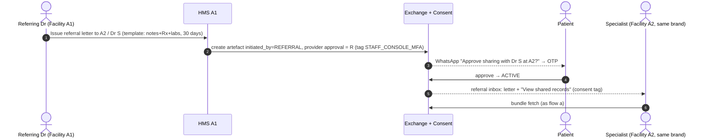

# 07 — Consent, Identity & Data-Sharing Architecture (Nabd HMS)

| | |
|---|---|
| Author role | Principal Architect |
| Date | 2026-10-17 |
| Status | Design proposal. Not implemented. Needs legal review per country before build. |
| Scope | Global identity plane (patients, practitioners), cross-facility consent, the Exchange service, intra-hospital access policy, migration away from `brands.data_visibility_scope`, ABDM / NABIDH / Malaffi / KSA / Qatar notes |
| Related | `02-security-tenancy-privacy-review.md` (findings this design depends on, especially break-glass and RLS ownership) |
| Line references | `path:line` refers to the working tree on the date above. |

---

## 1. Summary and design principles

**The problem.** Nabd isolates each facility in its own tenant. That part is correct. Two things are wrong for the product the founder describes:

1. **Identity is per tenant.** A doctor working at three hospitals has three `staff` rows, because email is unique only per tenant (`V1__staff_auth_core.sql:66`). A patient seen at two clinics has two `patients` rows with no link between them (`V3__patients.sql:16-33`).
2. **The only cross-facility path is wholesale and has no consent.** `TenantContext.set()` fills `app.accessible_tenant_ids` from `brands.data_visibility_scope` (`TenantContext.java:34-47`, `V42__brand_data_visibility_scope.sql:6-7`). The `OR` clause that V6 added to the policies (`V6__owner_brand_hierarchy.sql:92-131`) then exposes every sibling facility's patients, staff, sessions, consents and clinical notes. There is no consent, no expiry and no audit. `CrossFacilityVisibilityTest.java:47-59` and `:76-88` show this working as designed.

**The proposal.**

- Add a **global identity plane** per country region. It holds a `Person` for each patient and a `Practitioner` for each clinician, plus verified identifiers, relationships and facility affiliations.
- **Clinical records stay in the tenant that created them.** Tenants hold only a pairwise, opaque link to the global Person.
- Add a **Consent service** that issues signed, time-boxed **consent artefacts**. Each needs approval from **both the patient (or guardian) and the responsible doctor** at the providing facility. The artefact maps 1:1 to FHIR R4 `Consent` and to the ABDM consent artefact.
- Deliver shared data only through an **Exchange service**. It asks the providing tenant to assemble a read-only, consent-scoped FHIR bundle and serves it to the requester. **RLS is never widened across tenants.**
- Make every decision in **one policy decision point: Cedar, embedded in-process.** Every disclosure is written to an access log that the patient can see.

**Design principles.**

| Principle | What it means in Nabd |
|---|---|
| Privacy by design and by default | Default is no sharing. A new facility, department or role starts isolated. Sharing is an explicit, signed artefact. |
| Least privilege | An artefact names data categories, a record date range and a requester. The bundle carries only that. Sensitive categories are excluded unless named explicitly. |
| Purpose limitation | Every artefact carries a purpose code: `CAREMGT`, `BTG`, `PATRQT`, `PUBHLTH`, `HPAYMT` or `DSRCH`, aligned to ABDM and HL7 PurposeOfUse. The PDP refuses access for any other purpose. |
| Time-boxing | Each artefact has an access window (`valid_from`/`valid_until`), an optional `max_access_count`, and an erase-by date for any stored copy. There are no open-ended grants. Break-glass is time-boxed too. |
| Everything auditable | Each state change and each disclosure is written to the consent ledger (hash-chained) and to both tenants' `audit_log` chains (V14). |
| Patient-visible access history | Patients see, on WhatsApp or the web portal, who saw what, when, under which consent, and can revoke from there. |
| Records live with the custodian | The providing facility stays the data fiduciary or controller. The requester gets a view, not a copy, unless the artefact allows `STORE`. |
| Jurisdiction-local | Identity, consent and exchange are deployed per country region. Nothing crosses a border by default. |

---

## 2. Identity model

### 2.1 Two planes

```
┌──────────────────────── Region (IN | AE | SA | QA) ────────────────────────┐
│  GLOBAL IDENTITY PLANE (schema identity, service: nabd-identity)            │
│   persons · person_identifiers · person_relationships · person_links        │
│   practitioners · practitioner_registrations · practitioner_affiliations    │
│   login_accounts                                                            │
│                                                                             │
│  CONSENT + EXCHANGE PLANE (schema consent, service: nabd-exchange)          │
│   consent_artefacts · consent_approvals · consent_events · access_log       │
├─────────────────────────────────────────────────────────────────────────────┤
│  TENANT PLANE (schema public, RLS on tenant_id, service: nabd-hms)          │
│   patients(+person_ref) · staff(+practitioner_ref) · queue_entries ·        │
│   clinical_notes · prescriptions · vitals · patient_allergies · ...         │
└─────────────────────────────────────────────────────────────────────────────┘
```

- **Separate DB roles.** `nabd_app` (the tenant app) has **no grants** on `identity.*` or `consent.*`. `nabd_identity` has none on tenant tables. `nabd_exchange_reader` has `SELECT` only on the clinical tables. It always runs with `app.tenant_id` set to the providing tenant, and it never sets `app.accessible_tenant_ids`.
- **Migration ownership.** Each schema is migrated by a dedicated owner role, never by the runtime role. This fixes the "RLS inert because the app owns the tables" finding in `02` §3.3. Every table in all three schemas gets `FORCE ROW LEVEL SECURITY`.
- **Deployment.** Start as separate Spring Boot modules in this repository with one deployable per plane per region. The tenant service calls the identity and exchange services over mTLS with service tokens. It never reads their tables directly.

### 2.2 Person (patient) and how a tenant record links to it

A `Person` is the data principal. A tenant `patients` row is that facility's record **about** the person. It is not the person.

**Pairwise reference.** `patients` gains `person_ref text`, defined as `base64url(HMAC-SHA256(region_link_key, person_id ‖ tenant_id))`.
- Two facilities holding the same person get **different** refs, so a leaked tenant export cannot be joined across facilities.
- Only `identity.person_links` (tenant_id, patient_id → person_id) can resolve a ref.
- The OpenID Connect "pairwise subject identifier" uses the same pattern.

**Linking and assurance levels.**

| Level | How it is reached | What it unlocks |
|---|---|---|
| L0 unlinked | Registered at the desk, nothing verified | Local care only |
| L1 contact-verified | OTP to the registered mobile, by WhatsApp (an authentication template through the existing `WhatsAppOtpSender`) or SMS | Booking via the aggregator; receiving notifications |
| L2 identity-verified | L1 plus a government identifier proven by its national rail: **India:** ABHA via ABDM OTP/e-KYC. **UAE:** Emirates ID via UAE PASS or an EID card read. **KSA:** National ID or Iqama via Nafath. **Qatar:** QID via Tawtheeq/NAS. Passport plus manual check at the desk for visitors. | Cross-facility consent and exchange, guardian approvals, patient access history |

**A mobile number identifies a login account, not a person.** Families share one number. The registry already avoids flagging guardian- and sibling-linked rows as duplicates on that basis (`PatientRepository.java:132-137`). So one `login_account` can manage several Persons (self plus dependants) through `person_relationships`. A mobile number on its own never merges two Persons.

**Identifier storage.** Identifiers are stored as an HMAC blind index for exact lookup, plus AES-GCM ciphertext. This is the same scheme as `patients.national_id_enc` (`V3__patients.sql:26`). Raw values are never returned.

**Duplicates and merge.**

- **Inside a tenant:** unchanged. The V5 `patient_merges` table (`V5__v2_plan_sync.sql:62-75`) and `PatientService.merge`/`unmerge` (`PatientService.java:380-411`) keep their 30-day reversible, step-up-gated behaviour. A merge in a tenant re-points `person_links` to the surviving patient row.
- **Across tenants (global):** `identity.person_merges` is modelled on `patient_merges`, with a 30-day reversal window. A merge is proposed only from an **exact match on a verified L2 identifier**, such as the same ABHA number or the same Emirates ID. The fuzzy name+DOB matcher (`PatientRepository.java:192-204`) is **never run across tenants**. Doing so would leak the existence of patients at other facilities. A fuzzy candidate is resolved only by asking the patient, via OTP, to claim the record.
- **Reversals.** Merge and unmerge emit `person.merged` / `person.unmerged` events through the outbox (V44). Consent artefacts that reference the absorbed `person_id` are re-pointed, and the event is logged on each artefact.

### 2.3 Practitioner, registrations and affiliations

- **Practitioner.** One per human clinician per region.
- **`practitioner_registrations`.** Each row records (registry, number, jurisdiction, specialty, valid_from/until, verified_at, verification_method). Registries:
  - India: NMC/State Medical Council and the **HPR** ID ([ABDM HPR](https://hpr.abdm.gov.in/)).
  - UAE: **DHA** (Sheryan), **DoH** Abu Dhabi, **MOHAP**.
  - KSA: **SCFHS**.
  - Qatar: **QCHP**, now the MOPH Department of Healthcare Professions.

  Verification is through the registry API where one exists (HPR has one), and otherwise by document upload plus operator review. Today's free-text `staff.professional_registration_no` (`V55:7-11`) and the clinician rows in `licence_registry` (`V17__clinic_setup.sql:158-178`) become seeds for this table.
- **`practitioner_affiliations`.** Each row records (practitioner, tenant, staff_id, role title, department, start_date, end_date, status `invited|active|suspended|ended`).
  - The tenant's `staff` row **stays**. It still carries that facility's role, permissions, department and "own patients only" scope (`V1:58`, `V37:48`). Facilities keep full control of what a visiting doctor may do in their building.
  - When an affiliation ends (the doctor leaves the hospital), the staff row is suspended and that facility's sessions are revoked. The Practitioner and their other affiliations are untouched. The records the doctor authored **stay with the facility**.

### 2.4 Login for a doctor with several affiliations

This is the pattern the codebase already uses for Owners. `OwnerService.login` issues a short-lived `pending_workspace` token. `selectWorkspace` checks ownership and mints a normal tenant-scoped staff token through `authService.issueTokensForStaff` (`OwnerService.java:129-145`, `:152-163`). Practitioners reuse that shape:

1. `POST /v1/identity/auth/login` takes the practitioner's mobile or email, plus PIN/OTP, plus TOTP if required. The response is a `practitioner_pending` token: 5 minutes, `aud=identity`, `typ=pending`.
2. `GET /v1/identity/me/affiliations` returns active affiliations only.
3. `POST /v1/identity/affiliations/{id}/enter` mints the existing tenant access/refresh pair for the linked `staff` row. MFA policy is evaluated per tenant role (`roles.mfa_required`, `V31:9`).
4. **Facility switcher** (top bar, next to the clinic card in `ClinicNav`). The UI calls `enter` again for another affiliation. The old tenant session is kept, so switching back is instant, but each tenant token is still single-tenant.

**Token hygiene.** `02` reports that every JWT shares one key and issuer, and that pending or MFA tokens are accepted as bearer credentials. This flow **requires** that fix first: a distinct `aud` and `typ` per token kind, with resource servers rejecting anything other than `typ=access`.

### 2.5 What data lives where

| Data item | Plane | Owner (controller/fiduciary) | Who can see |
|---|---|---|---|
| Person core: name, DOB, sex, preferred language | Global (identity) | Nabd, as platform controller for the aggregator; facilities hold their own copy | The person and their guardians. Facilities only via their own `patients` row |
| Verified identifiers (ABHA, EID, Iqama, QID) | Global, encrypted plus blind index | Nabd | Never shown in full. Facilities see "verified ✓ (ABHA ••••1234)" |
| Login account, mobile, PIN/TOTP | Global | Nabd | The account holder |
| Relationships (guardian, caregiver, POA) | Global | Nabd, with evidence from the facility that verified it | The person, the related party, a treating facility while a consent is active |
| Practitioner profile and registrations | Global | Nabd (verified copy); the registry is the source of truth | Public directory fields (name, specialty, registry number) to patients and facilities |
| Affiliation (doctor ↔ facility, dates) | Global | Facility (it asserts it), Nabd (stores it) | The practitioner, that facility's admins, patients via the aggregator listing |
| Patient record at facility (MRN, demographics copy, address) | Tenant | Facility | That facility's staff, per the intra-hospital policy (§6) |
| Encounters, notes, Rx, vitals, allergies, documents, vaccines | Tenant | Facility (custodian) | That facility per §6; other facilities **only** through an active artefact via Exchange |
| Tenant processing consents (`treatment`, `data_processing`, `messaging`, `guardian_access`) | Tenant (`consents`, V5/V28) | Facility | That facility; the patient |
| Cross-facility consent artefacts | Consent plane | The **providing** facility is the controller of the disclosure. Nabd processes. | The patient, guardian, requesting and providing practitioners, both facilities' privacy officers |
| Access log for disclosures | Consent plane plus both tenants' `audit_log` | Nabd (ledger), each facility (own chain) | The patient (their own rows), both facilities, regulators on request |
| Appointments booked through the aggregator | Tenant (the facility's `appointments`), with a booking ref in global | Facility | The patient and the facility |

---

## 3. Consent model

### 3.1 Two kinds of consent

- **Tenant processing consents** stay where they are. These are V5 `consents` (`V5__v2_plan_sync.sql:41-54`), extended in V28 (`V28:18-20`). They cover treatment, data processing, messaging and guardian access at one facility.
  - They need one fix: today `data_processing` is "no row = allowed" (`V5:55-59`, `PatientRepository.java:30-32`), while messaging is default-deny (`WhatsAppMessageRepository.java:43-52`). Both should record the **notice version** the patient acknowledged, which ties them to each facility's own privacy policy.
- **Exchange consent artefacts** are new. They live in the consent plane and are the only thing that authorises a disclosure to another facility.

### 3.2 Lifecycle

```
             ┌──────────── DENIED (patient or doctor refuses) ───────────┐
REQUESTED ──► PATIENT_APPROVED ──► DOCTOR_APPROVED ──► ACTIVE ──► EXPIRED │
     │               │                   │               │                │
     └──── CANCELLED (requester) ────────┘               └──► REVOKED ◄───┘ (patient, guardian, provider, or system: person merge, affiliation ended)
```

- **Patient approves first.** The patient is the data principal. A doctor should not decide on a disclosure the patient has not yet seen. The doctor may approve, **narrow** the scope (fewer categories or a shorter range, never wider), or deny with a reason code (`clinically_inappropriate`, `third_party_information`, `records_incomplete`, `not_my_patient`).
- **DOCTOR_APPROVED → ACTIVE** happens at `valid_from`. That is usually immediate, but a referral can be future-dated.
- **Patient-initiated sharing (flow b)** starts at `PATIENT_APPROVED`.
- **Break-glass** starts at `ACTIVE` with `purpose=BTG` and a mandatory `review_due_at`. It skips both approvals, and §4(c) explains why that is lawful.
- **Who is "the doctor".** The resolution order is:
  1. The practitioner who authored the most recent record in scope, if still actively affiliated with the providing facility.
  2. The head of the department that owns those encounters.
  3. The facility's designated **medical records / privacy officer**.

  Doctors change hospitals, so (1) often fails. Approval authority can be **delegated** for leave cover through the existing `role_delegations` pattern (`V30__role_delegations.sql:5-16`). An unanswered approval escalates to the next approver after an SLA set per facility (default 4 working hours; 30 minutes when the request is marked urgent).
- **The patient's own access is not gated by the doctor.** A patient downloading their own records exercises a statutory right: DPDP s.11, UAE Federal Law 2/2019, and similar. The two-party approval rule applies to **facility-to-facility** disclosure only. Legal should confirm this reading for each country.

### 3.3 Approval tags

Every approval is a row in `consent_approvals`. It records who, in what capacity, through which channel, what text they saw, and the evidence. The UI shows it as a tag on every shared item and in the patient's timeline:

> `Consent C-IN-2026-004812 · Patient (WhatsApp OTP, 17 Oct 14:02) · Dr R. Menon, Hospital A (Nabd console + TOTP, 14:31) · Valid until 31 Oct 23:59 · 2/5 views used`

Channels: `WHATSAPP_OTP`, `WHATSAPP_BUTTON_OTP` (a Utility template with an Approve button, then an OTP to bind the reply to the person), `WEB_OTP`, `APP_BIOMETRIC`, `ABDM_PHR_APP` (approved in the ABHA app, mirrored to Nabd), `IN_PERSON_SIGNATURE` (tablet signature at the desk, staff-witnessed), `STAFF_CONSOLE_MFA` (doctor approvals; requires TOTP step-up through the existing `StepUpVerifier`).

### 3.4 Integrity

- The artefact body is canonicalised with JCS ([RFC 8785](https://www.rfc-editor.org/rfc/rfc8785)) and hashed with SHA-256.
- It is signed as a detached JWS (ES256) with a per-region KMS key when it becomes ACTIVE.
- Each approval stores the hash of the artefact version it approved. If a doctor narrows the scope, the hash changes and the patient is notified of the narrower version. Narrowing needs no re-approval because it is strictly less; widening is impossible.
- `consent_events` is append-only and hash-chained per artefact, reusing the V14 trigger design (`V14__audit_log.sql:62-92`).

### 3.5 Core DDL

```sql
-- Schema owned by nabd_consent_owner; runtime role nabd_exchange has DML via functions only.
CREATE SCHEMA consent;

-- Controlled vocabularies (kept as CHECKs for v1; move to lookup tables when localised)
-- purpose: HL7 PurposeOfUse / ABDM: CAREMGT, BTG, PATRQT, PUBHLTH, HPAYMT, DSRCH
-- categories: map to FHIR resource types and ABDM hiTypes (see §3.6)

CREATE TABLE consent.consent_artefacts (
  id                         uuid PRIMARY KEY DEFAULT gen_random_uuid(),
  public_ref                 text NOT NULL UNIQUE,            -- 'C-IN-2026-004812', shown in UI/WhatsApp
  region                     text NOT NULL CHECK (region IN ('IN','AE','SA','QA')),
  person_id                  uuid NOT NULL,                   -- identity.persons(id), same region
  subject_minor_or_proxy     boolean NOT NULL DEFAULT false,  -- approved by guardian/proxy
  initiated_by               text NOT NULL CHECK (initiated_by IN
                               ('REQUESTING_PRACTITIONER','PATIENT','GUARDIAN','SYSTEM_BREAK_GLASS','REFERRAL')),
  requesting_tenant_id       uuid NOT NULL,
  requesting_practitioner_id uuid,                            -- identity.practitioners(id); NULL only for patient->facility shares
  providing_tenant_id        uuid NOT NULL,
  providing_practitioner_id  uuid,                            -- resolved approver (§3.2); may change on escalation
  purpose_code               text NOT NULL CHECK (purpose_code IN ('CAREMGT','BTG','PATRQT','PUBHLTH','HPAYMT','DSRCH')),
  purpose_text               text,
  categories                 text[] NOT NULL CHECK (categories <@ ARRAY[
                               'demographics','encounters','clinical_notes','prescriptions','labs','imaging',
                               'allergies','conditions','vitals','immunizations','documents','discharge_summaries']::text[]
                               AND cardinality(categories) > 0),
  sensitive_categories       text[] NOT NULL DEFAULT '{}' CHECK (sensitive_categories <@ ARRAY[
                               'mental_health','hiv_sti','reproductive','substance_use','genetic','sexual_violence']::text[]),
  care_context_ids           uuid[],                          -- optional: specific encounters (queue_entries.encounter_id)
  records_from               date,                            -- record date range (ABDM permission.dateRange)
  records_to                 date,
  access_mode                text NOT NULL DEFAULT 'VIEW' CHECK (access_mode IN ('VIEW','STORE')),
  valid_from                 timestamptz,
  valid_until                timestamptz,                     -- access window
  data_erase_at              timestamptz,                     -- STORE copies must be purged by this (ABDM dataEraseAt)
  max_access_count           int CHECK (max_access_count IS NULL OR max_access_count > 0),
  access_count               int NOT NULL DEFAULT 0,
  status                     text NOT NULL DEFAULT 'REQUESTED' CHECK (status IN
                               ('REQUESTED','PATIENT_APPROVED','DOCTOR_APPROVED','ACTIVE',
                                'EXPIRED','REVOKED','DENIED','CANCELLED')),
  status_reason              text,
  urgent                     boolean NOT NULL DEFAULT false,
  review_due_at              timestamptz,                     -- mandatory for BTG
  reviewed_at                timestamptz,
  review_outcome             text CHECK (review_outcome IN ('justified','unjustified','escalated')),
  external_ref               text,                            -- ABDM consentId / NABIDH ref when mirrored
  policy_version             text NOT NULL,                   -- Cedar policy bundle version at decision
  notice_version_providing   text NOT NULL,                   -- providing facility privacy-notice version shown
  body_hash                  text NOT NULL,                   -- sha256(JCS(artefact body))
  signature_jws              text,                            -- set on ACTIVE
  created_at                 timestamptz NOT NULL DEFAULT now(),
  updated_at                 timestamptz NOT NULL DEFAULT now(),
  CHECK (requesting_tenant_id <> providing_tenant_id OR initiated_by = 'REFERRAL'),
  CHECK (valid_until IS NULL OR valid_until > valid_from),
  CHECK (valid_until IS NULL OR valid_until <= valid_from + interval '180 days'),   -- hard cap; per-country policy may be lower
  CHECK (records_to IS NULL OR records_from IS NULL OR records_to >= records_from),
  CHECK (purpose_code <> 'BTG' OR review_due_at IS NOT NULL),
  CHECK (status <> 'ACTIVE' OR (valid_from IS NOT NULL AND valid_until IS NOT NULL AND signature_jws IS NOT NULL)),
  CHECK (access_mode = 'VIEW' OR data_erase_at IS NOT NULL)
);
CREATE INDEX idx_ca_person ON consent.consent_artefacts (person_id, status, valid_until);
CREATE INDEX idx_ca_requester ON consent.consent_artefacts (requesting_tenant_id, requesting_practitioner_id, status);
CREATE INDEX idx_ca_provider ON consent.consent_artefacts (providing_tenant_id, status);
CREATE INDEX idx_ca_expiring ON consent.consent_artefacts (valid_until) WHERE status = 'ACTIVE';

CREATE TABLE consent.consent_approvals (            -- the "approval tags"
  id                 uuid PRIMARY KEY DEFAULT gen_random_uuid(),
  artefact_id        uuid NOT NULL REFERENCES consent.consent_artefacts(id),
  approver_capacity  text NOT NULL CHECK (approver_capacity IN
                       ('PATIENT','GUARDIAN','CAREGIVER_PROXY','PROVIDING_PRACTITIONER','DEPARTMENT_HEAD',
                        'PRIVACY_OFFICER','REQUESTING_PRACTITIONER','BREAK_GLASS_REVIEWER')),
  approver_person_id       uuid,                    -- for patient/guardian
  approver_practitioner_id uuid,                    -- for clinicians/officers
  on_behalf_of_person_id   uuid,                    -- guardian approving for a minor/elder
  relationship_id          uuid,                    -- identity.person_relationships(id) relied upon
  delegation_ref           uuid,                    -- tenant role_delegations(id) when approving as cover
  decision           text NOT NULL CHECK (decision IN ('APPROVE','APPROVE_NARROWED','DENY')),
  reason_code        text,
  channel            text NOT NULL CHECK (channel IN ('WHATSAPP_OTP','WHATSAPP_BUTTON_OTP','WEB_OTP','APP_BIOMETRIC',
                       'ABDM_PHR_APP','IN_PERSON_SIGNATURE','STAFF_CONSOLE_MFA')),
  evidence           jsonb NOT NULL,                -- {otpChallengeId, wamid, ip, userAgent, deviceId, signatureImageRef,...}
  consent_text_version text NOT NULL,              -- which template wording was shown
  language           text NOT NULL,                 -- 'en','ar','hi',...
  approved_body_hash text NOT NULL,                 -- hash of the artefact version decided on
  decided_at         timestamptz NOT NULL DEFAULT now(),
  CHECK (num_nonnulls(approver_person_id, approver_practitioner_id) = 1)
);
CREATE INDEX idx_cap_artefact ON consent.consent_approvals (artefact_id, decided_at);

CREATE TABLE consent.consent_events (               -- append-only, hash-chained per artefact (V14 pattern)
  id           bigint GENERATED ALWAYS AS IDENTITY PRIMARY KEY,
  artefact_id  uuid NOT NULL REFERENCES consent.consent_artefacts(id),
  event        text NOT NULL,                       -- 'requested','patient_approved','narrowed','activated','revoked','expired',...
  actor_type   text NOT NULL CHECK (actor_type IN ('person','practitioner','system','operator')),
  actor_id     uuid,
  from_status  text,
  to_status    text,
  detail       jsonb,
  created_at   timestamptz NOT NULL DEFAULT now(),
  prev_hash    text,
  row_hash     text NOT NULL
);
-- + BEFORE INSERT chain trigger and UPDATE/DELETE/TRUNCATE immutability triggers, copied from V14.

CREATE TABLE consent.access_log (                   -- every disclosure; source of patient-visible history
  id                   bigint GENERATED ALWAYS AS IDENTITY PRIMARY KEY,
  access_id            uuid NOT NULL UNIQUE DEFAULT gen_random_uuid(),   -- embedded in bundle as watermark id
  artefact_id          uuid NOT NULL REFERENCES consent.consent_artefacts(id),
  person_id            uuid NOT NULL,
  requesting_tenant_id uuid NOT NULL,
  practitioner_id      uuid NOT NULL,
  staff_id             uuid NOT NULL,              -- the tenant staff row used (via affiliation)
  providing_tenant_id  uuid NOT NULL,
  purpose_code         text NOT NULL,
  categories_served    text[] NOT NULL,
  resource_count       int NOT NULL,
  bundle_hash          text NOT NULL,
  decision             text NOT NULL CHECK (decision IN ('PERMIT','DENY')),
  deny_reason          text,
  ip_address           inet,
  user_agent           text,
  accessed_at          timestamptz NOT NULL DEFAULT now(),
  prev_hash            text,
  row_hash             text NOT NULL
);
CREATE INDEX idx_access_person ON consent.access_log (person_id, accessed_at DESC);
```

```sql
CREATE SCHEMA identity;

CREATE TABLE identity.persons (
  id            uuid PRIMARY KEY DEFAULT gen_random_uuid(),
  region        text NOT NULL CHECK (region IN ('IN','AE','SA','QA')),
  display_name  text NOT NULL,
  dob           date,
  sex           text CHECK (sex IN ('male','female','other','unknown')),
  assurance     text NOT NULL DEFAULT 'L0' CHECK (assurance IN ('L0','L1','L2')),
  status        text NOT NULL DEFAULT 'active' CHECK (status IN ('active','merged','deceased')),
  merged_into_id uuid REFERENCES identity.persons(id),
  hie_opt_out   jsonb NOT NULL DEFAULT '{}',        -- {"NABIDH": true} mirrored from HIE
  created_at    timestamptz NOT NULL DEFAULT now(),
  updated_at    timestamptz NOT NULL DEFAULT now(),
  CHECK ((status = 'merged') = (merged_into_id IS NOT NULL))
);

CREATE TABLE identity.person_identifiers (
  id           uuid PRIMARY KEY DEFAULT gen_random_uuid(),
  person_id    uuid NOT NULL REFERENCES identity.persons(id),
  id_type      text NOT NULL CHECK (id_type IN ('ABHA_NUMBER','ABHA_ADDRESS','EMIRATES_ID','SA_NATIONAL_ID',
                                                'IQAMA','QID','PASSPORT','MOBILE')),
  blind_index  text NOT NULL,                       -- HMAC(region_key, normalised value)
  value_enc    bytea NOT NULL,                      -- AES-GCM
  last4        text,
  verified_via text,                                -- 'ABDM_OTP','UAE_PASS','NAFATH','TAWTHEEQ','DESK_DOC','WHATSAPP_OTP'
  verified_at  timestamptz
);
-- Government identifiers identify exactly one person; MOBILE is many-persons-per-number (families).
CREATE UNIQUE INDEX uq_person_identifier_gov ON identity.person_identifiers (id_type, blind_index)
  WHERE id_type <> 'MOBILE';
CREATE INDEX idx_person_identifier_mobile ON identity.person_identifiers (blind_index)
  WHERE id_type = 'MOBILE';

CREATE TABLE identity.person_links (               -- tenant patient row -> person
  tenant_id    uuid NOT NULL,
  patient_id   uuid NOT NULL,
  person_id    uuid NOT NULL REFERENCES identity.persons(id),
  person_ref   text NOT NULL,                       -- pairwise ref written to patients.person_ref
  linked_via   text NOT NULL,
  linked_at    timestamptz NOT NULL DEFAULT now(),
  unlinked_at  timestamptz,
  PRIMARY KEY (tenant_id, patient_id)
);
CREATE INDEX idx_person_links_person ON identity.person_links (person_id) WHERE unlinked_at IS NULL;

CREATE TABLE identity.person_relationships (
  id              uuid PRIMARY KEY DEFAULT gen_random_uuid(),
  subject_id      uuid NOT NULL REFERENCES identity.persons(id),   -- the minor / elder
  related_id      uuid NOT NULL REFERENCES identity.persons(id),   -- the guardian / caregiver
  kind            text NOT NULL CHECK (kind IN ('PARENT','LEGAL_GUARDIAN','COURT_GUARDIAN','POWER_OF_ATTORNEY','CAREGIVER')),
  can_approve_sharing boolean NOT NULL,             -- CAREGIVER defaults false
  evidence        jsonb NOT NULL,                   -- document refs, verifying facility/staff
  valid_from      date NOT NULL,
  valid_until     date,                             -- minors: 18th birthday, auto-review (NB-082)
  revoked_at      timestamptz,
  CHECK (subject_id <> related_id)
);

CREATE TABLE identity.practitioners (
  id            uuid PRIMARY KEY DEFAULT gen_random_uuid(),
  region        text NOT NULL,
  display_name  text NOT NULL,
  login_account_id uuid,
  status        text NOT NULL DEFAULT 'active' CHECK (status IN ('active','suspended','deceased')),
  created_at    timestamptz NOT NULL DEFAULT now()
);

CREATE TABLE identity.practitioner_registrations (
  id              uuid PRIMARY KEY DEFAULT gen_random_uuid(),
  practitioner_id uuid NOT NULL REFERENCES identity.practitioners(id),
  registry        text NOT NULL CHECK (registry IN ('NMC','STATE_MC','HPR','DHA','DOH_AD','MOHAP','SCFHS','QCHP')),
  number          text NOT NULL,
  specialty       text,
  valid_from      date,
  valid_until     date,
  verified_at     timestamptz,
  verification_method text CHECK (verification_method IN ('REGISTRY_API','DOCUMENT_REVIEW')),
  UNIQUE (registry, number)
);

CREATE TABLE identity.practitioner_affiliations (
  id              uuid PRIMARY KEY DEFAULT gen_random_uuid(),
  practitioner_id uuid NOT NULL REFERENCES identity.practitioners(id),
  tenant_id       uuid NOT NULL,
  staff_id        uuid NOT NULL,                    -- the tenant staff row (role/department/permissions)
  title           text,
  start_date      date NOT NULL,
  end_date        date,
  status          text NOT NULL DEFAULT 'invited' CHECK (status IN ('invited','active','suspended','ended')),
  UNIQUE (tenant_id, staff_id)
);
CREATE UNIQUE INDEX uq_affiliation_active ON identity.practitioner_affiliations (practitioner_id, tenant_id)
  WHERE status IN ('invited','active');
```

The tenant side needs two additive columns, `patients.person_ref text` and `staff.practitioner_ref text`, plus a per-facility notice-version column on `consents`.

### 3.6 Mapping to FHIR R4 Consent and the ABDM artefact

| Nabd field | FHIR R4 [`Consent`](https://hl7.org/fhir/R4/consent.html) | ABDM consent artefact ([HIE-CM](https://sandbox.abdm.gov.in/); [NRCES FHIR IG](https://www.nrces.in/ndhm/fhir/r4/)) |
|---|---|---|
| `id`, `public_ref` | `id`, `identifier` | `consentDetail.consentId` |
| `status` | `status`: REQUESTED/*_APPROVED → `proposed`, ACTIVE → `active`, DENIED → `rejected`, EXPIRED/REVOKED → `inactive` | `status`: REQUESTED, GRANTED, DENIED, REVOKED, EXPIRED |
| `person_id` | `patient` | `patient.id` (ABHA address) |
| requesting tenant / practitioner | `provision.actor` (role `IRCP` recipient) | `hiu.id`, `requester.name` / `requester.identifier` (HPR) |
| providing tenant / practitioner | `organization`, `provision.actor` (role `CST` custodian) | `hip.id` |
| `purpose_code` | `provision.purpose` (v3 PurposeOfUse) | `purpose.code` (CAREMGT, BTG, PUBHLTH, HPAYMT, DSRCH, PATRQT) |
| `categories` | `provision.class` (resource types) | `hiTypes` (OPConsultation, Prescription, DiagnosticReport, DischargeSummary, ImmunizationRecord, HealthDocumentRecord, WellnessRecord) |
| `sensitive_categories` | `provision.securityLabel` (v3 ActCode: PSY, HIV, SEX/REPRO, ETH, GDIS, SDV) | Not in the artefact. Enforced HIP-side by Nabd policy |
| `care_context_ids` | `provision.data.reference` | `careContexts[]` |
| `records_from/to` | `provision.dataPeriod` | `permission.dateRange` |
| `valid_from/until` | `provision.period` | Artefact validity / `permission.dataEraseAt` (for STORE) |
| `access_mode` | `provision.action` (`access` vs `collect`) | `permission.accessMode` (VIEW, STORE, QUERY, STREAM) |
| `max_access_count` | Extension `nabd-max-access` | `permission.frequency` (approximate) |
| approvals | `verification[]` (verified, verifiedWith, verificationDate), `performer` | Implicit (the patient approves in a PHR app); Nabd mirrors |
| `signature_jws` | `sourceAttachment` or a `Provenance.signature` | `signature` (CM-signed) |
| `policy_version`, notice version | `policyRule`, `policy.uri` | — |

The mapping is lossless from Nabd to FHIR. Where ABDM has no field, Nabd enforces the stricter local rule on the HIP side.

---

## 4. Flows

### (a) Hospital B doctor requests records held by Hospital A

```mermaid
sequenceDiagram
  autonumber
  actor DrB as Dr B (Hospital B)
  participant HMSB as Nabd HMS (tenant B)
  participant EX as Exchange + Consent svc (region)
  participant PDP as Cedar PDP
  participant ID as Identity svc
  participant WA as WhatsApp (Meta)
  actor P as Patient
  actor DrA as Dr A (Hospital A)
  participant HMSA as Custodian adapter (tenant A, read-only role)

  DrB->>HMSB: "Request outside records" (categories, date range, purpose CAREMGT, 14 days)
  HMSB->>EX: POST /exchange/v1/consent-requests (person_ref, staff token)
  EX->>ID: resolve person_ref→person; locate providing facilities (person_links)
  EX->>PDP: may DrB request? (active affiliation, care relationship at B, L2 person)
  PDP-->>EX: permit
  EX->>EX: create artefact REQUESTED; event chained
  EX->>WA: Utility template "Hospital B requests your records from Hospital A…" [Review]
  WA-->>P: message
  P->>EX: tap Review → web page (scope, validity) → OTP
  EX->>EX: approval tag (PATIENT, WHATSAPP_BUTTON_OTP); status PATIENT_APPROVED
  EX->>HMSA: notify approver (resolved Dr A / dept head / privacy officer)
  DrA->>EX: approve (or narrow) in Nabd inbox + TOTP step-up
  EX->>EX: approval tag; DOCTOR_APPROVED → ACTIVE; sign JWS
  EX-->>WA: "Shared until 31 Oct. Revoke: reply STOP or open link"
  DrB->>HMSB: open "Outside records"
  HMSB->>EX: GET /exchange/v1/consents/{id}/bundle
  EX->>PDP: permit? (status ACTIVE, window, count, requester match, categories)
  EX->>HMSA: build bundle (tenant A context only; categories ∩ date range; drop sensitive)
  HMSA-->>EX: FHIR Bundle + Provenance
  EX->>EX: watermark, access_log row, count++
  EX-->>HMSB: Bundle (no-store)
  HMSB-->>DrB: read-only panel tagged with consent ref
  Note over HMSA,HMSB: tenant A audit_log "exchange.disclosed"; tenant B audit_log "exchange.viewed"
```

### (b) Patient-initiated sharing ("share my last 6 months with Dr X")

```mermaid
sequenceDiagram
  autonumber
  actor P as Patient (WhatsApp / web)
  participant EX as Exchange + Consent
  participant ID as Identity
  actor DrA as Responsible doctor (providing facility)
  actor DrX as Dr X (receiving facility)

  P->>EX: "Share my records" → pick facility(ies), Dr X (directory), last 6 months, categories
  EX->>ID: verify session is L2 for this person; Dr X has active affiliation
  EX->>EX: artefact initiated_by=PATIENT, status PATIENT_APPROVED (OTP tag)
  EX->>DrA: approval request (SLA, escalation)
  DrA->>EX: approve
  EX->>EX: ACTIVE, signed
  EX-->>DrX: "Patient shared records with you until <date>" (inbox in Nabd HMS)
  EX-->>P: confirmation + revoke link
```

If Dr X is not on Nabd, the patient instead gets their **own** copy: a patient export, which is their right and not subject to the doctor gate. Nabd does not email records to non-Nabd third parties in v1.

### (c) Emergency break-glass with post-hoc review

Today's break-glass (`V31:34-43`, `AuthService.java:376-388`, `:559-571`) gives any staff member the facility **Owner's** full permissions for 30 minutes, with no permission check (`02` finding 2). It is replaced:

- **In-facility.** Break-glass becomes a Cedar context flag. It unlocks restricted departments and sensitive categories for **one patient** in that facility. It does not grant Owner permissions.
- **Cross-facility.** Break-glass creates a BTG artefact that grants the **emergency dataset only**: allergies, active medications, active conditions, blood group, last three encounter summaries, implants and devices. The window is 4 hours by default, configurable per country.

```mermaid
sequenceDiagram
  autonumber
  actor ED as ED doctor (Hospital B)
  participant HMSB as HMS tenant B
  participant EX as Exchange + Consent
  participant PDP as Cedar PDP
  participant HMSA as Custodian adapter A
  actor P as Patient / next of kin
  actor PO as Privacy officers A & B

  ED->>HMSB: Break-glass (reason code + free text, patient identified)
  HMSB->>EX: POST /exchange/v1/break-glass
  EX->>PDP: permit? (role has emergency privilege, active affiliation, not HIE opt-out blocked)
  PDP-->>EX: permit (emergency dataset, 4h)
  EX->>EX: artefact BTG ACTIVE, review_due_at = now+72h
  EX->>HMSA: build emergency bundle
  EX-->>HMSB: bundle with red "BREAK-GLASS" banner
  EX-->>P: WhatsApp notice "Emergency access by Hospital B at 03:12"
  EX-->>PO: review task (both facilities)
  PO->>EX: review: justified / unjustified / escalate
  Note over EX: Unjustified → incident record, staff flagged; outcome shown in patient history
```

The legal basis for skipping approval is the medical-emergency legitimate use (DPDP Act s.7(d)/(f)) and the vital-interests grounds under GCC laws. **NABIDH opt-out blocks even emergency access** (DHA opt-out leaflet), so the PDP must honour `persons.hie_opt_out` for data that comes from the HIE.

### (d) Revocation and expiry

```mermaid
sequenceDiagram
  autonumber
  actor P as Patient
  participant EX as Exchange + Consent
  participant C as Bundle cache
  participant HMSB as HMS tenant B
  participant JOB as Expiry job

  P->>EX: Revoke C-…4812 (WhatsApp "STOP" + OTP, or portal)
  EX->>EX: status REVOKED, event chained, approval tag (revocation)
  EX->>C: destroy per-artefact DEK (crypto-shred cached bundle)
  EX-->>HMSB: outbox event consent.revoked → close open panels, push 410 on next fetch
  EX-->>P: "Access ended. Hospital B viewed 2 times." + history link
  JOB->>EX: every minute: ACTIVE and valid_until < now() → EXPIRED; count exhausted → EXPIRED
  JOB->>EX: STORE artefacts past data_erase_at → erase task to requesting tenant, confirm or escalate
```

The providing facility can also revoke, for example after a mistaken disclosure. So can the system: an affiliation ending revokes artefacts where that practitioner is the requester, and a person merge triggers re-evaluation.

### (e) Referral within a chain

A referral uses a `clinical_documents` row with `doc_type='referral'` (V54) as its trigger. It creates an artefact `initiated_by=REFERRAL`. The referring doctor approves as the providing practitioner, and the patient approves at the desk (`IN_PERSON_SIGNATURE`) or by WhatsApp. The receiving doctor gets the referral letter plus the scoped bundle. The flow is the same whether the receiving facility is in the same brand or not. **Being in the same chain does not skip consent.** It can only pre-fill defaults, such as categories and validity, from the chain's referral template.



### (f) Guardian or caregiver approving for a minor or an elderly parent

Today the guardian is a tenant-local self-reference, `patients.guardian_id` (`V3:24`). It is kept in step with a `guardian_access` consent row (`PatientService.java:354-371`), and an age-18 review worklist exists (NB-082). That stays as the facility's view. Exchange approvals use the **global** `person_relationships`, with evidence and validity. India's DPDP Rules require verifiable parental consent for children under Rule 10. The Fourth Schedule exempts clinical establishments only "to the extent necessary" for the child's health services. Cross-facility sharing should therefore always use guardian approval.

```mermaid
sequenceDiagram
  autonumber
  participant EX as Exchange + Consent
  participant ID as Identity
  actor G as Guardian / POA holder
  actor M as Minor (≥ age threshold) or elder
  EX->>ID: subject is minor or has proxy? find relationships with can_approve_sharing
  ID-->>EX: Parent G (verified by Facility A desk, valid until 18th birthday)
  EX-->>G: WhatsApp approval request naming the dependant
  G->>EX: approve + OTP → tag GUARDIAN, on_behalf_of=subject, relationship_id
  alt Adolescent policy (e.g. reproductive/mental health)
    EX-->>M: separate confidential approval; guardian cannot see these categories
  end
  alt Elder with capacity
    EX-->>M: subject approves; caregiver only notified (can_approve_sharing=false)
  end
  Note over ID: At 18: relationship auto-expires; person gets own login; pending artefacts re-confirmed by the new adult
```

---

## 5. Enforcement architecture

### 5.1 Where the decision is made

There is one PDP. It is called from three enforcement points (PEPs):

1. The Exchange API: requests, bundle fetch, break-glass.
2. The custodian adapter, which filters what goes into a bundle.
3. Every tenant clinical read path. Today `/v1/clinical/**` has no per-patient scoping (`02` finding 6), and this closes that gap.

| Option | Strengths | Weaknesses | Fit |
|---|---|---|---|
| In-process Java rules (hand-written) | No new dependency; fastest | Logic spreads across services; no policy analysis; hard to show an auditor or regulator "the policy" | Poor |
| [OPA](https://www.openpolicyagent.org/) / Rego (sidecar or library) | Mature; decision logs; huge ecosystem | Rego is general-purpose and hard to review; a sidecar per pod; data must be pushed in as bundles; no static guarantees | Good, but heavier |
| [Cedar](https://www.cedarpolicy.com/) (embedded via [cedar-java](https://github.com/cedar-policy/cedar-java)) | Purpose-built for permit/forbid ABAC+RBAC; **schema validation** and formal analysis (catches "this policy can never fire" or "these overlap"); `forbid` always beats `permit`, which matches "sensitive is always restricted"; in-process and sub-millisecond; readable by compliance staff | Smaller ecosystem; JNI to a Rust core; the managed service (AWS Verified Permissions) may not be in every residency region | **Recommended** |

**Recommendation: Cedar, embedded in-process.** It runs inside `nabd-hms` (tenant PEPs) and `nabd-exchange`, from one versioned policy bundle in git (`policies/` plus `schema.cedarschema`). This matches `02` §6.

- Do **not** use the managed AVP service, so residency stays simple.
- Pin cedar-java ≥ 4.9.0, which fixes CVE-2026-55771/55772/55773. Never build policy text from user input. Pass entities and context as typed values only.
- Every decision logs `(policy_version, decision, determining policy ids)` into the access log.

Example policy:

```cedar
// Cross-facility read requires an ACTIVE artefact naming this practitioner and facility.
permit (principal is Practitioner, action == Action::"exchange.read", resource is RecordSet)
when {
  context.artefact.status == "ACTIVE" &&
  context.artefact.requesting_practitioner == principal &&
  context.artefact.requesting_tenant == context.session_tenant &&
  context.now >= context.artefact.valid_from && context.now < context.artefact.valid_until &&
  (context.artefact.max_access_count == 0 || context.artefact.access_count < context.artefact.max_access_count) &&
  resource.categories.isSubsetOf(context.artefact.categories)
};

// Sensitive categories are never served unless named explicitly in the artefact.
forbid (principal, action == Action::"exchange.read", resource)
when { !resource.sensitive_labels.isSubsetOf(context.artefact.sensitive_categories) };

// HIE opt-out blocks HIE-sourced data even for break-glass (NABIDH rule).
forbid (principal, action, resource)
when { resource.source == "HIE" && context.person.hie_opt_out.contains(resource.hie) };
```

### 5.2 How shared data is delivered (no RLS widening)

**Why not widen RLS.** The V6 approach has five problems:
- RLS cannot express consent (who, which categories, until when, how many times).
- It shares writes as well as reads, because no policy has `WITH CHECK` (`02` §3.2).
- It is inconsistent across tables: notes are widened, Rx and allergies are not (`V19:28-31` versus `V50`).
- It makes any missing `tenant_id` predicate into a cross-tenant breach.
- It records nothing about the disclosure.

**Custodian adapter.** A module inside `nabd-hms` runs as `nabd_exchange_reader` with `SELECT` only. Its call is `buildBundle(artefact, accessId)`.
1. Set `app.tenant_id = providing_tenant_id`. Leave `accessible_tenant_ids` unset.
2. Resolve `patient_id` from `person_links`.
3. Query only the categories, date range and care contexts in the artefact.
4. Drop sensitive-labelled resources unless they are named in the artefact.
5. Map the result to FHIR R4: `Encounter` from `queue_entries.encounter_id` (V43), `Composition`/`DocumentReference` from notes and documents, `MedicationRequest` from prescriptions, `AllergyIntolerance`, `Condition`, `Observation` for vitals and labs, `Immunization`.
6. Add a `Provenance` that names the custodian and the consent.

This is the same pattern as `SupportAccessService.viewPatient`. That method checks the grant, sets the context to that one tenant, returns a redacted DTO and audits every call, without touching RLS (`SupportAccessService.java:83-107`).

**Exchange service.** It owns the PDP check, the counters, the access log, watermarking and the response. The requesting UI renders the bundle in a read-only **"Outside records"** panel. It is visually distinct, with each item tagged by facility and consent ref. **Nothing is written into tenant B's tables in VIEW mode.**

**STORE mode.** Used for referrals that need records in B's chart, and for ABDM HIU `STORE`. Selected resources are imported into B as **external documents** with `Provenance`. They carry `data_erase_at`. The expiry job raises erase tasks for them, unless a clinician has summarised them into B's own note, in which case B's note is B's record.

**ABDM wire format.** HIP/HIU traffic uses ABDM's ECDH (Curve25519) encryption, called "Fidelius", on top of the same bundle.

### 5.3 Caching

- The Exchange cache holds bundles encrypted with a **per-artefact data key**. The TTL is `min(5 min, valid_until - now)`. Revocation or expiry destroys the key (crypto-shredding), so stale copies cannot be read.
- No shared data is put in any long-lived cache, search index, analytics store or backup of tenant B.
- HTTP responses carry `Cache-Control: no-store` and `Pragma: no-cache`. The Next.js panel uses no service-worker caching and stores nothing in local or session storage. React Query cache time is 0 for `outside-records` keys.
- Each fetch re-checks the PDP, so an open panel stops working at the next request after revocation. The outbox event also closes the panel immediately.

### 5.4 Watermarking

- **Visible.** Every panel, print or PDF render shows an overlay: "Shared under C-IN-2026-004812 · Dr B · Hospital B · 17 Oct 14:35 · not for onward disclosure".
- **Forensic.** `access_id` goes into `Bundle.meta.tag` and into each PDF's metadata, so a leaked copy can be traced back to one access.
- **Print and export** are disabled unless the artefact allows `STORE`. Screenshots cannot be prevented. The access log and watermark exist to deter and to attribute; they cannot stop a screenshot.

### 5.5 The audit trail the patient can see

Each disclosure is written three times, in one transaction per side:

- `consent.access_log` (hash-chained).
- Tenant A's `audit_log`: `exchange.disclosed`, entity `consent_artefact`.
- Tenant B's `audit_log`: `exchange.viewed`. Both use the V14 chain (`V14__audit_log.sql:21-92`).

The patient's **Access history** (portal and WhatsApp "HISTORY") reads only `consent.access_log` and `consent_events` for their `person_id`. It never runs a cross-tenant `audit_log` search; the SECURITY DEFINER pattern in V16/V85 is for operators only. It lists:

- every cross-facility view (who, facility, categories, time, consent);
- every break-glass and its review outcome;
- every approval, narrowing, revocation and expiry;
- phase 2: reads of their record **inside** a facility for sensitive categories and restricted departments.

Full in-facility read history needs `02`'s "PHI reads are not audited" gap fixed first.

---

## 6. Intra-hospital access policies

### 6.1 Settings model

```sql
CREATE TABLE facility_access_policies (            -- tenant-scoped, RLS, one active row per tenant
  tenant_id            uuid PRIMARY KEY REFERENCES tenants(id),
  visibility_mode      text NOT NULL DEFAULT 'SAME_DEPT_PLUS_REFERRED'
                         CHECK (visibility_mode IN ('ALL_DEPARTMENTS','SAME_DEPT_PLUS_REFERRED','CARE_TEAM_ONLY')),
  doctor_own_patients_default boolean NOT NULL DEFAULT false,   -- seeds staff.scope (V1:58)
  break_glass_roles    uuid[] NOT NULL DEFAULT '{}',            -- roles allowed in-facility break-glass
  break_glass_minutes  int NOT NULL DEFAULT 60 CHECK (break_glass_minutes BETWEEN 15 AND 240),
  exchange_approver_fallback uuid,                               -- staff id of privacy / medical-records officer
  approval_sla_minutes int NOT NULL DEFAULT 240,
  privacy_notice_version text NOT NULL,                          -- this facility's own policy
  policy_version       int NOT NULL DEFAULT 1,
  updated_by           uuid NOT NULL REFERENCES staff(id),
  updated_at           timestamptz NOT NULL DEFAULT now()
);

CREATE TABLE department_visibility_overrides (     -- "Cardiology may always see Emergency"
  tenant_id          uuid NOT NULL REFERENCES tenants(id),
  viewer_department  uuid NOT NULL REFERENCES departments(id),
  source_department  uuid NOT NULL REFERENCES departments(id),
  effect             text NOT NULL CHECK (effect IN ('ALLOW','DENY')),
  PRIMARY KEY (tenant_id, viewer_department, source_department)
);

CREATE TABLE sensitive_category_rules (            -- facility can ADD restrictions, never remove the floor
  tenant_id      uuid NOT NULL REFERENCES tenants(id),
  category       text NOT NULL,                     -- mental_health, hiv_sti, reproductive, substance_use, genetic, sexual_violence
  department_ids uuid[] NOT NULL DEFAULT '{}',      -- departments whose records are auto-labelled (e.g. Psychiatry)
  viewers        text NOT NULL DEFAULT 'AUTHOR_AND_CARE_TEAM' CHECK (viewers IN ('AUTHOR_ONLY','AUTHOR_AND_CARE_TEAM')),
  PRIMARY KEY (tenant_id, category)
);

CREATE TABLE care_team_members (                    -- explicit additions beyond derived membership
  tenant_id   uuid NOT NULL REFERENCES tenants(id),
  encounter_id uuid NOT NULL REFERENCES queue_entries(id),
  staff_id    uuid NOT NULL REFERENCES staff(id),
  role        text NOT NULL,
  added_by    uuid NOT NULL REFERENCES staff(id),
  added_at    timestamptz NOT NULL DEFAULT now(),
  removed_at  timestamptz,
  PRIMARY KEY (tenant_id, encounter_id, staff_id)
);
```

All four tables get `ENABLE` and `FORCE ROW LEVEL SECURITY`, with a `tenant_isolation` policy that has a `WITH CHECK` clause.

### 6.2 Mapping onto existing structures

- **Department of a record.** This is `queue_entries.department_id` (`V37:50`) for the encounter leg that produced it.
- **Viewer's department.** This is `staff.department_id` (`V37:48`).
- **"Referred" means a transfer edge was used.** A transfer from department X to Y follows the owner-designed `department_transfers` graph (`V37:32-40`) and creates a leg with `parent_queue_entry_id` (`V37:53`). Y then sees X's records **for that encounter** (`encounter_id`, `V43:15`), and nothing outside it.
- **Care team.** Membership is derived: the doctor on the queue entry, the authors of notes and Rx, the nurses on administration records. `care_team_members` adds explicit members.
- **Sensitivity labels.** Labels are computed when a record is written:
  1. from the department's `specialty_code` (`V41:19-21`), e.g. psychiatry, sexual health, IVF;
  2. from coded diagnoses: ICD-10 F-codes, B20–B24, Z21; reproductive O/Z3x;
  3. from an explicit "mark sensitive" action by the author.

  They are stored as a `sensitivity text[]` column on the clinical tables and mapped to HL7 [security labels](https://hl7.org/fhir/R4/security-labels.html).
- **Roles stay coarse.** Module grants such as `clinical:view` (`V1` roles plus `GrantsFlattener`) still decide whether a user can open the module at all. Cedar decides **which patient's which records**.
- **Delegations** (V30) and break-glass feed Cedar as context. They no longer merge Owner grants into the token.

**Floor rules.** Platform `forbid` policies that a facility cannot switch off:
- Sensitive categories are visible only to the author plus the care team, or through break-glass.
- Billing and reception roles never see clinical notes.
- An HIE opt-out is honoured.

### 6.3 Admin UI

The screen is **Settings → Privacy & Access**. It requires the `settings:edit` permission plus a TOTP step-up, and every change is audited with before and after values.

1. **Record visibility.** A radio group: *All departments* / *Same department + referred* (default) / *Care team only*. Each option has one plain sentence and an example.
2. **Department matrix.** Rows are viewer departments; columns are source departments. Cells read Allow, Deny or Default. Sensitive-department rows show a lock icon with the reason ("platform rule").
3. **Sensitive categories.** The six categories, with their auto-label departments. The facility can tighten a category to *Author only*. It cannot loosen one.
4. **Emergency access.** Which roles may use break-glass, the window length, and the reviewer.
5. **Sharing with other facilities.** The fallback approver, the approval SLA, and the privacy notice in each language with its version history. A new version prompts re-acknowledgement at the patient's next visit.
6. **"Who can see this?" simulator.** Pick a staff member and a patient. It runs Cedar and shows Permit or Deny with the deciding rule.

Changes take effect at the next request. The tenant `policy_version` is part of the Cedar entity data, so there is no cache to flush.

---

## 7. Migration from `data_visibility_scope`

**Today's exposure.** No API sets the scope, and every row defaults to `FACILITY`. App-level `tenant_id = ?` predicates neutralise the widening for most queries (`02` §3.4). The risk is therefore latent, but real for any brand set to BRAND or TENANT by SQL.

| Step | Change | Flag | Effort |
|---|---|---|---|
| M0 Inventory | `SELECT id, data_visibility_scope FROM brands WHERE data_visibility_scope <> 'FACILITY'`. Contact each owner. | — | S |
| M1 Contain | New migration adds `WITH CHECK (tenant_id = current_setting('app.tenant_id', true)::uuid)` to every widened policy, so writes into siblings are impossible at once. `TenantContext.set()` populates `accessible_tenant_ids` only when `nabd.legacy-brand-visibility` is on **and** the brand is on an allow-list. Default is off. The widening is also removed for `staff`, `sessions` and `roles` unconditionally; it has no legitimate use. | `legacy-brand-visibility` (off) | S |
| M2 Replacement for chains | Add `brands.chain_sharing_profile`: `NONE` or `DEMOGRAPHICS`. With `DEMOGRAPHICS`, sibling facilities can **look up** a person's demographics and MRN cross-reference through the Exchange "chain directory" endpoint. This goes through the API, never through RLS. Conditions: (i) the chain's own privacy notice discloses it, (ii) the patient was notified at registration and can opt out, (iii) every lookup is logged. Clinical data still needs an artefact. Referral templates (flow e) give chains a low-friction route. | `chain-directory` | M |
| M3 Owner dashboards | Owner Insights cross-facility aggregates read from **de-identified, aggregated** reporting views per tenant, combined in the app. They do not read raw rows through the GUC. | — | M |
| M4 Remove | New migration runs `ALTER POLICY tenant_isolation ... USING (tenant_id = current_setting('app.tenant_id', true)::uuid) WITH CHECK (...)` on all 20 widened tables (V6, V17, V19) and deletes the GUC branch in `TenantContext`. Rewrite `CrossFacilityVisibilityTest` so it asserts isolation for every scope value. Add a CI test that greps migrations for `accessible_tenant_ids`. | Flag deleted | S |
| M5 Drop column | After two releases, drop `brands.data_visibility_scope` (expand/contract). | — | S |

---

## 8. Country-specific notes

### India: DPDP and ABDM

- **DPDP status.** The Act was passed in 2023. The [DPDP Rules 2025](https://www.meity.gov.in/data-protection-framework) were notified on 13–14 Nov 2025 (G.S.R. 846(E)) and start in phases:
  - Board provisions apply immediately.
  - Consent-manager registration (Rule 4) applies about one year later, around 13 Nov 2026.
  - Notice, security, breach and rights duties apply after 18 months, around May 2027.
  - Rule 6 safeguards include keeping logs for at least one year.

  Sources: [SCC Online](https://www.scconline.com/blog/post/2025/11/14/meity-notified-digital-personal-data-protection-rules-2025/), [JSA](https://www.jsalaw.com/wp-content/uploads/2025/11/JSA-Prism-InfoTech-November-2025-DPDP-Rules.Final_.pdf). Confirm against the Gazette.
- **Roles.** Facilities are Data Fiduciaries, and Nabd is their Processor. For the aggregator, Nabd is a Fiduciary in its own right.
- **Nabd should not register as a DPDP Consent Manager.** A CM must be an independent, Indian-incorporated entity with at least ₹2 crore net worth, acting in a fiduciary capacity without conflict of interest. That conflicts with being the HMS vendor. Nabd's consent ledger is the facilities' own consent record. For ABDM-linked patients, **ABDM's HIE-CM is the consent manager of record**, and Nabd mirrors its artefacts (`external_ref`).
- **ABDM integration** ([sandbox docs](https://sandbox.abdm.gov.in/), [NRCES FHIR IG](https://www.nrces.in/ndhm/fhir/r4/)):
  - Register each facility in **HFR** and each doctor in **HPR**.
  - **M1:** ABHA creation and verification at registration. This gives L2 assurance.
  - **M2 (HIP):** link each encounter as a *care context* to the ABHA address and serve data on HIE-CM requests through the custodian adapter.
  - **M3 (HIU):** raise consent requests through HIE-CM and receive encrypted bundles.
  - Purpose codes and hiTypes map as in §3.6. When a request comes through ABDM, the patient's approval happens in their PHR app, so Nabd's own patient approval is satisfied by the ABDM artefact. The founder's **doctor approval** still applies before Nabd, acting as HIP, releases data, within ABDM's response time limits. Auto-escalate to the privacy officer to stay inside the HIP SLA, and confirm with NHA that a HIP-side clinical review step is acceptable.
- **Retention.** The IMC Regulations 2002 require records to be kept for at least 3 years. Many states and NABH expect longer. Consent artefacts and access logs are kept for the longer of the record retention period or 1 year (DPDP Rule 6).

### UAE: Federal Law No. 2 of 2019, PDPL, NABIDH, Malaffi, Riayati

- **Which law governs health data.** The PDPL (Federal Decree-Law 45/2021) carves out health data that has its own legislation. **Federal Law No. 2 of 2019** (ICT in Health Fields) therefore governs.
  - Article 13: health data may not be stored, processed or transferred outside the UAE except under Ministerial Resolution 51/2021's exceptions ([Tamimi](https://www.tamimi.com/news/health-data-transfers-outside-the-uae/), [Latham](https://lw.com/thoughtLeadership/lw-new-uae-law-regulates-healthcare-data)).
  - Article 20: keep records for at least **25 years** from the last procedure.
  - Abu Dhabi's ADHICS standard adds stricter rules on hosting and cloud use.
- **NABIDH (Dubai, DHA).** Records are shared by default, and patients may **opt out**. The opt-out blocks access "even for emergency treatment". See the [NABIDH Consent and Access Control policy](https://www.dha.gov.ae/uploads/102022/NABIDH%20Policies%20&%20Standards%20-%20Consent%20and%20Access%20Control20221025275.pdf) and the [opt-out form](https://azhd.ae/wp-content/uploads/NABIDH-Opt-out-Consent-Form.pdf). Nabd sends HL7 feeds as a NABIDH-connected EMR and mirrors the opt-out into `persons.hie_opt_out`.
- **Malaffi (Abu Dhabi, DoH).** Participation is mandatory under the DoH HIE policy, and no patient opt-out is published ([DoH policy](https://doh.gov.ae/-/media/A78104416DF2440E89AC90FB75F11055.ashx), [Malaffi](https://malaffi.ae/)). Verify the current DoH consent standard.
- **Riayati (MOHAP)** covers the Northern Emirates.
- **How Nabd fits.** These HIEs are **separate** from Nabd's own exchange.
  - Data viewed through an HIE portal is governed by the HIE.
  - Nabd's facility-to-facility artefacts sit on top. They are stricter than the HIE and they never override an HIE opt-out.
- **Schema change.** `tenants.region` must gain `AE` and `QA`; it is `IN|KSA` today (`V1:23`, `V8:17`, `V17:167`). Add `tenants.health_authority` (`DHA|DOH_AD|MOHAP|...`) to select the HIE connector and consent rules.

### KSA: PDPL and health data

- **PDPL.** In force since 14 Sep 2023 and enforceable from Sep 2024 ([Clyde & Co](https://www.clydeco.com/en/insights/2024/09/saudi-arabia-s-personal-data-protection-law-become)). Health data is sensitive, so legitimate interest is not available. Transfers abroad need the Transfer Regulation grounds or SDAIA standard clauses ([SDAIA DGP](https://dgp.sdaia.gov.sa/)).
- **Hosting.** Host in-Kingdom, and follow NCA ECC/CCC for cloud.
- **Identity.** SCFHS registration for practitioners; Nafath for patient L2.
- **Exchange and retention.** Interoperate with the national HIE and NPHIES as the MoH requires. Confirm the record retention period with local counsel (MoH policy, commonly 10+ years).

### Qatar: Law No. 13 of 2016

- **Special-nature data.** Health data is "special nature" personal data. Processing it needs a permit or registration with the competent authority: originally MOTC, now the NCSA's data protection function ([DLA Piper](https://www.dlapiperdataprotection.com/guide.pdf?c=QA), [Clyde & Co 2021 guidelines](https://www.clydeco.com/en/insights/2021/03/new-regulatory-guidelines-on-the-qatar-persona-1)).
- **Identity.** QID via Tawtheeq/NAS; QCHP for practitioners.
- **Hosting.** Use an in-country region. Confirm MOPH retention and HIE obligations with counsel.

### Data residency and deployment

- **One stack per region.** Identity, Consent, Exchange and the tenant database are deployed **once per country region** (IN, AE, SA, QA), each in an in-country cloud region with keys in that region's KMS. A practitioner working in both India and the UAE has **two** Practitioner records.
- **Global login router.** A thin router holds only `hash(login identifier) → region` so login can be sent to the right region. It holds no PHI.
- **No cross-border exchange in v1.** Any later cross-border flow is a separate, per-corridor legal design.

---

## 9. Phased implementation plan and API surface

Effort: **S** ≤ 2 engineer-weeks, **M** 2–6, **L** 6–12.

| Phase | Deliverable | Depends on | Effort |
|---|---|---|---|
| P0 Containment | M0/M1 (WITH CHECK, legacy flag off, no widening on staff/sessions/roles). Fix `02` criticals: token `typ`/`aud` separation, break-glass permission gate, separate migration owner plus `FORCE RLS`. PHI read audit on `/v1/clinical/**`. | — | M |
| P1 Identity plane | `identity` schema, Person linking (L1 WhatsApp OTP; L2 via ABHA, UAE PASS, Nafath, QID adapters), `patients.person_ref`, global merge, Practitioner, registrations, affiliations, single login plus facility switcher | P0 | L |
| P2 Consent and Exchange (VIEW, within region) | `consent` schema, lifecycle, approvals over WhatsApp (needs inbound webhook storage; today inbound is dropped, `WhatsAppWebhookController.java:87-88`), Cedar PDP, custodian adapter producing FHIR bundles, Outside Records panel, watermarking, access log, patient access history, expiry job | P1 | L |
| P3 Intra-hospital policy | `facility_access_policies`, sensitivity labelling, care team, Cedar PEP on every clinical read, admin UI and simulator | P0 (can run in parallel with P2) | M |
| P4 Emergency, guardian, referral | Break-glass v2 (in-facility and cross-facility BTG with review), global `person_relationships` and age-18 handover, referral-driven artefacts, STORE mode with erase tasks | P2, P3 | M |
| P5 Chain migration | M2 chain directory, M3 aggregated owner reporting, M4/M5 removal | P2 | M |
| P6 National integrations | ABDM M1–M3 (HIP+HIU) | P2 | L |
| P6b | NABIDH and Malaffi feeds, opt-out mirroring, region AE/QA enablement | P1 | L |
| P7 Hardening | Consent analytics for privacy officers, DPIA, penetration test of the exchange, regulator export (artefact plus access log for one person) | All | M |

### API surface

**Identity (`/v1/identity`)**
- `POST /auth/login`, `POST /auth/otp/verify`, `GET /me/affiliations`, `POST /affiliations/{id}/enter`
- `POST /persons/link` (tenant → person by OTP or national ID), `POST /persons/{ref}/verify` (L2 adapters: `abha`, `uaepass`, `nafath`, `qid`), `GET /persons/{ref}/link-status`
- `POST /person-merges`, `POST /person-merges/{id}/reverse`
- `POST /relationships`, `DELETE /relationships/{id}`, `GET /relationships/reviews-due`
- `POST /practitioners/{id}/registrations`, `POST /registrations/{id}/verify`
- `POST /affiliations` (facility invites a practitioner), `PATCH /affiliations/{id}` (end or suspend)
- `GET /directory/practitioners?q=&specialty=&facility=` (aggregator)

**Consent and Exchange (`/v1/exchange`)**
- `POST /consent-requests` (practitioner-initiated), `POST /shares` (patient-initiated), `POST /referrals/{documentId}/share`
- `GET /consents/{id}`, `GET /consents?role=requester|provider|approver&status=`
- `POST /consents/{id}/patient-decision` (OTP-bound), `POST /consents/{id}/provider-decision` (approve, narrow or deny, with step-up), `POST /consents/{id}/cancel`, `POST /consents/{id}/revoke`
- `GET /consents/{id}/bundle` (FHIR Bundle, `no-store`), `GET /consents/{id}/bundle/{resourceType}`
- `POST /break-glass`, `POST /break-glass/{id}/review`
- `GET /fhir/Consent/{id}` (FHIR R4 representation)
- `GET /chain-directory/persons/{ref}` (flagged, demographics only)
- `POST /webhooks/whatsapp/inbound` (button replies and STOP)
- ABDM bridge callbacks: `/abdm/v3/hip/*`, `/abdm/v3/hiu/*`

**Patient (`/v1/me`, aggregator portal and WhatsApp)**
- `GET /me/persons` (self plus dependants), `GET /me/consents`, `POST /me/consents/{id}/revoke`
- `GET /me/access-history`, `GET /me/records/export` (own-records right, not doctor-gated)
- `PUT /me/hie-preferences` (mirrors NABIDH opt-out where applicable)

**Tenant settings (`/v1/settings/privacy`)**
- `GET/PUT /access-policy`, `GET/PUT /department-visibility`, `GET/PUT /sensitive-categories`
- `POST /simulate` (Cedar "who can see this")
- `GET/PUT /privacy-notice` (versioned, multilingual)
- `GET /consents/inbox` (pending approvals for this facility's doctors and officers)
- `GET /exchange/disclosures` (facility disclosure report)

---

## Appendix A — Existing structures and how they are reused

| Existing | Where | Reuse |
|---|---|---|
| `consents` (treatment / data_processing / messaging / guardian_access) | `V5:41-54`, `V28:18-20`, `PatientRepository.java:30-32`, `WhatsAppMessageRepository.java:43-52` | Kept as tenant processing consents. Add a notice-version column. Unify default-allow and default-deny semantics. Not used for exchange. |
| `patient_merges` (30-day reversible) | `V5:62-75`, `PatientService.java:380-411` | Template for `identity.person_merges`. A tenant merge re-points `person_links`. |
| Guardian (`patients.guardian_id` plus `guardian_access`) | `V3:24`, `V28`, `PatientService.java:354-371` | Stays as the facility view. Global `person_relationships` drives exchange approvals. The NB-082 age-18 worklist logic moves to the relationship `valid_until`. |
| Support access grants (time-boxed, per-call audited, redacted view) | `V15:7-15`, `SupportAccessService.java:36,83-107` | **Pattern for the custodian adapter**: grant check, set one tenant's context, redacted or scoped DTO, audit every call, no RLS widening. |
| Break-glass grants | `V31:34-43`, `AuthService.java:376-388,559-571` | Table kept for in-facility history. Enforcement moves to a Cedar context flag (no Owner-grant merge). Cross-facility BTG becomes artefacts with review. |
| Role delegations (time-boxed) | `V30:5-16`, `AuthService.java:547-557` | Approval-authority delegation for doctors on leave (`consent_approvals.delegation_ref`). |
| Departments, transfers, encounter id | `V37:7-53`, `V38`, `V41:19-21`, `V43:15` | Inputs for intra-hospital visibility ("referred" = transfer edge for that encounter; specialty_code drives sensitivity). |
| Audit log hash chain, immutability, operator search | `V14:21-113`, `V16:12-40`, `V85` | Chain and immutability triggers copied to `consent_events` and `access_log`. Both tenants record `exchange.*` actions. Operator search stays operator-only. |
| Outbox, WhatsApp messages and templates | V44, `V46:9-24`, V47 | Consent notifications and approval prompts. Inbound reply storage must be added (V46 header says outbound only). |
| Owner pending-workspace flow | `OwnerService.java:129-163` | Template for the practitioner facility switcher. |
| `staff.professional_registration_no`, `licence_registry` | `V55:7-11`, `V17:158-178` | Seed and back-fill for `practitioner_registrations`. |
| Brand visibility scope | `V6:92-131`, `V42:6-7`, `TenantContext.java:34-47`, `CrossFacilityVisibilityTest.java` | Deprecated (§7). |

## Appendix B — Open questions for legal and product

1. Does the founder's "doctor must also approve" rule hold in each country when the **patient** asks for transfer? Patient access rights may make a doctor veto unlawful. The proposal treats the doctor step as a clinical release review with SLA and escalation, never as an indefinite block.
2. Should adolescents' confidential categories bypass guardian approval? Set the age threshold and categories per country.
3. Is a HIP-side clinical review acceptable to NHA within ABDM response times?
4. For chain directory sharing, is notice plus opt-out enough, or does each country need opt-in?
5. Who is the controller of the patient access-history view: Nabd as platform, or each facility?
